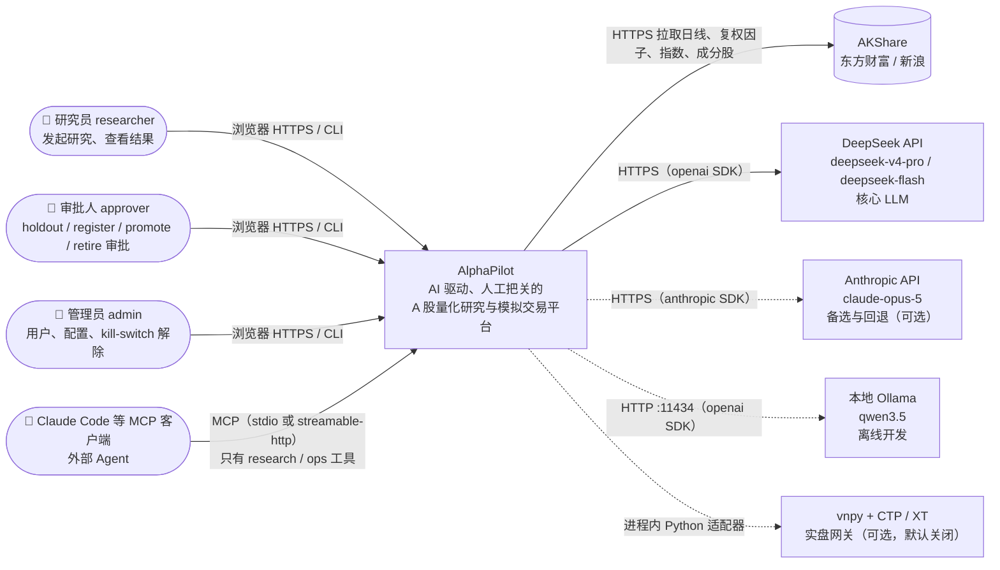
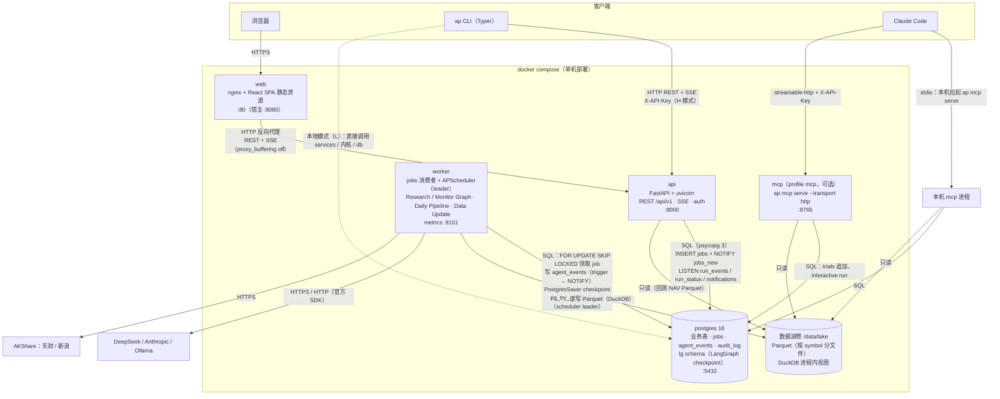
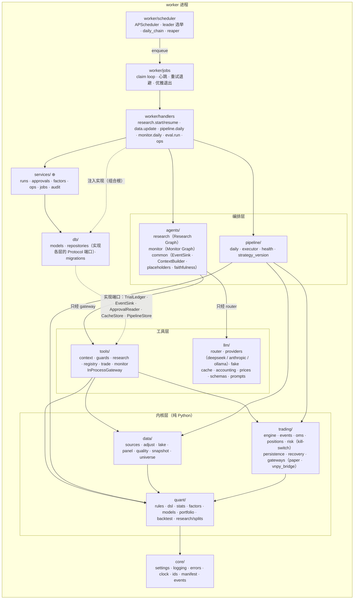
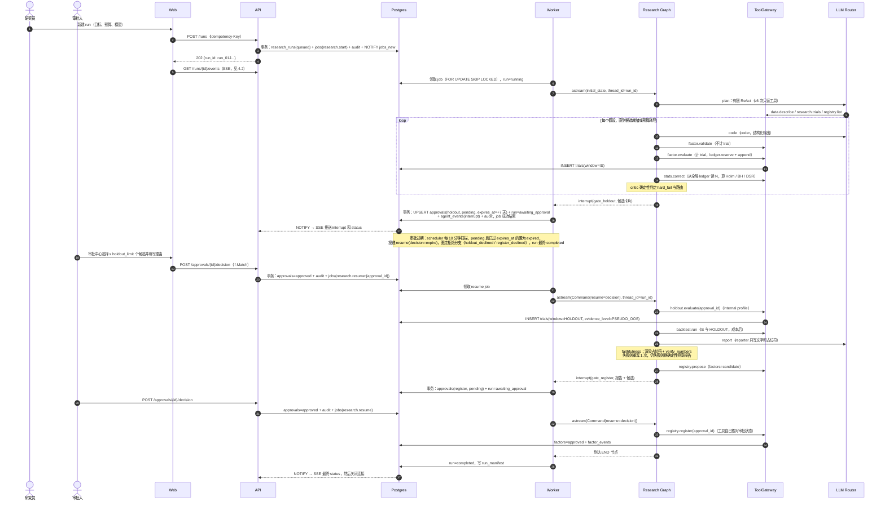
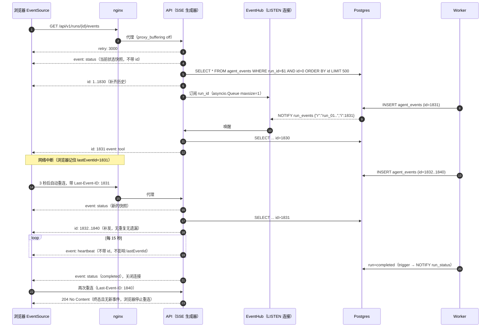
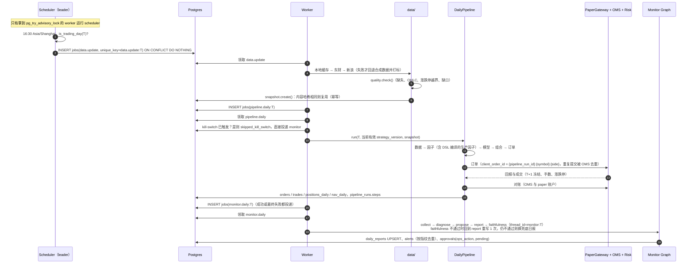
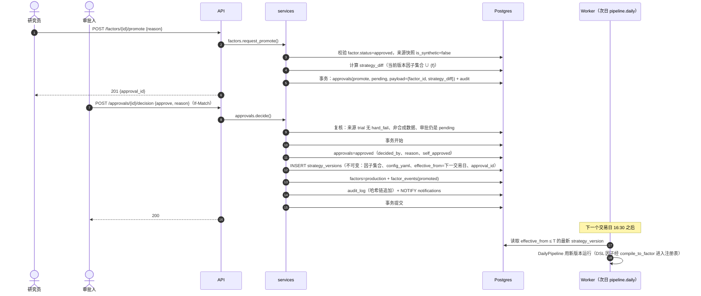
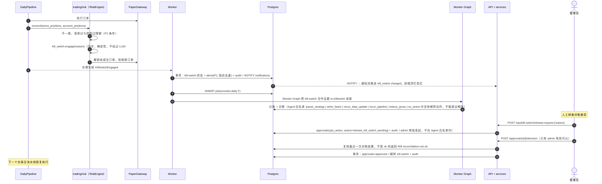
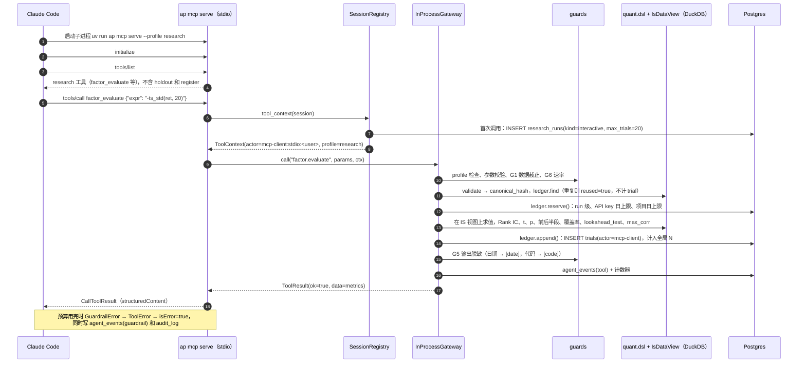
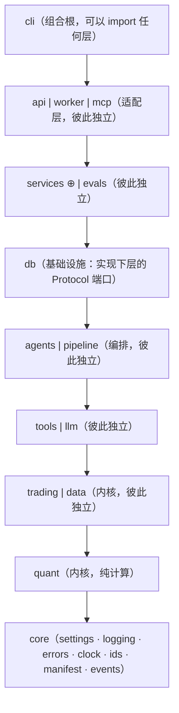

# AlphaPilot 架构总览

> **状态**：草案（M0），等待评审 · **对应 spec 章节**：§3、§4、§5.1、§5.5–§5.7、§6、§7（主文档 `docs/superpowers/specs/2026-11-08-alphapilot-design.md`）· **最后更新**：2026-11-08（已对齐 spec v1.2）
>
> 读者：新加入的工程师、面试官。本文按 C4 模型从外到内介绍系统（Context → Container → Component），再给出关键时序、依赖规则、部署视图和横切约定。**冲突时以 spec 为准**；细节以各 `docs/design/*.md` 为准，本文只做导航和汇总。标记 **⊕** 的内容是本文或其他设计文档对 spec 的扩展，需要回填到 spec。

---

## 0. 一页速览

| 问题 | 答案 |
|---|---|
| 它是什么 | Agent 当副驾驶做 A 股因子研究，人当机长审批；每个数字由代码算出、可以溯源（spec §0） |
| 有几个进程 | 4 个应用进程（web、api、worker、mcp）+ 1 个 Postgres；市场数据放在 Parquet 数据湖，进程内用 DuckDB 查询 |
| 状态放在哪 | **只有 Postgres**：业务表、jobs 队列、事件推送（LISTEN/NOTIFY）、LangGraph checkpoint、审计链（ADR-0001） |
| LLM 用什么 | DeepSeek V4（主）→ Claude（备）→ Ollama（离线）→ FakeLLM（测试），都走官方 SDK（ADR-0005、ADR-0008） |
| 研究数据的唯一入口 | `tools/`（带护栏的工具层）。Agent 节点、ReAct 循环和外部 MCP 客户端走同一条路径（ADR-0007） |
| 谁能下单 | 只有确定性的每日流水线（`pipeline/`），而且只对 paper 网关下单。Agent 不下单（ADR-0004） |

文档地图：

| 主题 | 详细设计 |
|---|---|
| 量化内核（data、quant、trading、pipeline） | `docs/design/quant-core.md` |
| 表结构、迁移、约束、trigger | `docs/design/data-model.md` |
| Research Graph、Monitor Graph | `docs/design/agents.md` |
| 工具层、护栏、MCP Server | `docs/design/tools-and-mcp.md` |
| LLM Router、provider、缓存、计费 | `docs/design/llm-router.md` |
| API、SSE、Worker、Scheduler、CLI | `docs/design/api.md` |
| Web 控制台 | `docs/design/frontend.md` |
| 测试与评测 | `docs/design/testing-and-evals.md` |

---

## 1. System Context（C4 L1）

> 详细设计：角色与权限见 `api.md` §1.2；外部 Agent 接入见 `tools-and-mcp.md` §5；LLM provider 见 `llm-router.md`。



| 外部角色 / 系统 | 与 AlphaPilot 的关系 | 信任边界 |
|---|---|---|
| 研究员 | 创建 run、查看时间线、发起 promote/retire（只创建审批） | JWT cookie；不能审批 |
| 审批人 | 在审批中心做决定，理由必填；hard_fail 时不能批准 | 审批进入审计哈希链 |
| 管理员 | 用户、API Key、kill-switch（`GET /ops/kill-switch`、`POST /ops/kill-switch/engage`、`POST /ops/kill-switch/release-request`）、手动调度（`POST /admin/jobs`、`POST /admin/schedules/daily/trigger`） | 解除 kill-switch 是单独的 admin 审批，还要求对账通过；CLI 访问 HOLDOUT / RESERVED 需要 admin 加 `--allow-sealed-window`（见 §2 CLI 信任边界） |
| Claude Code 等 MCP 客户端 | 调用 research profile 工具，trial 计入全局 ledger；**看不到 holdout，也不能审批** | stdio 依靠本机进程权限；http 必须带 `X-API-Key` |
| AKShare（东财、新浪） | 数据源，按“本地缓存 → 东财 → 新浪 → 合成数据”回退；收益只用新浪等比复权 | 不可信输入，入湖前做质量检查 |
| DeepSeek API | 核心 LLM，Pro 做主力，Flash 做轻量（ADR-0008） | 密钥只在环境变量；`api.deepseek.com` 加入 `NO_PROXY` |
| Anthropic API | 可选的备选与回退 | 同样受 run 级和每日美元上限约束 |
| 本地 Ollama | 离线开发和联调 | 只在本机或宿主机 |
| vnpy / CTP / XT | 可选 `[vnpy]` extra，默认关闭（spec §1.3） | 不在默认部署中 |

---

## 2. Container（C4 L2）

> 详细设计：`api.md`（api、worker、scheduler）、`tools-and-mcp.md` §5（mcp）、`frontend.md` §10（web、nginx）、`data-model.md`（postgres）、`quant-core.md`（数据湖）。



| 容器 | 技术 | 职责 | 不做什么 |
|---|---|---|---|
| web | nginx + React 19 SPA | 静态资源；`/api/` 反向代理；SSE location 关闭缓冲；屏蔽 `/metrics` | 不存状态 |
| api | FastAPI、uvicorn（单 worker 进程） | 认证、RBAC、REST、SSE 分发（EventHub 单例 LISTEN）、写审批并投递 resume | **不跑图、不调 LLM、不算因子**；重活一律投递 job |
| worker | asyncio + APScheduler 3.x | 领取 jobs；运行 Research / Monitor Graph、DailyPipeline、data.update、eval.run；scheduler 只在拿到 advisory lock 的实例上启动 | 不对外提供业务 HTTP（只有 `:9101/metrics`、`/healthz`） |
| mcp | 官方 `mcp` SDK 2.x 的 `MCPServer`（v1 中叫 FastMCP） | 把 research / ops profile 的工具暴露给外部 Agent；会话映射到 `interactive` run | 不注册 internal 工具（`holdout.evaluate`、`registry.register`） |
| postgres | Postgres 16 | 唯一状态存储；队列、事件、checkpoint、审计 | 不存市场行情明细 |
| 数据湖 | Parquet + DuckDB（嵌入式库，不是服务） | `data/lake/{daily,adj_factor,index,universe,meta}/`；快照内容哈希写入 `data_snapshots` | 只有 worker 的 data.update 写入；其余进程只读 |

**容器间协议一览**

| 从 → 到 | 协议 | 说明 |
|---|---|---|
| 浏览器 → web | HTTPS（生产）/ HTTP（本地） | JWT 在 httpOnly cookie，CSRF 用 double-submit（`api.md` §1.1） |
| web → api | HTTP/1.1 反向代理 | SSE 两个 location：`/runs/{id}/events`、`/notifications/stream` |
| CLI → api | HTTP + `X-API-Key` | H 模式；L 模式直接调用 services，身份见下方“CLI 信任边界” |
| api ↔ postgres | SQL；`LISTEN`/`NOTIFY` | NOTIFY 只用于唤醒，内容按 `id > last` 从表里读（`api.md` §3.2） |
| api → worker | **间接**：`INSERT jobs` + `NOTIFY jobs_new` | 两者没有直接网络通信 |
| worker ↔ postgres | SQL；`SKIP LOCKED`；advisory lock | 心跳续租、reaper 回收（`api.md` §4） |
| Claude Code → mcp | MCP JSON-RPC over stdio / streamable-http | http 模式要求 API key；默认绑定 127.0.0.1 |
| worker → LLM | HTTPS：`openai` SDK（DeepSeek、Ollama）、`anthropic` SDK | 回退链、缓存、计费都在 router 内（`llm-router.md`） |
| worker → AKShare | HTTPS | 多源回退加质量检查 |

> **LISTEN 驱动**：一律使用 **psycopg 3**（`AsyncConnection.notifies()`），不引入其他驱动（已在 spec v1.2 解决）。`langgraph-checkpoint-postgres` 本身就依赖 psycopg 3；`api.md` §3.2 已同步修订。
>
> **CLI 信任边界**（spec §5.7、§8.3）：
> - 本地模式（L）必须设置 `AP_LOCAL_USER`，它对应 users 表中的一个用户（初始化时用 `ap user create --role admin` 创建）；`decide()` 记录的 `decided_by` 就是这个用户，审计中标记 `channel=cli_local`。M3 的内存存储会自动创建 `usr_local`。
> - `ap backtest run` 默认只评估 builtin 或 production 因子（`--factors builtin|production`），数据截断到当前 split 的 `is_end`；访问 HOLDOUT 或 RESERVED 需要 admin 身份加 `--allow-sealed-window`，同时写入 ledger（trial，`tool=cli_backtest`）和 audit_log。
> - `ap trade paper --replay` 只能回放已上线的 strategy_version；`run_study`、`run_grid` 只能使用 IS 区间。
> - 直接 import 内核库属于信任边界之外：这样得到的结果在 ledger 中没有 trial，不能注册，也不能 promote。

---

## 3. Component：worker 内部（C4 L3）

> 详细设计：`agents.md`（agents）、`tools-and-mcp.md`（tools）、`quant-core.md`（quant、data、trading、pipeline）、`llm-router.md`（llm）、`api.md` §4–§5（worker、scheduler）。

worker 是唯一一个“所有层都会被加载”的进程，因此用它来说明组件关系。api 和 mcp 只加载其中的一部分（见 §5 的依赖规则）。



| 组件 | 关键接口 | 输入 → 输出 |
|---|---|---|
| `worker/handlers` | `handle(job) -> JobResult` | job payload → 调用图或流水线；interrupt 后在**事务**内 UPSERT approvals 并设 run=awaiting_approval（`api.md` §4.3） |
| `agents/research` | `build_research_graph(deps, checkpointer)` | goal + cfg → trials、candidates、报告、两次 interrupt（`agents.md` §1） |
| `agents/monitor` | `build_monitor_graph(deps)` | 当日证据 → 日报 + `approvals(kind=ops_action)`；**不执行动作** |
| `pipeline` | `DailyPipeline.run(trade_date, strategy_version)` | 数据 → 因子 → 模型 → 组合 → 订单 → 执行，任一步失败即停；步骤状态写 `pipeline_runs.steps` |
| `tools` | `def tool(ctx: ToolContext, **params) -> ToolResult` | 护栏 G1–G6，脱敏，写 `tool`/`guardrail` 事件（`tools-and-mcp.md` §2、§4） |
| `llm` | `complete_structured(role, messages, schema)`、`run_tool_loop(...)` | 回退链、空白重试、修复重试、`reasoning_content` 回传、计费、缓存（spec §5.5） |
| `quant` | DSL `validate/evaluate/lookahead_test/canonical_hash`；`stats` 的 IC、Holm、BH、DSR | 纯函数，输入输出都是 pandas / numpy |
| `data` | `lake.read_*`、`snapshot.create()`、`quality.check()` | 外部数据源 → Parquet + 快照哈希 |
| `trading` | `EventEngine`、`OMS`、`PositionBook`、`RiskEngine`、`PaperGateway` | 订单请求 → 回报、成交、持仓；对账；确定性 kill-switch |
| `db` | `PgLedger`、`PgEventSink`、`ApprovalRepo`、`PgLlmCache` … | 实现上层定义的 Protocol；SQLAlchemy 2 + psycopg 3 |
| `services` ⊕ | `approvals.decide()`、`runs.create()`、`factors.request_promote()` | 跨表事务、幂等、审计、self_approved 判定（`api.md` §0） |

**端口与实现（Ports & Adapters）**：端口（Protocol）定义在**使用它的一层**，例如 `TrialLedger` 在 `tools/context.py`，`EventSink` 在 `agents/common/events.py`（事件 payload 的 schema 本身定义在 `core/events.py`），`CacheStore` 在 `llm/cache.py`，`PipelineStore` 在 `pipeline/`。`db/` 提供 Postgres 实现，测试提供内存实现。由 `worker`、`api`、`mcp`、`cli` 这些**组合根**负责注入。因此 M2 可以先用内存 ledger 交付工具层，M4 再换成 Postgres，内核和工具代码不用改。

---

## 4. 关键时序

### 4.1 研究任务全生命周期（两次 interrupt 与 resume）

> 详细设计：`agents.md` §1、§5；`api.md` §2、§4.3。对应 spec §6.1。



要点：
- `thread_id = run_id`。一个 run 会跨越多个 job（1 次 start、每个 gate 1 次 resume、加上重试），但始终只有一个 thread。
- **审批记录由 worker 在图返回 interrupt 之后写入**，不在 gate 节点里写，因为节点恢复时会从头重跑（`api.md` §4.3、`agents.md` §5.1 都要求幂等）。
- 任何一个 gate 被拒绝或过期都会走向拒绝分支（`holdout_declined` 或 `register_declined`），run 最终为 `completed`，不会是 failed（`agents.md` §5.4）。过期由 scheduler 每 10 分钟扫描一次，默认 7 天，状态置为 `expired` 后同样投递 resume（`decision=expire`）。
- 审批决策契约：API 输入 `decision: "approve"|"reject"`、`reason`、`selected_candidate_keys`（canonical_hash 前 12 位）、`names`（只用于 register）；resume payload 的 `decision ∈ {approve, reject, expire}`。register 被拒时，因子进入终态 `rejected`，写 `factor_events(register_rejected)`。

### 4.2 SSE 订阅与断线补发

> 详细设计：`api.md` §3；前端 `useRunEvents` 见 `frontend.md` §4.3。



- NOTIFY 只用来唤醒，内容一律从表里读，所以 NOTIFY 丢失不会丢事件；慢客户端被唤醒后一次批量读取，天然有背压。
- 同一个 run 的 `agent_events` 只由持有该 run job 的 worker 串行写入，保证 id 的提交顺序单调（`api.md` §3.2）。

### 4.3 每日流水线（data.update → pipeline.daily → monitor.daily）

> 详细设计：`api.md` §4.3、§5；`quant-core.md`（DailyPipeline、数据源回退、对账）；`agents.md` §8（Monitor Graph）。对应 spec §6.2。



- data.update 最终失败（dead）时：生成 P1 告警，**不投递** pipeline（spec §11：跳过当天），但仍投递 monitor.daily（`upstream_status=data_failed`），让日报如实记录这一天。
- 每一步都可以安全重入：快照哈希去重、订单号确定、`pipeline_runs.steps` 记录已完成的步骤，重跑时跳过。

### 4.4 因子 promote 生成新的 strategy_version

> 详细设计：`api.md` §2（`/factors/{id}/promote`、审批决策）、`data-model.md`（`strategy_versions`、`factor_events`）、`quant-core.md`（`pipeline/strategy_version`）。



- `strategy_versions` 只能插入，不能修改；retire 也是生成一个**去掉该因子**的新版本，而不是改旧版本。
- 合成数据快照上得出的因子会被拒绝，返回 409 `synthetic-data-forbidden`（spec §8.6）。
- `effective_from = 下一交易日` 是本文的约定 ⊕：避免在当天流水线运行过程中切换版本。

### 4.5 P1 告警触发 kill-switch

> 详细设计：`quant-core.md`（`trading/risk`）、`agents.md` §8.6、`api.md` §1.2（`release_kill_switch` 只能由 admin 审批）。kill-switch 端点：`GET /ops/kill-switch`（状态）、`POST /ops/kill-switch/engage`（admin 手动触发）、`POST /ops/kill-switch/release-request`（创建 release 审批）。



### 4.6 Claude Code 通过 MCP 调用 factor.evaluate

> 详细设计：`tools-and-mcp.md` §3.1（`factor.evaluate`）、§5.3–§5.4（transport、interactive run）、§4（护栏）。对应 spec §6.3。



---

## 5. 依赖规则

> 详细设计：各层内部模块划分见 `quant-core.md`、`tools-and-mcp.md` §1、`agents.md` §0、`api.md` §0。

### 5.1 分层与方向



箭头表示“可以 import”。只能向下依赖，同一行中用 `|` 分隔的模块彼此不能互相 import。在此之上再加若干 forbidden 规则：

| 规则 | 允许 | 禁止 | 理由 |
|---|---|---|---|
| R1 内核纯净 | `quant` → core、numpy、pandas、scipy、statsmodels、scikit-learn | `quant` → db、llm、tools、agents、data、trading；sqlalchemy、psycopg、openai、anthropic、langgraph、mcp、fastapi、httpx、akshare | spec §3 分层原则 1：内核可以单独测试；quant 只做数学，不做 I/O |
| R2 数据层只做 I/O | `data` → quant（`rules` 用于质量检查的涨跌停规则）、core、duckdb、pyarrow、akshare | `data` → db、llm、tools、agents、trading；sqlalchemy、openai、anthropic、langgraph | 快照写库通过端口 `SnapshotStore` 注入 |
| R3 交易内核独立 | `trading` → quant（`rules`）、core；只有 `trading.gateways.vnpy_bridge` 可以 import vnpy | `trading` → db、llm、tools、agents、data；sqlalchemy | vnpy 是可选 extra（ADR-0003）；事件日志用 JSONL / SQLite（标准库），Postgres 实现放在 db |
| R4 工具层是唯一入口 | `tools` → quant、data、trading、core | `tools` → db、llm、agents、api | 护栏可以在内存实现上完整测试（ADR-0007）；M2 先交付内存 ledger |
| R5 LLM 层不碰数据 | `llm` → core、openai、anthropic、httpx | `llm` → quant、data、trading、tools、db、langgraph；**任何地方**都不能 import langchain* | ADR-0005：模型调用只走官方 SDK |
| R6 Agent 只经 gateway 和 router | `agents` → tools、llm、core、langgraph | `agents` → quant、data、trading、db、openai、anthropic（**直接** import） | `agents.md` §0.2：节点里不允许直接访问数据湖或 SDK |
| R7 流水线是确定性的 | `pipeline` → quant、data、trading、core | `pipeline` → llm、agents、tools、db | 每日下单路径中没有 LLM（ADR-0004） |
| R8 db 不反向依赖业务 | `db` → core、各层的 ports 模块、sqlalchemy、psycopg | `db` → quant、data、trading、llm 的实现、langgraph、fastapi | 仓储层只做持久化 |
| R9 服务层很薄 | `api` → services、db、core、fastapi | `api` → agents、pipeline、tools、llm、quant、data、trading（直接 import） | api 不跑图、不算因子（spec §3 分层原则 4） |
| R10 审批只有一个入口 | `services.approvals.decide()` | tools、agents、mcp 调用 `decide` | 护栏 G4；`tools-and-mcp.md` §4.1 |

### 5.2 用 import-linter 在 CI 中强制执行

配置放在 `pyproject.toml`，CI 的 lint job 运行 `uv run lint-imports`。forbidden 契约默认会检查**间接**依赖；对于“只禁止直接 import”的规则（R6、R9），设置 `allow_indirect_imports = true`。

```toml
[tool.importlinter]
root_package = "alphapilot"
include_external_packages = true

[[tool.importlinter.contracts]]
name = "L0 分层：只能向下依赖"
type = "layers"
layers = [
    "alphapilot.cli",
    "alphapilot.api | alphapilot.worker | alphapilot.mcp",
    "alphapilot.services | alphapilot.evals",
    "alphapilot.db",
    "alphapilot.agents | alphapilot.pipeline",
    "alphapilot.tools | alphapilot.llm",
    "alphapilot.trading | alphapilot.data",
    "alphapilot.quant",
    "alphapilot.core",
]

[[tool.importlinter.contracts]]
name = "R1 quant 是纯计算内核"
type = "forbidden"
source_modules = ["alphapilot.quant"]
forbidden_modules = [
    "sqlalchemy", "psycopg", "fastapi", "openai", "anthropic",
    "langgraph", "mcp", "httpx", "akshare", "duckdb",
]

[[tool.importlinter.contracts]]
name = "R2/R3 data、trading 不碰数据库与 LLM"
type = "forbidden"
source_modules = ["alphapilot.data", "alphapilot.trading"]
forbidden_modules = ["sqlalchemy", "psycopg", "fastapi", "openai", "anthropic", "langgraph", "mcp"]

[[tool.importlinter.contracts]]
name = "R3 vnpy 只能出现在 vnpy_bridge"
type = "forbidden"
source_modules = ["alphapilot"]
forbidden_modules = ["vnpy"]
ignore_imports = ["alphapilot.trading.gateways.vnpy_bridge -> vnpy"]

[[tool.importlinter.contracts]]
name = "R4/R5 tools、llm 不依赖持久化与 Web"
type = "forbidden"
source_modules = ["alphapilot.tools", "alphapilot.llm"]
forbidden_modules = ["sqlalchemy", "psycopg", "fastapi", "langgraph"]

[[tool.importlinter.contracts]]
name = "R5 全仓库禁止 LangChain ChatModel（ADR-0005）"
type = "forbidden"
source_modules = ["alphapilot"]
forbidden_modules = ["langchain", "langchain_core", "langchain_openai", "langchain_anthropic"]

[[tool.importlinter.contracts]]
name = "R6 Agent 只经 gateway 和 router"
type = "forbidden"
source_modules = ["alphapilot.agents"]
forbidden_modules = ["alphapilot.quant", "alphapilot.data", "alphapilot.trading", "openai", "anthropic"]
allow_indirect_imports = true

[[tool.importlinter.contracts]]
name = "R7 每日流水线中没有 LLM"
type = "forbidden"
source_modules = ["alphapilot.pipeline"]
forbidden_modules = ["openai", "anthropic", "langgraph"]

[[tool.importlinter.contracts]]
name = "R8 db 不依赖内核实现与编排"
type = "forbidden"
source_modules = ["alphapilot.db"]
forbidden_modules = [
    "alphapilot.agents.research.graph", "alphapilot.agents.monitor.graph",
    "alphapilot.quant", "alphapilot.data", "alphapilot.trading",
    "langgraph", "fastapi", "openai", "anthropic",
]
allow_indirect_imports = true

[[tool.importlinter.contracts]]
name = "R9 API 是薄适配层"
type = "forbidden"
source_modules = ["alphapilot.api"]
forbidden_modules = [
    "alphapilot.agents", "alphapilot.pipeline", "alphapilot.tools", "alphapilot.llm",
    "alphapilot.quant", "alphapilot.data", "alphapilot.trading", "openai", "anthropic", "langgraph",
]
allow_indirect_imports = true
```

- R8 中 `db` 需要 import `tools.context`（`TrialRecord`、`Reservation` 等端口类型）和 `agents.common.events`（`EventSink`）。分层契约允许这种向下的 import；R8 只禁止它依赖图的实现和内核实现。
- R10 是语义规则，import-linter 无法表达，由 `tests/unit/tools/test_no_approval_path.py` 用 AST 扫描保证：`tools/`、`agents/`、`mcp/` 中不出现对 `decide` 的调用（见 `testing-and-evals.md` §8）。
- 新增顶层包时，必须同时更新 `layers`；CI 中的 `tests/unit/test_layers_complete.py` 会断言 `alphapilot/` 下的每个顶层子包都出现在 L0 契约中。

---

## 6. 部署视图

> 详细设计：nginx 配置见 `frontend.md` §10；worker 运行参数见 `api.md` §4.2；健康探针见 `api.md` §8。

### 6.1 docker compose 服务

`deploy/compose.yaml`（节选，⊕ 表示 spec 没有列出的服务）：

```yaml
name: alphapilot
x-app: &app
  image: alphapilot/app:${AP_VERSION:-dev}
  build: { context: .., dockerfile: deploy/Dockerfile.api }
  env_file: ../.env
  environment:
    AP_DATABASE_URL: postgresql+psycopg://ap:${POSTGRES_PASSWORD:-ap}@postgres:5432/alphapilot
    AP_LAKE_DIR: /data/lake
    AP_OUTPUTS_DIR: /data/outputs
    TZ: UTC
    NO_PROXY: ${NO_PROXY:-api.deepseek.com,localhost,127.0.0.1,postgres,api,host.docker.internal,.eastmoney.com,.sina.com.cn}
  extra_hosts: ["host.docker.internal:host-gateway"]   # 容器内访问宿主机上的 Ollama

services:
  postgres:
    image: postgres:16-alpine
    environment: { POSTGRES_USER: ap, POSTGRES_PASSWORD: "${POSTGRES_PASSWORD:-ap}", POSTGRES_DB: alphapilot, TZ: UTC }
    ports: ["127.0.0.1:5432:5432"]
    volumes: [pgdata:/var/lib/postgresql/data]
    healthcheck: { test: ["CMD-SHELL", "pg_isready -U ap -d alphapilot"], interval: 5s, timeout: 3s, retries: 20 }

  migrate:                     # ⊕ 一次性任务：alembic upgrade head + PostgresSaver.setup()
    <<: *app
    command: ["ap", "db", "migrate"]
    depends_on: { postgres: { condition: service_healthy } }
    restart: "no"

  api:
    <<: *app
    command: ["ap", "serve", "--host", "0.0.0.0", "--port", "8000"]
    ports: ["127.0.0.1:8000:8000"]
    volumes: [lake:/data/lake:ro, outputs:/data/outputs:ro, ../configs:/app/configs:ro]
    depends_on: { migrate: { condition: service_completed_successfully } }
    healthcheck:
      test: ["CMD", "python", "-c", "import urllib.request,sys; sys.exit(urllib.request.urlopen('http://127.0.0.1:8000/readyz', timeout=2).status != 200)"]
      interval: 10s
      timeout: 3s
      retries: 6
      start_period: 15s

  worker:
    <<: *app
    command: ["ap", "worker"]
    volumes: [lake:/data/lake, outputs:/data/outputs, ../configs:/app/configs:ro]
    stop_grace_period: 30s
    depends_on: { migrate: { condition: service_completed_successfully } }
    healthcheck:
      test: ["CMD", "python", "-c", "import urllib.request,sys; sys.exit(urllib.request.urlopen('http://127.0.0.1:9101/healthz', timeout=2).status != 200)"]
      interval: 15s
      timeout: 3s
      retries: 4

  mcp:
    <<: *app
    profiles: ["mcp"]
    command: ["ap", "mcp", "serve", "--profile", "research", "--transport", "http", "--host", "0.0.0.0", "--port", "8765"]
    ports: ["127.0.0.1:8765:8765"]
    volumes: [lake:/data/lake:ro, ../configs:/app/configs:ro]
    depends_on: { migrate: { condition: service_completed_successfully } }

  web:
    build: { context: .., dockerfile: deploy/Dockerfile.web }
    ports: ["8080:80"]
    depends_on: { api: { condition: service_healthy } }
    healthcheck: { test: ["CMD", "wget", "-qO-", "http://127.0.0.1/"], interval: 15s, timeout: 3s, retries: 3 }

volumes: { pgdata: {}, lake: {}, outputs: {} }
```

| 服务 | 端口 | 卷 | 健康检查 | 备注 |
|---|---|---|---|---|
| postgres | 5432（只绑定 127.0.0.1） | `pgdata` | `pg_isready` | 备份与恢复写在 runbook 中（spec §11） |
| migrate ⊕ | — | — | 退出码 0 | `ap db migrate`：Alembic 迁移，再执行 `PostgresSaver.setup()` 在 `lg` schema 建表 |
| api | 8000 | `lake:ro`、`outputs:ro`、`configs:ro` | `/readyz`（DB、迁移版本、`lg` schema、LISTEN 连接） | 存活探针 `/healthz` 不访问 DB |
| worker | 9101（metrics 和 healthz，不对外映射） | `lake`（读写）、`outputs`、`configs:ro` | `:9101/healthz`：claim loop 心跳在 30 秒内，且 DB 可达 | `stop_grace_period: 30s`，配合 `AP_WORKER_GRACE_S=25` |
| mcp | 8765 | `lake:ro`、`configs:ro` | TCP 连通，以及 `/healthz` ⊕ | `--profile mcp` 时才启动；也可以通过 nginx 的 `/mcp/` 暴露 |
| web | 80（宿主 8080） | — | `wget /` | nginx：SSE location 关闭缓冲，屏蔽 `/metrics` |

`deploy/compose.e2e.yaml` 覆盖：`AP_OFFLINE=1`、`AP_LLM_DEFAULT=fake:scripted`、`AP_FAKE_LLM_SCRIPT=/app/tests/agent/scripts/e2e_happy.yaml`，并增加一个 `seed` 一次性服务（创建 `e2e-admin` 用户和合成快照），见 `testing-and-evals.md` §6。

### 6.2 环境变量清单

所有应用配置都以 `AP_` 开头，嵌套字段用 `__` 分隔（例如 `AP_BUDGET__RUN_USD`）。**密钥只能来自环境变量**，不能写进 YAML，也不能入库（spec §7）。

| 变量 | 默认值 | 用途 | 使用者 |
|---|---|---|---|
| `AP_ENV` | `dev` | `dev`、`test`、`prod`；prod 下拒绝弱密钥和 `AP_OFFLINE=1` 以外的 fake LLM | 全部 |
| `AP_DATABASE_URL`（别名 `DATABASE_URL`） | `postgresql+psycopg://ap:ap@localhost:5432/alphapilot` | Postgres 连接串；两个名字都接受，`AP_` 优先 | api、worker、mcp、cli |
| `AP_TEST_DATABASE_URL` | 空（为空时 testcontainers 自动启动容器） | integration 测试用库 | 测试 |
| `AP_LAKE_DIR` | `./data/lake` | 数据湖根目录 | worker、mcp、api（只读） |
| `AP_OUTPUTS_DIR` | `./outputs` | 报告、eval 结果、回测产物 | worker、cli |
| `AP_CONFIG_DIR` | `./configs` | YAML 配置目录 | 全部 |
| `AP_OFFLINE` | `0` | `1` 时不访问网络：数据走缓存或合成，LLM 走缓存或 fake（spec §7） | 全部 |
| `AP_LLM_CACHE` | `readwrite` | `readwrite`、`readonly`、`off`；eval 和回放必须用 `readonly` | worker、cli |
| `AP_LLM_DEFAULT` | 空 | 强制所有角色使用同一个模型，例如 `fake:scripted`（e2e、CI） | worker、cli |
| `AP_FAKE_LLM_SCRIPT` | 空 | FakeLLM 的 YAML 脚本路径 | worker、测试 |
| `DEEPSEEK_API_KEY` | — | DeepSeek 密钥（**核心**，真实研究时必填） | worker、cli |
| `DEEPSEEK_BASE_URL` | `https://api.deepseek.com` | strict tool call 时改为 `/beta` | worker |
| `ANTHROPIC_API_KEY` | —（可选） | 不设时回退链自动跳过 anthropic，并记一条事件 | worker |
| `OLLAMA_BASE_URL` | `http://localhost:11434/v1`（容器内为 `http://host.docker.internal:11434/v1`） | 本地模型 | worker |
| `AP_JWT_KEYS` | —（prod 必填） | JSON 列表 `[{"kid","secret"}]`，第一个用于签发（`api.md` §1.1） | api |
| `AP_API_URL`、`AP_API_KEY` | `http://localhost:8000`、— | CLI 的 H 模式；MCP stdio 用来确定 actor | cli、mcp |
| `AP_MCP_USER` | 当前 OS 用户 | stdio 模式下的 actor 名（`tools-and-mcp.md` §5.3） | mcp |
| `AP_LOCAL_USER` | —（本地模式必填） | CLI 本地模式（L）的身份，对应 users 表中的用户；审计标记 `channel=cli_local`。M3 内存存储自动创建 `usr_local` | cli |
| `AP_REQUIRE_GOLDEN` | `0` | `1` 时缺少 qtc 缓存的 golden 测试改为失败；M1 验收命令必须带上 | 测试 |
| `AP_WORKER_CONCURRENCY` | `4` | worker 槽位总数 | worker |
| `AP_WORKER_GRACE_S` | `25` | 优雅退出等待时间 | worker |
| `AP_SCHEDULER_ENABLED` | `1` | `0` 时这个 worker 不参与 leader 选举（`ap worker --no-scheduler`） | worker |
| `AP_BUDGET__RUN_USD`、`AP_BUDGET__DAILY_USD` | `0.5`、`5` | 覆盖 `configs/llm.yaml` 中的美元上限（spec §7） | worker |
| `AP_LOG_LEVEL`、`AP_LOG_FORMAT` | `INFO`、`json`（dev 为 `console`） | structlog 输出 | 全部 |
| `AP_QTC_CACHE` | `../qtc/data/cache` | `ap data import-qtc` 和 golden 测试的数据来源 | cli、测试 |
| `AP_VNPY_ENABLED` | `0` | 启用 vnpy 网关（需要安装 `[vnpy]` extra） | worker |
| `HTTP_PROXY`、`HTTPS_PROXY` | — | 访问境外 API（Anthropic）时使用 | worker |
| `NO_PROXY` | 见 compose | 必须包含 `api.deepseek.com`（spec §5.5）、内部服务名、`host.docker.internal`，以及东财、新浪的域名 | 全部 |
| `TZ` | `UTC` | 容器时区固定为 UTC，业务时区在代码中显式指定（§7.5） | 全部 |
| `POSTGRES_PASSWORD` | `ap`（仅 dev） | compose 中的数据库密码 | postgres |

### 6.3 本地开发模式

只有 Postgres 跑在 docker 里；API 和 worker 直接用 `uv run` 启动，便于调试和热重载。

```bash
make setup                                   # uv sync --all-groups；pnpm -C web install
docker compose -f deploy/compose.yaml up -d postgres      # make up
uv run ap db migrate                         # make migrate：Alembic + PostgresSaver.setup()
uv run ap data import-qtc --src ../qtc/data/cache          # 可选
uv run ap serve --reload                     # :8000
uv run ap worker --concurrency 2             # 另开一个终端；scheduler 默认开启
pnpm -C web dev                              # :5173，server.proxy['/api'] → http://localhost:8000
uv run ap mcp serve --profile research --transport http --port 8765   # 可选
```

- `.env` 由 pydantic-settings 自动读取；`.env.example` 列出 §6.2 中的全部变量。
- 离线联调：`AP_OFFLINE=1 AP_LLM_DEFAULT=fake:scripted uv run ap research "低波动+动量反转" --interactive`，不需要 Postgres（M3 的内存存储，会自动创建 `usr_local` 作为 `AP_LOCAL_USER`）。
- 本机 Ollama：`AP_LLM_DEFAULT=ollama:qwen3.5`，或者用 `--llm coder=ollama:qwen3.5` 只替换某个角色。

---

## 7. 横切关注点

### 7.1 配置（pydantic-settings + YAML）

> 详细设计：各配置项分别见 `llm-router.md`（`llm.yaml`）、`agents.md` §1.2（`research.yaml`）、`quant-core.md`（`strategy.yaml`、`universe.yaml`）。

- `core/settings.py` 定义根对象 `Settings(BaseSettings)`，子对象对应 `configs/` 下的四个 YAML：`strategy.yaml`、`llm.yaml`、`research.yaml`、`universe.yaml`。
- **来源优先级**（高 → 低）：构造参数（run 级覆盖，例如 `--llm role=provider:model`）> 环境变量（`AP_` 前缀，`__` 嵌套）> `.env` > YAML（`YamlConfigSettingsSource`）> 代码默认值。通过 `settings_customise_sources` 固定这个顺序。
- 密钥字段一律是 `SecretStr`，**只**接受环境变量来源；YAML 中出现 `*_key`、`*secret*` 之类的键时直接启动失败。
- 启动时完成校验：模型 ID 白名单（`deepseek-chat`、`deepseek-reasoner` 已下线，禁止使用；spec §5.5）、阈值范围、时区名。
- **配置进入 manifest**：每个 run 和 backtest 都把“生效配置”（去掉密钥）序列化后写入 `run_manifest`，同时记录 git commit 和代码指纹（spec §7）。critic 的阈值在单个 run 内不能修改（诚实性宪章）。
- 运行期可改的少量设置放在 `app_settings` 表（`api.md` §2 的 `/admin/settings`），LLM 路由仍以 YAML 为准。

### 7.2 日志（structlog）

- `core/logging.py` 的 `configure_logging(settings)` 在每个进程入口调用一次。dev 用 ConsoleRenderer，其余环境输出 JSON。
- 处理器链：`merge_contextvars` → `add_log_level` → `TimeStamper(fmt="iso", utc=True)` → `redact_secrets`（屏蔽 `api_key`、`authorization`、`token`、`secret`、`password` 等字段）→ `format_exc_info` → JSON。
- 标准库 `logging`（uvicorn、sqlalchemy、httpx、apscheduler）通过 `ProcessorFormatter` 统一成同样的格式。
- 上下文字段：`request_id`、`trace_id`、`run_id`、`job_id`、`node`、`actor`、`tool`，都通过 `structlog.contextvars` 绑定。job 被领取时，从 `payload._meta` 中恢复 `trace_id` 和 `request_id`（`api.md` §1.6）。
- **MCP stdio 模式下日志必须写到 stderr**，stdout 只能输出 JSON-RPC（`tools-and-mcp.md` §5.3）。
- prompt 和模型输出**不写**INFO 日志：它们已经在 `llm_calls`、`llm_cache` 和 `agent_events` 中，日志只记录摘要和 id。

### 7.3 Trace（agent_events）

- **单一事实来源**：`agent_events` 既是 Agent 的完整 trace，也是 SSE 的数据源，不依赖 LangSmith（spec §7）。
- **schema 只有一个来源**：每种事件 payload 的 schema 定义在 `src/alphapilot/core/events.py`（Pydantic），字段以 `agents.md` §0.3 为准；`api.md` §3.1、SSE 和前端类型都从它生成。SSE 中的 `status`、`heartbeat` 是不入库的瞬时事件，不在其中。
- 事件的产生位置是固定的，节点代码不需要自己写事件：

| type | 由谁写 | 典型 payload |
|---|---|---|
| `node_start` / `node_end` | `agents/common` 的节点包装器 | 耗时、更新的字段、路由决定 |
| `llm` | `llm/router` | provider、model、token（缓存命中和未命中分开）、cost、latency、`fallback_from`、`peak` |
| `tool` | `ToolGateway` | 工具名、参数摘要（已脱敏）、是否计 trial、trial_id |
| `guardrail` | `ToolGateway` / guards | 错误码、动作（截断或拦截） |
| `interrupt` | worker（进入 gate 时）和 gate 节点（恢复时） | gate、approval_id |
| `error` | 节点包装器 / worker | 异常类型、截断后的消息、是否可重试 |

- `trace_id` 从 HTTP 的 `traceparent` 一路传到 job、图节点和 LLM 调用，`agent_events.payload` 中也带上，便于和日志关联。单条 payload 不超过 64 KB，更大的内容只存引用。
- 指标（Prometheus）是对事件的聚合，不是第二套 trace，清单见 `api.md` §8。

### 7.4 错误处理分层

> 详细设计：错误码表见 `tools-and-mcp.md` §4.3；HTTP problem 码见 `api.md` §1.3；节点内的处理见 `agents.md` §4。

`core/errors.py` 定义根类型，各层只抛自己这一层的异常，再由**上一层**转换：

```
AlphaPilotError
├─ DomainError                 # 内核：DSLError、InvalidTransition、OverfillError、PipelineError、SyntheticDataForbidden、InvalidState
├─ GuardrailError              # 工具层：BudgetExceeded、HoldoutViolation、DataCutoffViolation、ApprovalForbidden、ProfileForbidden、RedactionViolation
├─ ProviderError (retryable)   # LLM：RateLimited(429)、ProviderUnavailable(5xx)、ProviderTimeout、Refusal、StructuredOutputError、LLMUnavailable
├─ InfraError (retryable)      # db、数据源：DatabaseUnavailable、SourceUnavailable、LeaseLost
└─ RunCancelled / StopRequested
```

| 层 | 抛出 | 捕获并转换 |
|---|---|---|
| quant / data / trading | `DomainError`；数据源失败抛 `SourceUnavailable` | data 内部按回退顺序处理 `SourceUnavailable` |
| tools | `GuardrailError` | `ToolGateway.call()` **永不抛异常**：转成 `ToolResult(ok=False, error.code)`，同时写 guardrail 事件和审计日志 |
| llm | `ProviderError` | router 内部：可重试的错误换下一个 provider；整条链失败抛 `LLMUnavailable` |
| agents | `LLMUnavailable`、`BudgetExceeded` 走确定性兜底（阴性报告、兜底报告）；`TransientError` 由 LangGraph `RetryPolicy` 重试 | 其余异常冒泡到 worker |
| worker | — | 可重试（`InfraError`、`ProviderError`、超时）→ job 指数退避重试 3 次；不可重试（`ValidationError`、`GuardrailError`、`SyntheticDataForbidden`、`InvalidState`）→ job dead、run failed、P2 告警 |
| api | — | 统一转成 RFC 9457 problem+json（`api.md` §1.3）；500 只返回 request_id |
| mcp | — | `ToolResult.ok=False` → `ToolError` → 客户端看到 `isError=true` |
| cli | — | 退出码 0–7（`api.md` §6） |

**预算耗尽不是错误**，是正常的研究结局，会产出阴性结论报告（spec §5.4）。

### 7.5 时区

| 场景 | 约定 |
|---|---|
| 数据库 | 所有时刻用 `timestamptz`，会话时区 `UTC`；容器 `TZ=UTC` |
| Python | 只用带时区的 `datetime`；ruff 的 `DTZ` 规则禁止 naive datetime；统一通过 `core.clock.Clock`（`now_utc()`、`today_cn()`）取时间，测试注入 `FrozenClock` |
| 交易日 | 用 `date` 类型（不带时区），按 **Asia/Shanghai** 的日历日定义。字段名统一为 `trade_date`，**不允许**通过 UTC 时刻反推交易日 |
| Parquet | 日线按 `trade_date`（`date32`）存储，不存时区 |
| 调度 | APScheduler 的 cron 使用 `Asia/Shanghai`（16:30 交易日任务）；“项目每日 trial 上限”的“一天”按 Asia/Shanghai 划分 |
| DeepSeek 计费 | 高峰时段按 spec 用 **UTC** 定义（周一至周五 01:00–04:00、06:00–10:00，即北京时间 09:00–12:00、14:00–18:00），中国法定节假日除外；`llm/prices.py` 按调用时间戳计算 |
| API | 时刻用 ISO-8601 UTC（带 `Z`）；交易日用 `YYYY-MM-DD`（`api.md` §2） |
| 前端 | 统一以 Asia/Shanghai 展示（`frontend.md` §1） |
| 知识截止日 | `knowledge_cutoff` 是 `date`，与 HOLDOUT 窗口的交易日直接比较（`agents.md` §7） |

### 7.6 ID 规范

> 以 `api.md` §2 为准，`data-model.md` 负责列类型。

| 对象 | 格式 | 生成方 |
|---|---|---|
| research run | `run_<ULID>`，`thread_id = run_id` | `core.ids.new_id("run")` |
| approval | `apv_<ULID>` | 同上 |
| backtest | `bt_<ULID>` | 同上 |
| data snapshot | `snap_<ULID>`；另有内容哈希 `sha256` | 同上 |
| user | `usr_<ULID>` | 同上 |
| strategy_version ⊕ | `sv_<ULID>` | 同上 |
| pipeline_run ⊕ | `pl_<ULID>` | 同上；订单号 `client_order_id = {pipeline_run_id}:{symbol}:{side}` |
| monitor thread | `monitor:{YYYY-MM-DD}` | worker |
| trial、factor、job、agent_event、llm_call、audit_log | `bigint identity` | 数据库；trial 和 agent_event 的 id 单调递增，分别用作 ledger 水位线和 SSE 的 `Last-Event-ID` |
| request_id | ULID（或者客户端传入的值） | api 中间件 |
| trace_id | W3C traceparent 中的 32 位十六进制 | api 中间件 |
| Idempotency-Key | 客户端提供；CLI 自动生成 UUIDv7 | 客户端 |
| canonical_hash | AST 规范化后的 `sha256` 十六进制；候选 key 取前 12 位 | `quant.dsl` |
| LLM 缓存键 | `sha256(provider, model, messages, schema, params)` | `llm/cache` |
| job unique_key | `{kind}:{业务键}`，例如 `data.update:2026-11-06`、`research.resume:{approval_id}` | 投递方 |

ULID 用 `python-ulid` 的单调生成器，大写 Crockford base32，按时间可排序。对外展示时不截断。

---

## 8. 技术栈与版本

> 以下版本是 2026-11-08 在 PyPI / npm 上查到的最新版，作为 `pyproject.toml` 的**下限**起点；实际版本由 `uv.lock` 和 `pnpm-lock.yaml` 锁定。前端主版本以 `frontend.md` §1 为准。

**运行时与核心依赖**

| 领域 | 包 | 版本 | 用途 |
|---|---|---|---|
| 语言 | Python | 3.12 | |
| 包管理 | uv | — | `uv.lock`；国内可用清华镜像 |
| 编排 | `langgraph` | 1.2.20 | Research / Monitor Graph |
| checkpoint | `langgraph-checkpoint-postgres` | 3.2.0 | `PostgresSaver`，`lg` schema；测试用 `MemorySaver` |
| MCP | `mcp[cli]` | 2.3.0 | `MCPServer`（v2 中 FastMCP 改名）；stdio 和 streamable-http |
| Web | `fastapi` / `uvicorn` | 0.162.2 / 0.54.0 | REST、SSE |
| ORM / 迁移 | `sqlalchemy` / `alembic` | 2.1.8 / 1.20.1 | |
| 驱动 | `psycopg[binary,pool]` | 3.3.8 | SQLAlchemy、LISTEN、checkpoint 共用 |
| CLI | `typer` | 0.28.0 | `ap` |
| 日志 | `structlog` | 26.1.0 | |
| 调度 | `apscheduler` | 3.11.3 | 3.x 的 `AsyncIOScheduler` |
| 配置 | `pydantic-settings` | 2.16.2 | YAML 来源 |
| LLM | `openai` | 3.46.0 | DeepSeek、Ollama |
| LLM | `anthropic` | 2.6.0 | Claude（可选） |
| 分析存储 | `duckdb` / `pyarrow` | 2.0.0 / 26.0.1 | 数据湖 |
| 数值 | `pandas` / `numpy` / `scipy` | 3.1.1 / 2.5.4 / 1.18.1 | 与 qtc 的 venv 版本一致，golden 测试依赖这一点 |
| 数据源 | `akshare` | 1.20.35 | 东财、新浪 |
| ID | `python-ulid` | 4.1.0 | |
| 指标 | `prometheus-client` | 0.26.0 | |
| 可选 | `vnpy` | 4.5.0 | `[vnpy]` extra，默认不安装 |
| 数据库 | Postgres | 16 | |

**开发与测试**

| 包 | 版本 | 用途 |
|---|---|---|
| `pytest` / `pytest-asyncio` / `pytest-xdist` / `pytest-cov` / `pytest-timeout` | 9.2.0 / 1.4.1 / 3.8.0 / 7.1.0 / 2.4.0 | 测试 |
| `hypothesis` | 6.170.x | DSL、规则的性质测试 |
| `testcontainers[postgres]` | 4.15.0 | 本地 integration |
| `respx` | 0.23.1 | provider 的 HTTP 层模拟 |
| `schemathesis` | 4.33.x | API schema 冒烟测试 |
| `ruff` / `mypy` / `pandas-stubs` | 0.17.4 / 2.4.1 / 3.1.0.x | lint、类型 |
| `import-linter` | 2.16 | 依赖规则（§5.2） |

**前端**（详见 `frontend.md` §1）：React 19、Vite、TypeScript（strict）、TanStack Query v5、React Router v7、Tailwind CSS v4 + shadcn/ui、ECharts 6、原生 EventSource、Zod、openapi-typescript；测试用 Vitest、Testing Library、MSW、Playwright；Node 24 LTS、pnpm 10。

**工程**：Docker Compose、GitHub Actions、nginx 1.27。

---

## 9. 质量属性与架构的对应关系

| 质量属性（spec §7） | 架构上的保证 | 验证方式（`testing-and-evals.md`） |
|---|---|---|
| 可复现 | run_manifest；LLM 缓存 readonly 回放；critic 记录 ledger 水位线 | agent 测试回放一致；eval 用 readonly |
| 可观测 | structlog 上下文；agent_events；`/metrics` | integration 中的 SSE 测试 |
| 可靠 | jobs 租约、心跳、reaper；checkpoint 续跑；步骤幂等 | worker 崩溃恢复（agent + integration） |
| 安全 | 密钥只在环境变量；DSL 用 AST 白名单；审计哈希链；MCP http 要求 API key | 护栏 unit 测试；审计链 integration |
| 性能 | IS 评估在进程池中执行；DuckDB 列式读取 | unit 中的性能冒烟（单次评估 ≤ 2 秒） |
| 成本 | router 级美元预算；回退同样受上限约束 | eval 的单 run 成本指标 |
| 离线 | `AP_OFFLINE=1`；FakeLLM；合成数据 | CI 全程离线 |
| 诚实 | 工具层护栏；全局 ledger；faithfulness；图结构上 holdout 不回流 | 零信号 FDR、植入因子召回、护栏成功越权 = 0 |
