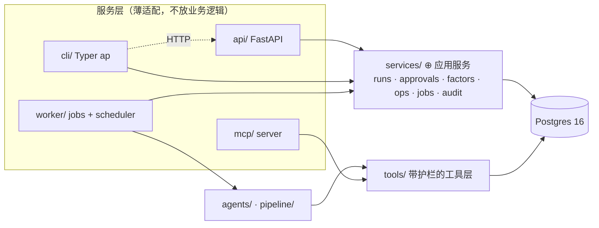
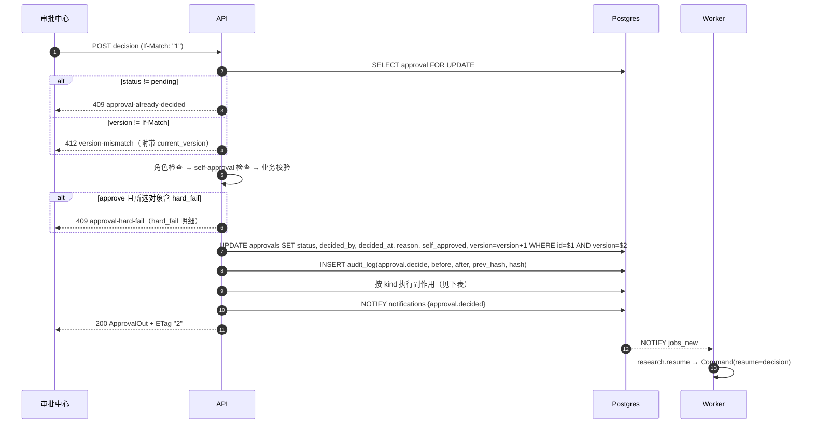
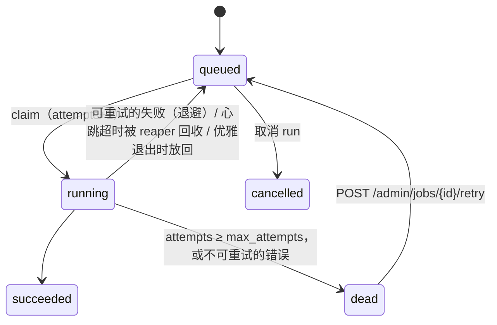
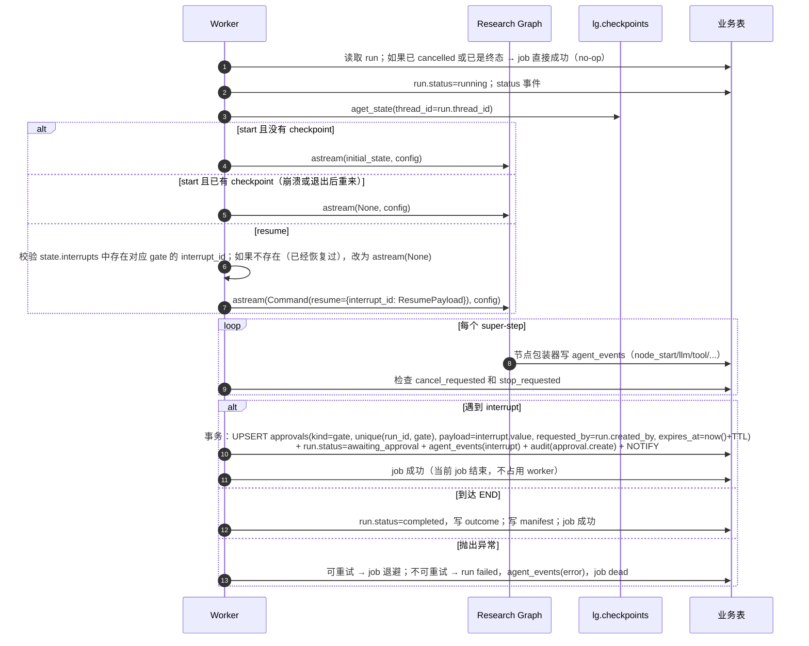
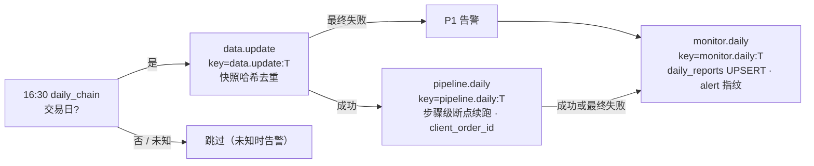

# AlphaPilot 服务层详细设计：API · Worker · Scheduler · CLI

> **状态**：草案（待评审）· **对应 spec 章节**：§2、§5.6、§5.7、§6、§7、§8（主文档 `docs/superpowers/specs/2026-11-08-alphapilot-design.md`）· **最后更新**：2026-11-08（已对齐 spec v1.2）
>
> 本文是 spec §5.7 的展开。冲突时以 spec 为准。标记 **⊕** 的端点、字段或表是本文**新增的扩展**，spec 里没有列出，需要回填到 spec 和 `data-model.md`。

---

## 0. 范围与分层



- 审批决策、创建 run、promote/retire、kill-switch 这类**跨表事务逻辑**放在 `src/alphapilot/services/`（⊕，spec §5.1 没有这个目录）。API 和 CLI 离线模式调用同一组函数，保证审计、幂等和 self_approved 判定只有一份实现。
- `services/` **不能**调用 `tools/` 里的审批相关能力；护栏 4（工具不能批准）保持不变。审批只能由 `services.approvals.decide()` 完成，而这个函数只对已认证的人类主体开放。

---

## 1. 通用约定

### 1.1 认证

| 通道 | 凭据 | 载体 | 说明 |
|---|---|---|---|
| Web | JWT access token（有效期 1h）和 refresh token（有效期 7d） | httpOnly cookie：`ap_at`（Path=/api），`ap_rt`（Path=/api/v1/auth） | `Secure; SameSite=Lax`；开发环境允许关闭 Secure |
| CLI / MCP http | API Key，格式为 `ap_<prefix8>_<secret32>` | `X-API-Key` 请求头 | 库里只存 `sha256(secret)` 和 prefix；明文只在创建时返回一次 |

- **JWT**：算法 HS256；claims 包括 `sub`（user_id）、`role`、`iat`、`exp`、`jti`、`ver`（用户的 token_version，改密码或禁用用户时加 1，旧 token 全部失效）。
- **密钥轮换**（spec §7）：环境变量 `AP_JWT_KEYS` 是一个 JSON 列表 `[{"kid":"k2","secret":"..."},{"kid":"k1",...}]`。签发用第一个，校验时接受全部；header 中带 `kid`。轮换步骤：把新密钥插到列表最前面 → 部署 → 等 7 天 → 删除旧密钥。
- **CSRF**：cookie 认证下，所有非 GET 请求使用 double-submit 校验。登录时下发一个可读的 cookie `ap_csrf`，前端把它的值放进 `X-CSRF-Token` 请求头。用 API Key 认证的请求不做这项校验。
- **主体（Principal）**：`{user_id, role, channel: "web"|"api_key", api_key_id?, scopes}`。API Key 的角色**不能高于**所属用户的角色；可选 scope `holdout:read` 默认关闭（见 §2.3）。

### 1.2 RBAC

角色是**层级**关系：`researcher < approver < admin`，高级角色拥有低级角色的全部权限。单人部署时，一个 admin 既发起也审批，此时审批会标记 `self_approved`（spec §12）。

| 端点 | researcher | approver | admin |
|---|:-:|:-:|:-:|
| `POST /auth/login` `refresh` `logout`、`GET /auth/me` ⊕ | ✓ | ✓ | ✓ |
| 所有 `GET`（runs、trials、events、approvals、factors、backtests、paper、alerts、reports、llm、snapshots、notifications、`/ops/kill-switch`） | ✓ | ✓ | ✓ |
| `POST /runs` | ✓ | ✓ | ✓ |
| `POST /runs/{id}/cancel` | 仅自己的 run | 仅自己的 run | ✓ |
| `POST /approvals/{id}/decision`（kind 为 holdout、register、promote、retire，以及 Agent 白名单内的 ops_action） | ✗ | ✓ | ✓ |
| `POST /approvals/{id}/decision`（`ops_action.release_kill_switch`，admin 单独发起的审批，不在 Agent 白名单内） | ✗ | ✗ | ✓ |
| `POST /factors/{id}/promote` `retire`（只创建审批） | ✓ | ✓ | ✓ |
| `POST /alerts/{id}/ack` ⊕ | ✗ | ✓ | ✓ |
| `GET/POST/DELETE /me/api-keys` ⊕ | ✓ | ✓ | ✓ |
| `POST /ops/kill-switch/engage`、`POST /ops/kill-switch/release-request` | ✗ | ✗ | ✓ |
| `/admin/*`（用户、`POST /admin/jobs`、`POST /admin/schedules/daily/trigger`、设置 ⊕、审计校验 ⊕） | ✗ | ✗ | ✓ |
| `GET /metrics` | 只允许内网访问（nginx 不对外暴露），不做 RBAC | | |

实现方式：`Depends(require_role("approver"))`；资源级检查（例如“只能取消自己的 run”）放在 `services/` 中。

### 1.3 错误格式：RFC 9457 problem+json

```http
HTTP/1.1 409 Conflict
Content-Type: application/problem+json

{
  "type": "https://alphapilot.dev/problems/approval-hard-fail",
  "title": "候选存在硬性否决，不能批准",
  "status": 409,
  "detail": "候选 #57 触发 lookahead_failed、max_corr_exceeded",
  "instance": "/api/v1/approvals/apv_01JC9.../decision",
  "code": "approval-hard-fail",
  "request_id": "01JC9Z3Q...",
  "trace_id": "4bf92f3577b34da6a3ce929d0e0e4736",
  "hard_fail": [{"candidate_key": "9f8e7d6c5b4a", "codes": ["lookahead_failed", "max_corr_exceeded"]}]
}
```

扩展成员固定包括 `code`、`request_id` 和 `trace_id`。参数校验错误另外附带 `errors: [{loc, msg, type}]`。

| code | HTTP | 场景 |
|---|---|---|
| `validation-error` | 422 | 请求体或参数校验失败；模型名用了已下线的 `deepseek-chat` 或 `deepseek-reasoner` |
| `unauthenticated` | 401 | 缺少凭据、凭据过期或已吊销 |
| `csrf-failed` | 403 | 缺少 `X-CSRF-Token` 或与 cookie 不一致 |
| `forbidden` | 403 | 角色不够，或不是资源所有者 |
| `self-approval-forbidden` | 403 | 配置 `approval.allow_self=false` 时，审批人与发起人是同一人 |
| `not-found` | 404 | 资源不存在 |
| `invalid-state` | 409 | 状态机不允许该操作，例如取消已完成的 run |
| `approval-already-decided` | 409 | 审批已被决策 |
| `approval-hard-fail` | 409 | 批准的对象含有 hard_fail 候选 |
| `faithfulness-failed` | 409 | register 审批关联的报告没有通过 faithfulness 检查（spec §8.4，属于防御性检查） |
| `synthetic-data-forbidden` | 409 | 基于合成数据快照的因子不能 promote（spec §8.6） |
| `reconciliation-not-ok` | 409 | 对账没有通过时不能解除 kill-switch |
| `budget-exhausted` | 409 | 项目每日 LLM 美元上限或每日 trial 上限已用完 |
| `job-conflict` | 409 | unique_key 已存在且该 job 不是 `dead` 状态 |
| `idempotency-in-progress` | 409 | 相同 Idempotency-Key 的请求还在处理中 |
| `version-mismatch` | 412 | `If-Match` 与当前 version 不一致 |
| `idempotency-key-reused` | 422 | 同一个 Key 用于不同的请求体 |
| `holdout-limit-exceeded` | 422 | holdout 批准时选中的候选数为 0，或超过 holdout_limit |
| `candidate-not-in-approval` | 422 | 选中的候选（或 `names` 的 key）不属于这条审批 |
| `precondition-required` | 428 | 审批决策请求缺少 `If-Match` |
| `rate-limited` | 429 | 超过限流，响应带 `Retry-After` |
| `internal-error` | 500 | 未处理的异常；只返回 request_id，不返回堆栈 |
| `service-unavailable` | 503 | 数据库不可用，或迁移版本不匹配 |

### 1.4 分页：cursor

- 请求参数：`?limit=50&cursor=<opaque>`，`limit` 取值 1–200，默认 50。
- 响应格式：`{"items": [...], "next_cursor": "eyJrIjpbIjIwMjYtMTEtMDhUMDg6MDA6MDBaIiwxMjNdfQ" | null}`。
- cursor 是 `base64url(json({"k": [sort_value, id], "f": filter_hash}))`。服务端用 `(sort_col, id) < ($1, $2)` 做 keyset 查询。如果 `filter_hash` 和当前过滤条件不一致，返回 422。
- 默认排序是 `created_at DESC, id DESC`。trials 默认按 `id ASC` 排序，以便与 ledger 顺序一致。

### 1.5 幂等：`Idempotency-Key`

- 适用于：`POST /runs`、`POST /approvals/{id}/decision`、`POST /factors/{id}/promote|retire`、`POST /admin/jobs`、`POST /ops/kill-switch/*`、`POST /me/api-keys`。
- 存储在 ⊕ `idempotency_keys` 表，字段为 `(principal_id, key)` 主键、`method`、`path`、`request_hash`、`status`（`in_progress`/`done`）、`response_status`、`response_body`、`created_at`，保留 24 小时，由 scheduler 清理。
- 处理流程：
  1. 在业务事务内 `INSERT ... ON CONFLICT DO NOTHING`。
  2. 冲突时：如果 `request_hash` 不同，返回 422 `idempotency-key-reused`；如果状态是 `in_progress`，返回 409；如果是 `done`，原样重放存下来的响应，并加响应头 `Idempotent-Replayed: true`。
- 不带 Key 的创建请求仍然可以执行（CLI 会自动生成一个 UUIDv7 作为 Key）。

### 1.6 版本、限流与追踪

- **版本**：主版本放在 URL 里（`/api/v1`）。新增字段不算破坏性变更；破坏性变更走 `/api/v2` 并与 v1 并行一段时间，旧端点返回 `Deprecation` 和 `Sunset` 响应头。OpenAPI 的 `info.version` 等于包版本。
- **限流**：进程内令牌桶，按 principal 计数。项目单 API 实例部署（ADR-0001 不引入 Redis），如果以后扩成多实例，改为按 Postgres 计数。
  | 维度 | 限额 |
  |---|---|
  | 默认 | 每个 principal 每分钟 120 次 |
  | `POST /auth/login` | 每个 IP 加用户名，每分钟 5 次 |
  | `POST /runs` | 每个用户每小时 10 次 |
  | SSE 并发连接 | 每个用户 10 个，全局 200 个 |

  响应头：`RateLimit-Limit`、`RateLimit-Remaining`、`RateLimit-Reset`；返回 429 时加 `Retry-After`。
- **请求 ID 与 trace_id**：
  - 接受客户端传入的 `X-Request-ID`（格式 `[A-Za-z0-9._-]{1,128}`），没有则生成 ULID，并在响应中回显。
  - 接受 W3C `traceparent`，没有则新建；`trace_id` 取 traceparent 中的 32 位十六进制值。
  - 两者都通过 `structlog.contextvars` 绑定，每行日志都带上（spec §7）。
  - 投递 job 时写入 `payload._meta = {trace_id, request_id, actor, enqueued_by}`。worker 取到 job 后重新绑定这些值，LLM 调用日志也会带上。这样从一次 HTTP 请求到 worker、图节点和 LLM 调用，都能用同一个 trace_id 串起来。

---

## 2. 端点详述

公共响应头：`X-Request-ID`、`traceparent`。时间统一使用 ISO-8601 UTC 格式；交易日用 `YYYY-MM-DD`（Asia/Shanghai）。ID 格式：run 为 `run_<ULID>`，approval 为 `apv_<ULID>`，backtest 为 `bt_<ULID>`，snapshot 为 `snap_<ULID>`，user 为 `usr_<ULID>`；trial、factor、job、agent_event 用 bigint。

### 2.1 认证 ⊕

| Method / Path | 请求 | 响应 | 副作用 |
|---|---|---|---|
| `POST /auth/login` | `{"username": str, "password": str}` | 200 `MeOut`，同时 Set-Cookie `ap_at`、`ap_rt`、`ap_csrf`；失败返回 401 | `audit_log(auth.login)`，成功和失败都记录；密码用 argon2id |
| `POST /auth/refresh` | 无请求体（携带 `ap_rt` cookie） | 204，重新 Set-Cookie | refresh token 轮换：旧 jti 写入吊销表 ⊕ `revoked_tokens` |
| `POST /auth/logout` | — | 204，清除 cookie | 吊销 jti |
| `GET /auth/me` | — | `MeOut {id, username, display_name, role, allow_self_approval: bool}` | — |

### 2.2 Runs

**`POST /runs` → 202**（researcher 及以上）

```python
class BudgetIn(BaseModel):
    trials: int = Field(14, ge=1, le=200)            # 默认值来自 configs/research.yaml
    llm_usd: Decimal = Field(Decimal("0.50"), gt=0, le=5)

class RunCreate(BaseModel):
    goal: str = Field(min_length=4, max_length=500)
    budget: BudgetIn = BudgetIn()
    llm: dict[Literal["planner","coder","critic","reporter"], ModelRef] = {}  # "deepseek:deepseek-v4-pro"
    k_hypotheses: int = Field(3, ge=1, le=10)
    holdout_limit: int = Field(2, ge=1, le=5)
    horizon: int = Field(5, ge=1, le=60)   # 交易日；与 agents.md、qtc 09 课一致
    sample_every: int = Field(5, ge=1, le=60)        # 交易日，IC 采样间隔；生产调仓频率由 strategy.yaml 单独配置（默认月度）
    split_id: str | None = None                      # 切分版本；为空时使用 configs/research.yaml 的默认版本（qtc09 的切分作为版本 `qtc09` 导入）
    snapshot_id: str | None = None                   # 为空时使用最新快照
```

- `ModelRef` 必须出现在 `configs/llm.yaml` 的白名单中；`deepseek-chat`、`deepseek-reasoner` 返回 422（spec §5.5）。
- 如果当日 LLM 花费已达到每日上限（默认 5 美元），返回 409 `budget-exhausted`。
- 响应：202，`Location: /api/v1/runs/{id}`，body 为 `RunOut`（status=`queued`）。
- 副作用（单个事务）：`research_runs` 插入一行（status 为 queued，thread_id 等于 run_id，cfg 是合并默认值后的完整配置，created_by）；`jobs` 插入 `research.start`，`unique_key=research.start:{run_id}`；写 `audit_log(run.create)`；发 `NOTIFY jobs_new`。

**`GET /runs`**：查询参数 `status`、`kind`（`research` 或 `interactive`）、`outcome`、`created_by`、`q`（对 goal 做模糊匹配），加 cursor 分页。返回 `Page[RunSummary]`。

**`GET /runs/{id}` → `RunOut`**

```json
{
  "id": "run_01JC9Z...", "kind": "research", "goal": "低波动+动量反转",
  "status": "awaiting_approval", "outcome": null,
  "created_by": {"id": "usr_01...", "display_name": "perlou"},
  "created_at": "2026-11-08T08:00:00Z", "started_at": "...", "finished_at": null,
  "thread_id": "run_01JC9Z...",
  "snapshot": {"id": "snap_01...", "content_hash": "b3:9f2c...", "is_synthetic": false,
               "date_range": ["2018-01-02", "2025-02-28"], "known_biases": ["survivorship:current_constituents"]},
  "splits": {"split_id": "qtc09", "is": ["2018-01-02","2022-12-30"], "embargo_days": 20, "holdout": ["2023-02-01","2025-02-14"],
             "holdout_window_id": "ho:2023-02-01:2025-02-14"},
  "horizon": 5, "sample_every": 5,
  "models": {"planner": "deepseek:deepseek-v4-pro", "coder": "deepseek:deepseek-flash", "...": "..."},
  "max_knowledge_cutoff": "2026-10-17",
  "budget": {"trials_limit": 14, "trials_used": 9, "llm_usd_limit": "0.50", "llm_usd_used": "0.1234"},
  "counts": {"hypotheses": 3, "trials": 9, "candidates": 2, "guardrail_events": 1},
  "pending_approval_id": "apv_01JCA...",
  "report_available": false, "backtest_ids": [],
  "cancel_requested": false, "version": 7
}
```

- `kind` 只有 `research`（Research Graph）和 `interactive`（外部 MCP 会话）两个取值。
- `outcome` 在 run 结束时写入，取值 `registered | holdout_declined | holdout_failed | register_declined | negative_budget | negative_exhausted | llm_unavailable`；未结束时为 null。
- `split_id` 引用切分版本，每个版本有自己独立的 holdout 窗口；`holdout_window_id` 由该版本的 holdout 起止日派生，两者一一对应。

**`GET /runs/{id}/trials`**：参数 `window`（`IS` 或 `HOLDOUT`）、`candidate_only`，加 cursor 分页。

```json
{"items": [{
  "id": 42, "window": "IS", "expr": "-ts_std(ret, 20)", "canonical_hash": "c1a9...",
  "hypothesis_id": 7, "created_at": "...", "lookahead_ok": true, "evidence_level": "IS",
  "split_id": "qtc09", "horizon": 5, "sample_every": 5,
  "metrics": {"ic_mean": 0.031, "icir": 0.52, "t": 3.1, "p": 0.002,
              "ic_h1": 0.034, "ic_h2": 0.027, "coverage": 0.93, "max_corr": 0.41, "turnover": 0.38},
  "candidate": {"p_holm": 0.018, "q_bh": 0.011, "dsr": 0.97, "n_trials_global": 1287,
                "hard_fail": [], "warnings": ["single_industry"]}
}], "next_cursor": null}
```

> trial 的查重和复用键是 `(canonical_hash, snapshot_id, split_id, horizon, sample_every)`。HOLDOUT 行的 `evidence_level` 一律为 `PSEUDO_OOS`，并附 `contamination: "full"|"partial"|"none"|"unknown"`。
>
> **HOLDOUT 可见性**：`window=HOLDOUT` 的 trial 只返回给 JWT 会话（人类用户），或带有 `holdout:read` scope 的 API Key。其他 API Key 请求时，HOLDOUT 的行会被过滤，响应头带 `X-Redacted: holdout`。这样外部 Agent 即使绕开 MCP 直接调 HTTP，也拿不到 holdout 结果（spec §5.3 护栏 5、§8.3）。

**`GET /runs/{id}/report` ⊕** → `{"status": "draft"|"final", "markdown": str, "refs": [{"ref": "trial:42.icir", "value": "0.52", "trial_id": 42, "field": "icir"}], "faithfulness": {"passed": true, "issues": []}, "appendix_biases": [...]}`。
- 渲染后的 Markdown 中，每个数字都以链接形式 `[0.52](ap://trial/42?field=icir)` 输出，前端据此实现“点击数字跳转到来源 trial”。
- 报告还不存在时返回 404。

**`POST /runs/{id}/cancel`**：返回 202 `RunOut`。

| 当前状态 | 处理 |
|---|---|
| queued | 立即设为 cancelled；对应 job 设为 `cancelled` |
| running | 设置 `cancel_requested=true` ⊕；worker 在下一个节点边界检查到后设为 cancelled，并写 `agent_events(error)`（`exc_type=RunCancelled`，`handled=true`） |
| awaiting_approval | 设为 cancelled；该 run 下所有 pending 审批设为 `expired`（reason 记为 `run_cancelled`），**不投递** resume |
| completed、failed、cancelled | 409 `invalid-state` |

副作用：写 `audit_log(run.cancel)`。

**`GET /runs/{id}/events`**：SSE，见 §3。

### 2.3 Approvals

**`GET /approvals?status=pending&kind=holdout&subject_id=...`**：cursor 分页，返回 `Page[ApprovalSummary]`。

**`GET /approvals/{id}` ⊕** → `ApprovalOut`，带 `ETag: "<version>"`。

```json
{
  "id": "apv_01JCA...", "kind": "holdout", "status": "pending", "version": 1,
  "subject": {"type": "run", "id": "run_01JC9Z..."},
  "requested_by": {"id": "usr_01...", "display_name": "perlou"},
  "requested_at": "...", "expires_at": "2026-11-15T08:00:00Z",
  "payload": {
    "gate": "holdout", "interrupt_id": "9c1e...", "holdout_limit": 2,
    "snapshot": {"id": "snap_01...", "is_synthetic": false, "known_biases": ["..."]},
    "contamination": {"holdout_end": "2025-02-14", "max_knowledge_cutoff": "2026-10-17",
                      "expected_evidence_level": "PSEUDO_OOS", "label": "full"},
    "candidates": [{
      "candidate_key": "a1b2c3d4e5f6", "trial_id": 42, "expr": "-ts_std(ret, 20)", "suggested_name": "low_vol_20d",
      "hypothesis": {"statement": "...", "rationale": "...", "family": "low_vol", "expected_sign": 1},
      "is_metrics": {"ic_mean": 0.031, "icir": 0.52, "t": 3.1, "p": 0.002, "ic_h1": 0.034,
                     "ic_h2": 0.027, "coverage": 0.93, "turnover": 0.38},
      "p_holm": 0.018, "q_bh": 0.011, "dsr": 0.97, "n_trials_global": 1287,
      "max_corr": {"value": 0.41, "with": "factor:mom_12_1"},
      "lookahead_ok": true, "evidence_level": "IS",
      "hard_fail": [], "warnings": ["single_industry"], "critic_comment": "..."
    }]
  },
  "decision": null,
  "viewer": {"can_decide": true, "can_approve": true, "block_reasons": [], "will_be_self_approved": true}
}
```

- `contamination.label` 取值 `full | partial | none | unknown`（unknown 按 full 展示）；HOLDOUT 一律记为 `PSEUDO_OOS`（spec §8）。
- `max_corr` 的比较范围是 production 因子、approved 因子和本 run 的其他候选（与 critic 的 hard_fail 规则一致）。
- `viewer` 由服务端根据当前用户计算，前端直接用它决定按钮状态，不在前端重复实现这些规则。
- `block_reasons` 的可能取值：`role_insufficient`、`self_approval_forbidden`、`all_candidates_hard_fail`、`synthetic_snapshot`、`faithfulness_failed`、`reconciliation_not_ok`、`not_pending`。
- register 审批的 payload 额外包含 `report_ref`（run_id）、`holdout_trial_ids`、`faithfulness`；每个候选带 `suggested_name`（来自 `registry.propose` 的建议名）。promote 和 retire 的 payload 包含 `factor_id`、`strategy_diff`。ops_action 的 payload 包含 `action`、`params` 和 `evidence_ids`；Agent 发起时 `action` 只能是白名单 `pause_strategy | retire_factor | rerun_data_update | rerun_pipeline | reduce_gross | no_action`，`release_kill_switch` 只能由 admin 通过 `POST /ops/kill-switch/release-request` 发起。

**`POST /approvals/{id}/decision`**（approver 及以上；`release_kill_switch` 只限 admin）

```http
POST /api/v1/approvals/apv_01JCA.../decision
If-Match: "1"
Idempotency-Key: 0192f3e1-...
X-CSRF-Token: ...

{"decision": "approve", "reason": "两个候选经济逻辑清晰，IS 统计稳健，同意看 holdout", "selected_candidate_keys": ["a1b2c3d4e5f6"]}
```

```python
class DecisionIn(BaseModel):
    decision: Literal["approve", "reject"]
    reason: str = Field(min_length=10, max_length=2000)    # 必填；去掉首尾空白后再判断长度
    selected_candidate_keys: list[str] = []                 # 候选 key（canonical_hash 前 12 位）；holdout 批准时必填（非空），register 可选（默认取全部可审候选）
    names: dict[str, str] | None = None                     # 只用于 register：key -> 因子名，需满足 ^[a-z][a-z0-9_]{2,40}$；缺省时取 registry.propose 的建议名，审批人可以改
```

- 存储状态：`approvals.status ∈ {pending, approved, rejected, expired}`；`decision=approve` 写 `approved`，`reject` 写 `rejected`。
- 投递给图的 ResumePayload：`decision ∈ {"approve", "reject", "expire"}`，其中 `expire` 只由 scheduler 的过期扫描产生。
- 非 register 审批传入 `names` 时返回 422 `validation-error`。

**处理流程**（`services.approvals.decide`，单个事务）：



1. **并发**：使用乐观锁。缺少 `If-Match` 时返回 428；版本不一致时返回 412，并附带 `current_version` 和 `current_status`。行锁加上 `WHERE version=$2` 保证只有一个决策成功。前端收到 412 后刷新卡片，提示“该审批已被他人更新”。
2. **self_approved**：`decided_by == requested_by` 时为 true。gate 类审批的 requested_by 是 run.created_by；promote 和 retire 是发起人；Agent 发起的 ops_action 是 `agent:monitor`，不会触发 self_approved；`release_kill_switch` 的 requested_by 是发起的 admin。如果配置 `approval.allow_self=false`（默认 true，spec §12），返回 403 `self-approval-forbidden`。这个标记写入 ⊕ `approvals.self_approved` 列，同时出现在 audit `after` 字段中。
3. **hard_fail**：只在 approve 时检查。holdout 检查所选候选，register 检查被登记的候选，promote 检查因子的来源 trial（来源 trial 必须在 ledger 中存在；直接 import 内核库得到的结果没有 trial，不能注册也不能 promote）。命中时返回 409，problem 中附 `hard_fail` 明细。reject 不受这项限制。
4. **holdout 选择**：所选候选数必须在 1 到 `holdout_limit` 之间，并且全部属于 `payload.candidates`，否则返回 422。
5. **审计**：`audit_log(actor=user, action="approval.decide", subject="approval:{id}", before={status, version}, after={status, decision, reason, selected, names, self_approved, version}, channel)`，`channel` 为 `web`、`api_key` 或 `cli_local`。哈希链追加时先用 `pg_advisory_xact_lock(hashtext('audit_log'))` 串行化，避免 prev_hash 竞争。

**按 kind 的副作用**

| kind | approve | reject |
|---|---|---|
| holdout（gate） | 投递 `research.resume`，`unique_key=research.resume:{approval_id}`，payload 包含 `selected_candidate_keys` | 同样投递 resume，`decision=reject`；图会跳过 holdout，直接进入 report，`outcome=holdout_declined` |
| register（gate） | 投递 `research.resume`（带 `names`）；由图中的 register 节点写 `factors(approved)` | 投递 resume，`decision=reject`；因子进入终态 `rejected`，写 `factor_events(register_rejected)`；图结束，`outcome=register_declined`，run 为 completed |
| register（来自 MCP `registry.propose`，没有 thread） | 在同一事务中调用 `registry.register` → `factors.approved`（名称取 `names` 或建议名），写 `factor_events` | 因子进入终态 `rejected`，写 `factor_events(register_rejected)`；rejected 不占用 live hash 唯一索引（索引排除 rejected 和 retired），以后可以重新 propose |
| promote | 检查快照不是合成数据（否则 409），生成新的 `strategy_versions`（包含该因子，`approval_id` 指向本条审批），`factors.status=production`，写 `factor_events` | 因子保持 approved |
| retire | 生成不含该因子的新 `strategy_versions`，`factors.status=retired` | 无 |
| ops_action（Agent 白名单） | `pause_strategy`（设置 strategy_version.paused）、`reduce_gross`（写入下一次 pipeline 的覆盖参数）、`retire_factor`（改为创建一条 retire 审批）、`rerun_data_update`（投递强制模式的 `data.update`）、`rerun_pipeline`（投递强制模式的 `pipeline.daily`）、`no_action`（只记录） | 无 |
| ops_action（`release_kill_switch`，admin 发起） | 最近一次对账必须是 ok，否则 409 `reconciliation-not-ok`；解除 kill-switch | 无 |

**过期**：scheduler 每 10 分钟扫描一次，把 `expires_at < now()` 的 pending 审批设为 `expired`（默认 TTL 7 天，可配置；`decided_by=system:expiry`），同时写审计记录。如果是 gate 类审批，投递 `research.resume`（`decision=expire`），图走拒绝分支：holdout gate 得到 `outcome=holdout_declined`，register gate 得到 `outcome=register_declined`，run 最终为 `completed`（过期不会让 run 失败）。非 gate 类审批过期后只改状态，不产生其他副作用。

### 2.4 Factors

| Method / Path | 权限 | 请求 / 响应 | 副作用 |
|---|---|---|---|
| `GET /factors?status=&name=&q=` | 全部 | `Page[FactorSummary {id, name, expr, status, origin_trial_id, evidence_level, is_synthetic, updated_at}]` | — |
| `GET /factors/{id}` | 全部 | `FactorOut`：在 Summary 基础上增加 `lineage {trial, run{id, goal}, hypothesis{statement, rationale}}`、`events[]`（factor_events）、`ic_decay[{lag, ic}]`、`health {ic_20d, psi, last_eval}`、`strategy_versions[]`、`pending_approval_id` | — |
| `POST /factors/{id}/promote` | researcher 及以上 | `{"reason": str(≥10)}` → 202 `ApprovalOut`（kind=promote） | 前提是因子状态为 approved，否则 409；快照为合成数据时 409；如果已有 pending 的 promote 审批，返回 409 并附 `existing_approval_id`；写 `approvals(pending)` 和 `audit(approval.create)`；发 `NOTIFY notifications` |
| `POST /factors/{id}/retire` | researcher 及以上 | 同上，kind=retire | 前提是因子状态为 approved 或 production |

这两个 POST 接口**只创建审批**（spec §5.7），因子的状态迁移在审批决策时完成。

### 2.5 回测、模拟盘、告警、日报

| Method / Path | 响应要点 |
|---|---|
| `GET /backtests` ⊕ `?run_id=&factor_id=` | `Page[BacktestSummary]` |
| `GET /backtests/{id}` | `{id, run_id, config, window, metrics{ann_ret, ann_vol, sharpe, max_dd, turnover, capacity}, nav[{date, nav, bench}], drawdown[{date, dd}], quantile_returns[{q, ann_ret}], cost_breakdown{commission, stamp_duty, slippage}, manifest{git_commit, code_fingerprint, snapshot_hash, models, llm_cache_keys}, evidence_level, is_synthetic}`。NAV 从 Parquet 读取后内联返回；超过 3000 个点时按周降采样，并标注 `downsampled: true` |
| `GET /paper/{acct}/nav?from=&to=` | `{acct, strategy_version_id, series[{date, nav, bench, daily_ret}], metrics{...}}` |
| `GET /paper/{acct}/positions?date=` | `{date, items[{symbol, name, qty, frozen_qty, cost, price, mv, weight, pnl}]}`（T+1 冻结字段为 `frozen_qty`） |
| `GET /paper/{acct}/orders?date=&status=` | `Page[Order {client_order_id, symbol, side, qty, price, status, reject_reason, created_at}]` |
| `GET /paper/{acct}/trades?date=` ⊕ | `Page[Trade {trade_id, client_order_id, symbol, side, qty, price, fee, ts}]` |
| `GET /paper/{acct}/reconciliation?date=` ⊕ | `{date, status: "ok"|"mismatch"|"pending", diffs[{symbol, book_qty, broker_qty}], checked_at}` |
| `GET /ops/kill-switch` ⊕ | `{engaged: bool, reason, engaged_at, engaged_by: "risk_engine"|usr_id, release_approval_id}` |
| `POST /ops/kill-switch/engage` ⊕（admin） | `{"reason"}` → 200；写 `audit` 和 `NOTIFY` |
| `POST /ops/kill-switch/release-request` ⊕（admin） | 创建一条 `approvals(kind=ops_action, action=release_kill_switch)` → 202（spec §5.4：解除需要 admin 审批并且对账通过） |
| `GET /pipeline/runs` ⊕ `?date=` | `[{trade_date, step, status, started_at, finished_at, error}]`，用于 Dashboard |
| `GET /alerts?status=open&severity=P1` | `Page[Alert {id, fingerprint, severity, title, detail, first_seen, last_seen, count, status}]` |
| `POST /alerts/{id}/ack` ⊕ | 写 `audit(alert.ack)` |
| `GET /reports/daily` ⊕ | `Page[{date, faithfulness_passed}]` |
| `GET /reports/daily/{date}` | `{date, markdown, refs[], faithfulness{passed, issues}, ops_approvals[ApprovalSummary]}` |
| `GET /llm/usage?from=&to=&group_by=day,role,model` | `{total_usd, rows[{day, role, provider, model, calls, input_tokens, cached_tokens, output_tokens, reasoning_tokens, cost_usd, fallback_calls}], daily_cap_usd, today_usd}` |
| `GET /snapshots` | `Page[{id, content_hash, date_range, is_synthetic, known_biases, created_at}]` |
| `GET /settings/llm-routing` ⊕ | `configs/llm.yaml` 的有效配置（只读），包括角色链、thinking 设置和 knowledge_cutoff |

### 2.6 管理与个人 ⊕

| Method / Path | 说明 |
|---|---|
| `GET/POST /admin/users`、`PATCH /admin/users/{id}` | 创建用户、修改角色、禁用用户（会使 token_version 加 1）；写 audit |
| `GET /me/api-keys`、`POST /me/api-keys {name, role?, scopes?, expires_at?}`、`DELETE /me/api-keys/{id}` | 明文 Key 只在 201 响应中返回一次；写 audit |
| `GET /admin/jobs?status=&kind=` | 查看 jobs 队列，包括 dead 状态的 job |
| `POST /admin/jobs` `{kind, payload, force?: bool}` | 手动投递 job（见 §5.4）；`eval.run` 也通过这个接口触发 |
| `POST /admin/jobs/{id}/retry` | 把 dead 的 job 重置为 queued，attempts 清零（jobs 没有 failed 状态） |
| `POST /admin/schedules/daily/trigger` `{trade_date, from_step?: "data.update"|"pipeline.daily"|"monitor.daily", force?: bool}` | 手动触发每日任务链 |
| `GET/PATCH /admin/settings` | ⊕ `app_settings` 表：默认预算、每日上限、`approval.allow_self`、审批 TTL。LLM 路由仍以 YAML 为准，这里只读 |
| `GET /admin/audit/verify?from_id=` | 校验哈希链，返回 `{ok, checked, first_broken_id}` |

---

## 3. SSE

### 3.1 Run 事件流 `GET /api/v1/runs/{id}/events`

- 响应头：`Content-Type: text/event-stream`、`Cache-Control: no-cache`、`X-Accel-Buffering: no`。
- 连接建立后，服务端先发送 `retry: 3000`。
- 补发起点：优先读 `Last-Event-ID` 请求头；也支持 `?last_event_id=` 查询参数，供前端手动重连时使用，因为原生 EventSource 无法设置请求头。不传时从 0 开始，即回放全部事件。

**线上格式**

```
id: 1832
event: tool
data: {"id":1832,"run_id":"run_01JC9Z...","type":"tool","node":"evaluate","ts":"2026-11-08T08:03:12.481Z","payload":{...}}

event: heartbeat
data: {"ts":"2026-11-08T08:03:27Z","last_id":1832}
```

- 持久化的事件类型有 node_start、node_end、llm、tool、interrupt、guardrail、error。它们来自 `agent_events`，`id` 就是 `agent_events.id`。
- `status` 和 `heartbeat` 是**合成事件**，不写入 `agent_events`（spec §5.6 的 type 枚举中没有这两种），也**不带 `id:` 字段**。按 SSE 规范，不带 id 的事件不会改变浏览器记录的 lastEventId，因此不影响补发。
- 断线期间错过的 status 变化不需要补发：每次（重新）连接时，服务端都会先推一条当前状态的 `status` 快照。

**`data` 的结构**：外层统一为 `{id?, run_id, type, node?, ts, payload}`，节点名只放在外层的 `node`。7 种持久化事件的 `payload` schema **只有一个来源**：`src/alphapilot/core/events.py`（Pydantic），字段与枚举以 `agents.md` §0.3 为准；`llm` 事件的字段以 `llm-router.md` §10.2 为准。API、SSE 和前端类型都从它生成，本文不另行定义，下面只是摘录。更细的分类放在 `payload.kind`。`api/schemas/sse.py` 只定义外层信封和两种瞬时事件，并导出到 OpenAPI（见 §7）。

```python
# 摘录自 core/events.py（权威定义见 agents.md §0.3）
class NodeStart(BaseModel):  attempt: int; resumed: bool
class NodeEnd(BaseModel):    duration_ms: int; updates: list[str]          # 本节点更新的 state 字段名
                             kind: Literal["route"] | None = None          # 路由节点额外带 route、rule
                             route: str | None = None; rule: str | None = None
class Llm(BaseModel):        kind: Literal["call", "retry", "fallback", "budget_warn"]
                             ...                                           # 其余字段见 llm-router.md §10.2（tokens、cost_usd、peak、latency_ms 等）
class Tool(BaseModel):       tool: str; params_digest: str; ok: bool; counted_trial: bool
                             trial_id: int | None = None; duration_ms: int; warnings: list[str]
class Interrupt(BaseModel):  kind: Literal["enter", "resume"]; gate: Literal["holdout", "register"]; approval_id: str
                             decision: Literal["approve", "reject", "expire"] | None = None   # 仅 kind="resume"
class Guardrail(BaseModel):  code: str; tool: str | None; message: str; severity: Literal["block", "warn"]
class Error(BaseModel):      exc_type: str; message: str; handled: bool   # message 截断到 500 字符

# 瞬时事件，不入库、不带 id（定义在 api/schemas/sse.py）
class Status(BaseModel):     status: RunStatus; previous: RunStatus | None; reason: str | None
                             budget: RunBudget; pending_approval_id: str | None
class Heartbeat(BaseModel):  ts: datetime; last_id: int
```

**补发与结束**

1. 连接后先发送 `status` 快照，然后执行 `SELECT * FROM agent_events WHERE run_id=$1 AND id>$last ORDER BY id LIMIT 500`，循环直到追上最新事件，再进入实时模式。
2. run 进入终态（completed、failed、cancelled）后，服务端发送最后一条 `status`，然后关闭连接。
3. 如果客户端带着 `Last-Event-ID` 重连，而 run 已经是终态并且没有新事件，服务端返回 **204 No Content**。按 EventSource 规范，浏览器收到 204 后不会再重连。
4. 心跳每 15 秒一次（`event: heartbeat`）。它也用于让 nginx 和中间代理保持连接活跃。

### 3.2 服务端实现

```mermaid
flowchart LR
  WK["Worker 写 agent_events"] -->|AFTER INSERT trigger<br/>pg_notify('run_events', run_id:id)| PG[(Postgres)]
  RR["research_runs UPDATE OF status"] -->|trigger pg_notify('run_status', ...)| PG
  PG -->|单个专用 LISTEN 连接<br/>psycopg 3 AsyncConnection.notifies()| HUB["EventHub（API 进程单例）"]
  HUB -->|按 run_id 查订阅者| Q1["asyncio.Queue(maxsize=1)<br/>连接 A"]
  HUB --> Q2["asyncio.Queue(maxsize=1)<br/>连接 B"]
  Q1 --> S1["SSE 生成器 A：被唤醒后从 DB 拉 id > last 的事件"]
  Q2 --> S2["SSE 生成器 B"]
```

- **NOTIFY 只用来唤醒**。payload 很小，例如 `{"r":"run_01..","i":1832}`，远低于 8000 字节的限制。事件内容一律从表里按 `id > last_sent` 读取。这样有几个好处：
  - 不怕 NOTIFY 丢失；
  - 事件顺序以数据库为准；
  - 背压天然收敛——队列的 `maxsize=1`，满了就丢掉多余的唤醒信号（`put_nowait`，捕获 `QueueFull` 后忽略），慢客户端被唤醒后一次批量读取。
- **写入顺序约束**：同一个 run 的 `agent_events` 只由持有该 run job 的 worker 串行写入，从而保证 id 的提交顺序单调。API 侧产生的变化（例如取消）只更新 `research_runs.status`，通过 `run_status` 通道推送，不写入 `agent_events`，避免并发事务乱序提交，导致 `id > last` 漏掉事件。
- **EventHub**：
  - 订阅关系存在 `dict[run_id, set[Subscriber]]` 中。
  - LISTEN 连接断开后按指数退避重连（1 秒到 30 秒）。重连成功后，向**所有**订阅者广播一次唤醒，让它们各自从数据库补齐。
  - readyz 会检查 LISTEN 连接是否存活。
- **客户端断开**：每次写出之前检查 `await request.is_disconnected()`；生成器的 `finally` 块注销订阅。单次写出超时为 30 秒，超时说明客户端读取太慢，主动关闭连接，客户端会带着 Last-Event-ID 重连。
- **连接配额**：达到每用户 10 个或全局 200 个上限时返回 429。SSE 连接不占用数据库连接池，补发查询使用短事务。

### 3.3 全局通知流 `GET /api/v1/notifications/stream` ⊕

供 Dashboard 和顶栏使用，所有已登录角色都可以订阅。它对应 Postgres 的 `notifications` 通道，触发来源包括：approvals 插入或更新、alerts 插入、research_runs 状态变化、kill-switch 变化、pipeline_runs 状态变化。

| event | data |
|---|---|
| `snapshot` | 连接时发送：`{pending_approvals: {holdout: 1, register: 0, promote: 1, retire: 0, ops_action: 2}, open_alerts: {P1: 0, P2: 3}, kill_switch: {engaged: false}, pipeline_today: "succeeded"}` |
| `approval.created` / `approval.decided` | `{approval_id, kind, subject, status, requested_by}` |
| `alert.created` | `{alert_id, severity, title}` |
| `run.status` | `{run_id, status, previous}` |
| `kill_switch.changed` | `{engaged, reason}` |
| `pipeline.status` | `{trade_date, step, status}` |
| `heartbeat` | 每 15 秒一次 |

这个通知流**不做补发**（不带 id）。客户端重连后会收到新的 `snapshot`，并据此让相关的 TanStack Query 缓存失效。

---

## 4. Worker

### 4.1 jobs 表与状态机

spec §5.6 的 jobs 表已包含 `status`、`locked_by`、`heartbeat_at`；本文另外补充以下列（⊕）：`priority smallint`、`max_attempts`（默认 4，即首次执行加 3 次重试，spec §7）、`locked_at`（仅记录领取时间）、`last_error jsonb`、`result jsonb`、`finished_at`。其中 `unique_key` 建 UNIQUE 索引。

- `status ∈ {queued, running, succeeded, dead, cancelled}`，**没有 failed 状态**：可重试的失败在退避期间保持 `queued`，达到上限后转为 `dead`；人工重试只针对 `dead`。
- **租约**由 `locked_by` 加 `heartbeat_at` 表示：心跳超时（默认 60 秒）即视为租约过期，可以被回收。不设单独的租约到期列。



**取任务**：worker 先 `LISTEN jobs_new` 等待唤醒，同时每 5 秒轮询一次作为兜底。

```sql
WITH next AS (
  SELECT id FROM jobs
  WHERE status = 'queued' AND run_after <= now() AND kind = ANY($1)   -- $1：还有空闲槽位的 kind
  ORDER BY priority DESC, run_after, id
  FOR UPDATE SKIP LOCKED LIMIT 1)
UPDATE jobs j SET status='running', attempts=j.attempts+1, locked_by=$2,
       locked_at=now(), heartbeat_at=now()
FROM next WHERE j.id = next.id RETURNING j.*;
```

### 4.2 运行参数

| 参数 | 默认值 | 说明 |
|---|---|---|
| `AP_WORKER_CONCURRENCY` | 4 | 单进程内同时运行的 asyncio 任务槽位总数 |
| 按 kind 的并发上限 | `research.*` 为 2，`eval.run` 为 1，`data.update`、`pipeline.daily`、`monitor.daily` 各为 1 | 后三种还会用 `pg_advisory_xact_lock(hashtext(kind))` 做跨进程串行 |
| 超时（`asyncio.timeout`） | research.start/resume 30 分钟，data.update 20 分钟，pipeline.daily 15 分钟，monitor.daily 10 分钟，eval.run 60 分钟 | 超时按可重试失败处理 |
| 心跳 | 每 10 秒 `UPDATE jobs SET heartbeat_at=now() WHERE id=$1 AND locked_by=$me` | 如果影响 0 行，说明租约已经丢失，立即取消该任务，不再写结果 |
| Reaper | scheduler 每 30 秒运行 | 把 `running` 且 `heartbeat_at < now() - 心跳超时`（默认 60 秒）的 job 回收：未达上限的放回 queued 并退避，达到上限的设为 dead |
| 重试退避 | `run_after = now() + min(30s · 2^(attempts-1), 10min) + jitter(0–20%)` | 共重试 3 次 |
| 不可重试的错误 | `ValidationError`、`GuardrailError`（出现在 handler 层时）、`SyntheticDataForbidden`、`InvalidState` | 直接设为 dead |

**毒消息**：job 进入 dead 时，写 `last_error`（异常类型、消息和堆栈摘要），生成 P2 告警（指纹 `job.dead:{kind}`），并发送 `NOTIFY notifications`。如果是 research 类 job，run 设为 `failed`，并写一条 `agent_events(error)`。dead 状态的 job 不会被自动重试，只能由 admin 手动重试。

**优雅退出（SIGTERM）**：

1. 停止取新任务，取消 LISTEN。
2. 给运行中的任务设置 `stop_requested` 标志：
   - 研究图在每个 super-step 之后检查这个标志。LangGraph 在每步结束时已经写好 checkpoint，所以可以安全中断。
   - pipeline 在每个步骤之后检查。
3. 最多等待 `AP_WORKER_GRACE_S`（默认 25 秒，compose 中 `stop_grace_period: 30s`）。超时后调用 `task.cancel()`。
4. 把这些 job 放回队列：`status='queued', attempts=attempts-1, run_after=now(), locked_by=NULL`。这种情况不算失败，所以 attempts 减回去。research run 的状态改回 `queued`，并推送 status 事件（reason=`worker_shutdown`）。
5. 下一个 worker 取到 job 后：研究图从 checkpoint 继续执行（`ainvoke(None, config)`）；pipeline 从第一个未完成的步骤继续（见 §5.3）。
6. 如果进程被 SIGKILL 杀掉，由 reaper 回收，这种情况计入 attempts。

> 工具层的副作用必须可以安全重入。如果某个节点在 checkpoint 之前被中断，重跑时 `factor.evaluate` 会以 `(run_id, canonical_hash, window)` 作为幂等键，返回已经写入的 trial，不会重复追加，否则全局 N 会虚增。详见 `tools-and-mcp.md`。

### 4.3 job 种类与 handler

所有 payload 都包含 `_meta: {trace_id, request_id, actor, enqueued_by: "api"|"scheduler"|"handler"|"cli"}`。

| kind | payload | unique_key | 投递方 |
|---|---|---|---|
| `research.start` | `{run_id}` | `research.start:{run_id}` | `POST /runs` |
| `research.resume` | `{run_id, approval_id, gate, decision: "approve"|"reject"|"expire", selected_candidate_keys?, names?, reason, decided_by}` | `research.resume:{approval_id}` | 审批决策，或 scheduler 的 `approval_expiry`（`decision=expire`） |
| `data.update` | `{trade_date, force: bool=false, sources?: ["eastmoney","sina"]}` | `data.update:{date}` | scheduler 或 admin |
| `pipeline.daily` | `{trade_date, mode: "forward"|"replay", snapshot_id, strategy_version_id?, replay_range?: [a, b]}`（replay 只能回放已上线的 strategy_version） | `pipeline.daily:{date}` | data.update 成功后由 handler 投递，或 admin 手动投递 |
| `monitor.daily` | `{trade_date, pipeline_run_id?, upstream_status}` | `monitor.daily:{date}` | pipeline.daily 结束后（成功或最终失败）投递 |
| `eval.run` | `{suite: "core"|"smoke", llm_overrides?: {}, cache_mode: "readonly"}` | `eval.run:{suite}:{uuid}` | `POST /admin/jobs` |

**research.start / research.resume**



- **thread 与 run 的关系是 1:1**：`thread_id = run_id`，记录在 `research_runs.thread_id`。checkpoint 由 `AsyncPostgresSaver` 存放在 `lg` schema。一个 run 的生命周期内可能跨越多个 job：一次 start，每个 gate 一次 resume，外加重试；但始终只有一个 thread。
- **审批写入放在 worker，不放在 gate 节点里**：节点被恢复时会从头重新执行，如果在节点里写审批就会重复插入。worker 在图返回 interrupt 之后用 UPSERT 写入，可以安全重入。
- interrupt 的 value 就是候选卡片的数据（结构见 §2.3），由 critic 节点的确定性输出组装而成。
- 预算耗尽属于正常路径，不是错误：图会直接进入 report（spec §5.4）。审批被拒或过期同样是正常路径，run 以 `completed` 结束，`outcome` 记录具体分支。

**data.update**：
1. 检查是否为交易日，不是则 no-op。
2. 按多源回退顺序拉取数据，再做质量检查。
3. 调用 `snapshot.create()`。如果内容哈希与已有快照相同，直接复用，保证幂等。
4. 如果发生回退或使用了合成数据，生成 P2 告警。
5. 成功后投递 `pipeline.daily:{date}`。
6. 最终失败（dead）时生成 P1 告警，**不投递** pipeline（spec §11：跳过当天），但仍投递 `monitor.daily`（`upstream_status=data_failed`），让日报如实记录这一天。

**pipeline.daily**：
1. 如果 kill-switch 已触发，把 `pipeline_runs.status` 设为 `skipped_kill_switch` 并告警，然后转到第 6 步。
2. 如果快照是合成数据，拒绝运行（forward 模式）。
3. 加载当前有效的 strategy_version；如果它被 `paused`，跳过。
4. `DailyPipeline` 依次执行各步骤，每一步的状态写入 `pipeline_runs.steps`，重跑时跳过已经成功的步骤。订单使用确定性的 `client_order_id = {pipeline_run_id}:{symbol}:{side}`，重复提交会被 OMS 去重。
5. 对账不一致时，由 `trading/risk` 确定性地触发 kill-switch（P1 告警），不经过 LLM。
6. 投递 `monitor.daily`。

**monitor.daily**：运行 Monitor Graph，`thread_id=monitor:{date}`。图中没有 interrupt。产出写入：
- `daily_reports`，对 date 做 UPSERT；
- `alerts`，按指纹去重；
- `approvals(kind=ops_action)`，对 `(date, action, subject)` 做唯一约束；`action` 只能取 Agent 白名单 `pause_strategy | retire_factor | rerun_data_update | rerun_pipeline | reduce_gross | no_action`。

**eval.run**：用 readonly 缓存运行 `evals.runner`。结果写到 `outputs/evals/{ts}/`，摘要写入 `jobs.result`。

---

## 5. Scheduler

### 5.1 单实例

- APScheduler 3.x 的 `AsyncIOScheduler` 运行在 worker 进程中，任务定义写在代码里，使用内存 jobstore，不持久化。这里只负责“按时投递 job”，真正的幂等由 `jobs.unique_key` 保证。
- **leader 选举**：每个 worker 用一个专用的会话连接，每 30 秒尝试一次 `pg_try_advisory_lock(0x4150_5343)`（"APSC"）。拿到锁的进程调用 `scheduler.start()`；连接断开时锁自动释放，其他 worker 在 30 秒内接手。失去连接的 leader 会立即调用 `scheduler.shutdown(wait=False)`。
- 刚成为 leader 时会执行一次**补投**：如果今天是交易日、当前时间晚于 16:30，并且 `data.update:{today}` 还不存在，就立即投递。cron 任务设置 `misfire_grace_time=3600, coalesce=True`。

### 5.2 交易日历

- 数据源：`data/lake/meta/trade_calendar.parquet`，每月由 `calendar_refresh` 任务从 AKShare `tool_trade_date_hist_sina` 拉取更新。备用来源是 `exchange_calendars` 的 `XSHG`。离线模式（`AP_OFFLINE=1`）只读本地文件。
- `is_trading_day(date)`：
  - 日期在日历中，返回 true；
  - 日期在日历覆盖范围内但不在日历中，返回 false；
  - **日历没有覆盖该日期**（日历过期），返回 unknown：不执行，并生成 P2 告警 `calendar_stale`。这是保守做法，宁可漏跑一天，也不在非交易日下单。

### 5.3 任务表

| 任务 | 触发时间（Asia/Shanghai） | 动作 |
|---|---|---|
| `daily_chain` | `cron(day_of_week="mon-fri", hour=16, minute=30)` | 如果是交易日，投递 `data.update`，`unique_key=data.update:{T}` |
| `job_reaper` | 每 30 秒 | 回收心跳超时的 job（§4.2） |
| `approval_expiry` | 每 10 分钟 | 把过期的 pending 审批设为 expired；gate 类投递 `research.resume(decision=expire)`（§2.3） |
| `idempotency_gc` | 每天 03:00 | 删除 24 小时之前的 idempotency_keys |
| `audit_verify` | 每天 02:00 | 校验哈希链；发现断裂时生成 P1 告警 |
| `calendar_refresh` | 每月 1 日 08:00 | 更新交易日历 |



### 5.4 失败重跑与手动触发

- **自动重试**：遵循 §4.2 的退避策略。
- **重跑 dead 的 job**：`POST /admin/jobs/{id}/retry`，或者 `ap jobs retry <id>`。这会把**同一行** job 重置为 queued，unique_key 不变，后续链条照常自动推进。
- **强制重跑已经成功的步骤**：`POST /admin/schedules/daily/trigger {"trade_date":"2026-11-06","from_step":"pipeline.daily","force":true}`。此时 unique_key 改为 `{kind}:{date}:force:{ulid}`，payload 带 `force=true`，handler 会忽略“该步骤已成功则跳过”的判断。步骤内部的幂等（订单号、UPSERT、快照哈希）仍然有效，所以不会重复下单或重复写日报。写 `audit(job.trigger)`。
- 不带 `force` 时，如果 unique_key 已经存在且不是 dead 状态，返回 409 `job-conflict`，并附 `existing_job_id`。

---

## 6. CLI（`ap`）

Typer 应用 `alphapilot.cli.main:app`。全局选项：`--api URL`（环境变量 `AP_API_URL`）、`--api-key`（环境变量 `AP_API_KEY`）、`--json`（输出机器可读格式）、`-v/--verbose`。

**执行模式**：
- **L = 本地（离线）**：直接调用 services、内核和 db，需要 `AP_DATABASE_URL`，或者在 M3 阶段使用内存存储。
- **H = HTTP**：调用 API，需要 API Key。除 `research --interactive` 外，涉及审批的命令只走 HTTP。

**本地身份**：L 模式必须设置 `AP_LOCAL_USER`，它对应 users 表中的一个用户（初始化时用 `ap user create <name> --role admin` 创建）；未设置或用户不存在时命令直接报错退出。本地调用 `services.approvals.decide()` 时，`decided_by` 记录的就是这个用户，审计中标记 `channel=cli_local`。M3 的内存存储会自动创建 `usr_local`。

**信任边界**（spec §5.7、§8）：
- `ap backtest run` 默认只评估 builtin 或 production 因子（`--factors builtin|production`），数据截断到当前 split 的 `is_end`。
- 访问 HOLDOUT 或 RESERVED 区间必须是 admin 身份（`AP_LOCAL_USER` 对应的用户为 admin）并加 `--allow-sealed-window`，同时写入 ledger（trial，`tool=cli_backtest`）和 audit_log。
- `ap trade paper --replay` 只能回放已上线的 strategy_version。
- 研究网格 `run_study`、`run_grid` 只能使用 IS 区间。
- 直接 import 内核库得到的结果在 ledger 中没有 trial，不能注册，也不能 promote。

```
ap
├─ data
│  ├─ import-qtc  --src PATH [--dry-run]                       L   ap data import-qtc --src ~/qtc/cache
│  ├─ update      [--date D] [--force] [--source eastmoney|sina] L  ap data update --date 2026-11-06
│  ├─ status                                                   L   显示数据湖覆盖范围、最新交易日、合成数据标记
│  └─ snapshot    [--note TEXT]                                L   创建快照并输出 snap_id 和哈希
├─ backtest run   -c configs/strategy.yaml [--factors builtin|production] [--from A --to B]
│                 [--allow-sealed-window] [--out DIR]   L   默认截断到 is_end；封存窗口需 admin，写 ledger 和 audit
├─ research "<goal>" [--llm role=provider:model]... [--budget N] [--usd X]
│        [--holdout-limit K] [--interactive] [--follow]
│        默认 H：POST /runs；加 --follow 时订阅 SSE，在终端显示时间线
│        --interactive 为 L：在进程内运行图，在终端审批（M3）；审批通过 services.approvals.decide 记录，
│                       decided_by 为 AP_LOCAL_USER 对应的用户，channel=cli_local；
│                       发起人和审批人是同一用户，因此标记 self_approved（approval.allow_self=false 时拒绝）
├─ runs ⊕
│  ├─ list   [--status S] [--limit N]                          H
│  ├─ show   <run_id>                                          H
│  ├─ tail   <run_id> [--from-id N]                            H   SSE，支持 Last-Event-ID 续传
│  └─ cancel <run_id>                                          H
├─ review
│  ├─ list   [--kind K] [--all]                                H   默认只列 pending
│  ├─ show   <approval_id>                                     H   渲染候选卡片，显示 hard_fail 和污染警告
│  ├─ approve <approval_id> -r "<reason>" [--pick KEY,KEY] [--name KEY=NAME]... [--yes]   H   --pick 为候选 key；--name 只用于 register；自动带上 If-Match 和 Idempotency-Key
│  └─ reject  <approval_id> -r "<reason>"                      H
├─ factor
│  ├─ list   [--status S]                                      H（未配置 API 时以 L 只读）
│  ├─ show   <name>                                            H/L  通过 GET /factors?name= 查询
│  ├─ promote <name> -r "<reason>"                             H   只创建审批
│  └─ retire  <name> -r "<reason>"                             H
├─ trade paper  --date D | --replay A:B [--acct paper-main]    L   --replay 只能回放已上线的 strategy_version
├─ monitor report --date D                                     L
├─ mcp serve  --profile research|ops [--transport stdio|http] [--port 8765]   L   默认预算：每会话 20 个 trial，每个 API key 每天 60 个
├─ serve      [--host 0.0.0.0 --port 8000 --workers 1]         L   uvicorn
├─ worker     [--concurrency 4] [--no-scheduler]               L
├─ eval run   --suite core|smoke [--llm ...]                   L   AP_LLM_CACHE=readonly
├─ jobs ⊕ list [--status dead] | retry <id> | trigger-daily --date D [--from-step S] [--force]   H（admin）
├─ killswitch ⊕ status | engage -r "<reason>" | release-request -r "<reason>"           H（admin）  对应 /ops/kill-switch*
├─ user create <username> --role R | apikey create --name N [--scope holdout:read]   L（初始化）/ H   首个用户用 --role admin 创建，并设为 AP_LOCAL_USER
├─ db ⊕ migrate | current                                      L   alembic upgrade head
└─ audit ⊕ verify [--from-id N]                                L
```

退出码：0 成功；1 未知错误；2 用法错误；3 一般的 4xx problem；4 5xx；5 护栏或预算问题；6 409 冲突（例如 hard_fail、已被决策）；7 412（版本过期，提示重新执行 `review show`）。

示例：

```bash
ap research "低波动+动量反转" --budget 14 --usd 0.5 --llm coder=deepseek:deepseek-v4-pro --follow
ap review show apv_01JCA...
ap review approve apv_01JCA... --pick a1b2c3d4e5f6 -r "经济逻辑清晰，IS 稳健，进入 holdout"
ap jobs trigger-daily --date 2026-11-06 --from-step pipeline.daily --force
```

---

## 7. OpenAPI 与前端类型

- **operationId 规范**：使用 `generate_unique_id_function=lambda r: f"{r.tags[0]}_{r.name}"`，例如 `runs_create`、`approvals_decide`。每个路由都必须声明 `response_model` 和 `responses={409: {"model": Problem}, ...}`。
- **SSE schema 导出**：OpenAPI 无法描述事件流。在 `custom_openapi()` 中把 `SseEnvelope`、`core/events.py` 中的 7 种 payload（`NodeStart`……`Error`）、`Status`、`Heartbeat`、`NotificationEvent` 注入 `components.schemas`，并在 `/runs/{id}/events` 的 `200.content["text/event-stream"]` 中引用 `SseEnvelope`。这样前端可以直接使用生成的事件类型。
- **生成流程**：
  ```bash
  uv run python -m alphapilot.api.export_openapi --out web/openapi.json   # 键排序，输出确定性的 JSON
  pnpm -C web gen:api   # openapi-typescript openapi.json -o src/api/schema.gen.ts
  ```
- **CI drift 检查**（放在 `web` job 里）：
  ```bash
  make openapi && git diff --exit-code -- web/openapi.json web/src/api/schema.gen.ts \
    || { echo "::error::OpenAPI 已变更但生成物未提交，请运行 make openapi"; exit 1; }
  ```
  另外在 `tests/integration` 中跑一个 schemathesis 冒烟测试（只覆盖 GET 端点），检查实际响应与 schema 是否一致。

---

## 8. 观测

| 端点 | 用途 | 检查项 | 响应 |
|---|---|---|---|
| `/healthz`（同时挂载在 `/api/v1/healthz`） | 存活探针 | 只确认进程能响应，不访问数据库 | 200 `{"status":"ok","version":"0.5.0","git":"e1e1819"}` |
| `/readyz`（同时挂载在 `/api/v1/readyz`） | 就绪探针 | ① 在 1 秒超时内执行 `SELECT 1`；② `alembic_version` 等于代码中的 head；③ `lg` schema 存在；④ EventHub 的 LISTEN 连接存活 | 200 或 503，响应中给出各项检查结果 `{"checks":{"db":"ok","migrations":"ok|behind:abc123","lg_schema":"ok","listener":"ok"}}` |
| `/metrics`（同时挂载在 `/api/v1/metrics`） | Prometheus 抓取 | nginx 不对外暴露，只允许内网抓取 | text exposition 格式 |

指标的来源：
- API 进程用 `prometheus_client` 采集请求类指标；
- 数据库相关的 gauge 由自定义 Collector 在抓取时查询，结果缓存 15 秒；
- worker 进程在 `:9101` 上单独暴露自己的 `/metrics`。

| 指标 | 类型 | labels | 进程 |
|---|---|---|---|
| `ap_http_requests_total` | counter | method, route, status | api |
| `ap_http_request_duration_seconds` | histogram | method, route | api |
| `ap_sse_connections` | gauge | stream=run\|notifications | api |
| `ap_sse_events_sent_total` | counter | type | api |
| `ap_runs_total` | counter | status（终态） | worker |
| `ap_runs_active` | gauge | status | api（DB） |
| `ap_trials_total` | counter | window, actor_kind=agent\|mcp\|user | worker |
| `ap_trials_global` | gauge | — | api（DB），即多重检验的分母 N |
| `ap_llm_calls_total` | counter | provider, model, role, outcome=ok\|retry\|fallback\|error | worker |
| `ap_llm_tokens_total` | counter | provider, model, kind=input\|cached\|output\|reasoning | worker |
| `ap_llm_cost_usd_total` | counter | provider, model, role, peak | worker |
| `ap_llm_latency_seconds` | histogram | provider, model | worker |
| `ap_guardrail_events_total` | counter | guard, action | worker |
| `ap_jobs_queue_depth` | gauge | kind, status | api（DB） |
| `ap_job_wait_seconds` | histogram | kind | worker，从 `run_after` 到被取走的时间 |
| `ap_job_duration_seconds` | histogram | kind, outcome | worker |
| `ap_job_retries_total` / `ap_jobs_dead_total` | counter | kind | worker |
| `ap_approvals_pending` | gauge | kind | api（DB） |
| `ap_approval_decision_seconds` | histogram | kind, decision | api，从创建到决策的耗时 |
| `ap_pipeline_last_success_timestamp` | gauge | step | api（DB） |
| `ap_kill_switch_engaged` | gauge | — | api（DB） |
| `ap_audit_chain_ok` | gauge | — | worker（audit_verify 任务） |
| `ap_scheduler_leader` | gauge | instance | worker |

---

## 9. 待回填到 spec 和 data-model 的扩展项

1. 新增 `services/` 应用服务层（§0）。
2. 新增表：`idempotency_keys`、`revoked_tokens`、`app_settings`。
3. 新增列：
   - `approvals.version`、`requested_by`、`self_approved`、`expires_at`（已在 spec v1.2 解决）；`decided_at`；
   - `research_runs.kind`（取值 `research | interactive`）、`created_by`、`cancel_requested`、`outcome`（已在 spec v1.2 解决）；`version`；
   - `jobs.status`、`locked_by`、`heartbeat_at`（已在 spec v1.2 解决）；`priority`、`max_attempts`、`locked_at`、`last_error`、`result`、`finished_at`（§4.1）；
   - `trials.split_id`、`sample_every`（已在 spec v1.2 解决，需同步到 `data-model.md`）。
4. 新增 NOTIFY 通道：`run_status`、`notifications`、`jobs_new`。
5. 新增端点：§2 中所有标记 ⊕ 的端点。其中 kill-switch 三个端点、`POST /admin/jobs`、`POST /admin/schedules/daily/trigger`、`/auth/*`、`/me/api-keys`、`/admin/users`、`GET /paper/{acct}/trades|reconciliation`、`GET /notifications/stream` 已在 spec v1.2 解决。
6. 审批决策契约（`DecisionIn`、ResumePayload、过期走拒绝分支）、事件 schema 单一来源、CLI 本地身份与信任边界：已在 spec v1.2 解决。
