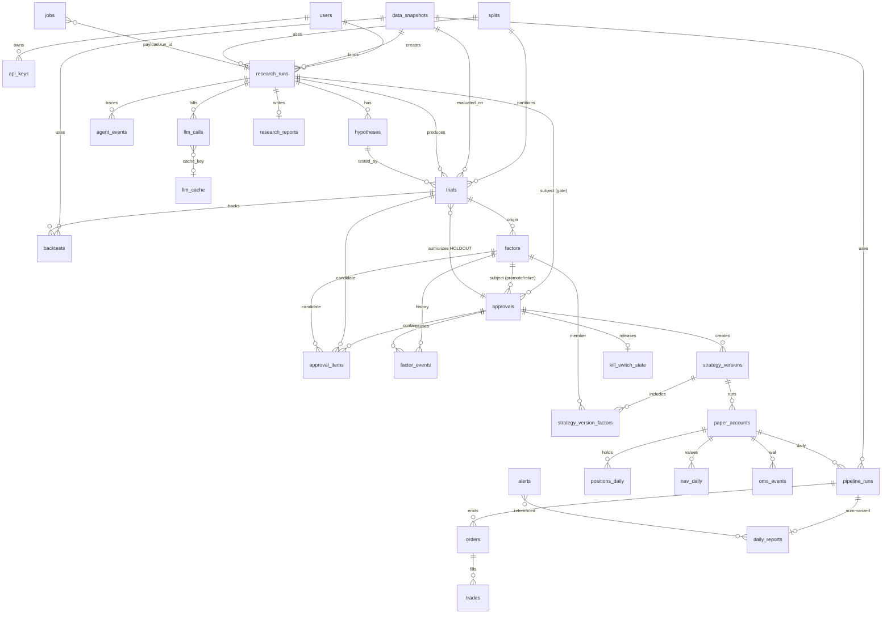
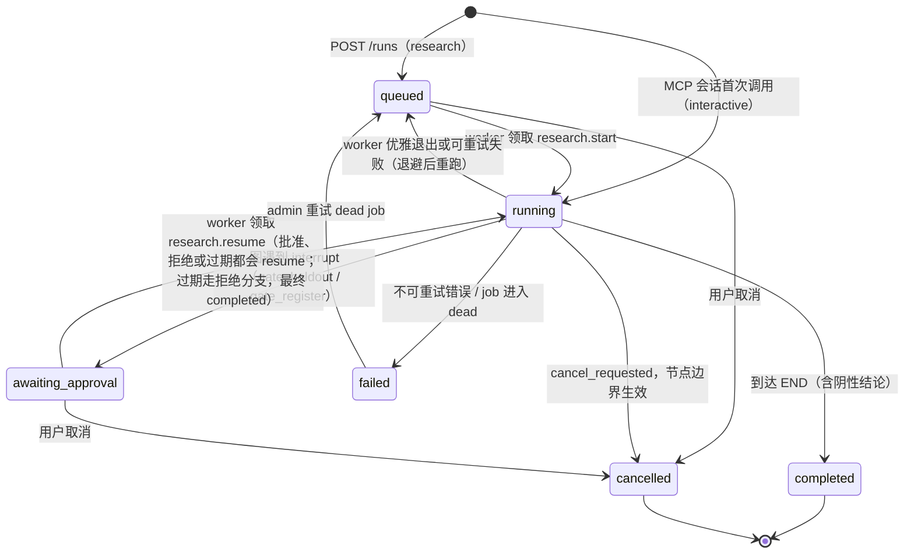
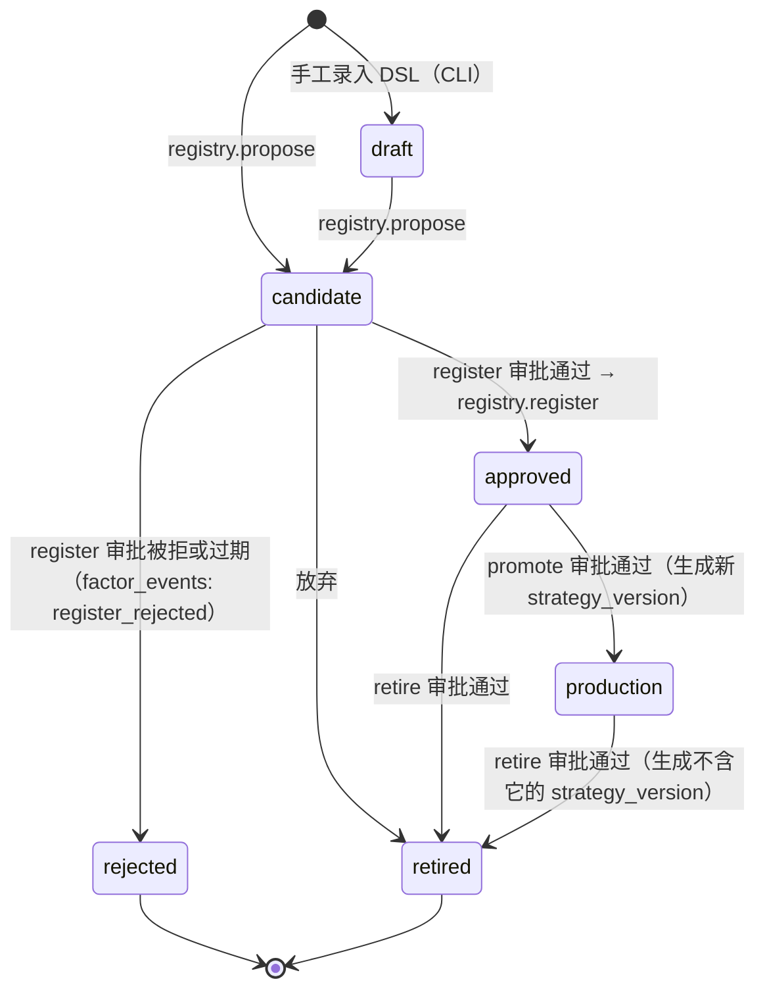
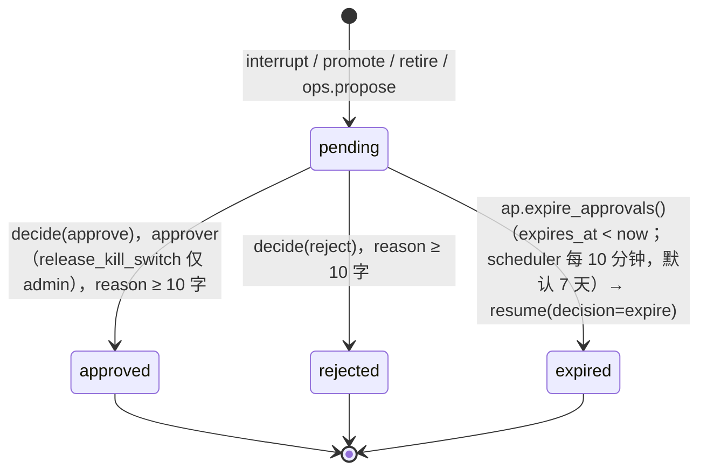
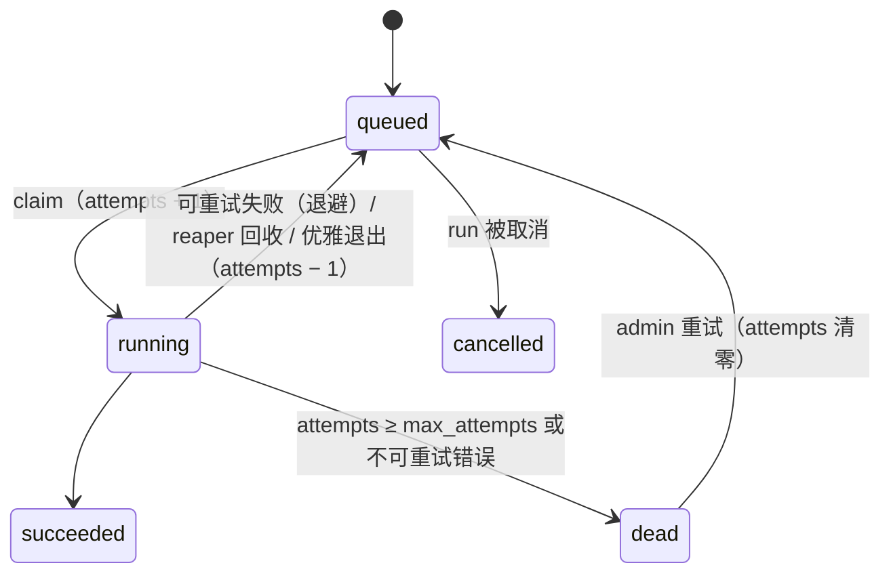
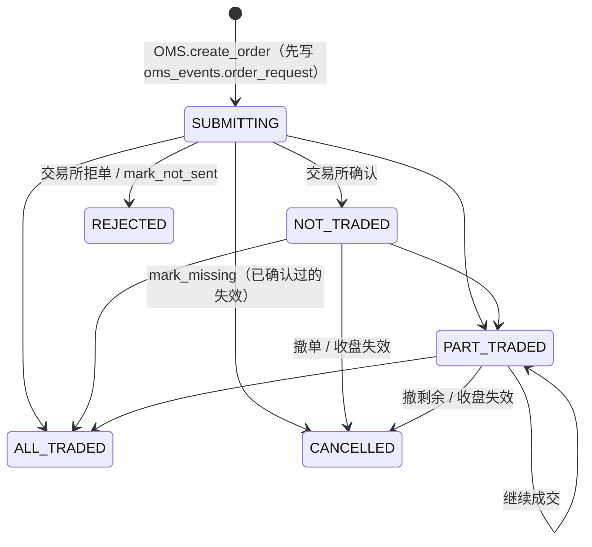

# Postgres 数据模型详细设计

> 状态：**草案，待评审** · 对应 spec：§5.6（持久化）、§2（核心概念）、§5.3（护栏 2/3/4）、§5.7（SSE、Worker、Scheduler、Auth）、§7（可靠、可复现）、§8（诚实性）
> 最后更新：2026-11-08（已对齐 spec v1.2）
> 相关：ADR-0001（只用 Postgres）、`api.md` §1.5/§3/§4/§9（本文回填了它列出的扩展项）、`tools-and-mcp.md` §2.2/§4（TrialLedger、预算、G3/G4）、`agents.md` §1.2/§5（gate、thread）、`llm-router.md` §9（llm_calls）、`quant-core.md` §4.6/§12.1（快照、样本切分）。
> 标注：⊕ = spec §5.6 未列出、本文增补。

---

## 0. 约定

- **Postgres 16**。扩展：`pgcrypto`（`digest()`，审计哈希）、`citext`（用户名）。
- **Schema**：业务表在 `ap`，LangGraph checkpoint 在 `lg`（§7）。应用连接 `search_path = ap, public`。
- **主键**（与 api.md §2 一致）：`run_<ULID>`、`apv_<ULID>`、`bt_<ULID>`、`snap_<ULID>`、`usr_<ULID>`、`sv_<ULID>` ⊕、`pr_<ULID>` ⊕ 为 `text`；trials、factors、jobs、agent_events、audit_log 等高频表用 `bigint GENERATED ALWAYS AS IDENTITY`。
- **时间**：一律 `timestamptz`（UTC 存储）；交易日用 `date`（Asia/Shanghai 口径）。金额 `numeric(18,2)`，价格 `numeric(12,4)`，LLM 美元 `numeric(12,6)`，统计量 `double precision`。
- **枚举**：用 Postgres `ENUM`，新增取值只能 `ALTER TYPE … ADD VALUE`（Alembic 中单独一个 revision，不能在事务里与使用它的语句混写）。
- **会话变量**：业务事务开头 `SET LOCAL ap.actor = 'usr_…'`、`ap.request_id`、`ap.reason`、`ap.approval_id`，供 trigger 写 `factor_events`、`audit_log` 时读取（`current_setting('ap.actor', true)`）。
- **数据库角色**：

| 角色 | 使用者 | 权限要点 |
|---|---|---|
| `ap_owner` | Alembic 迁移 | 拥有全部对象；唯一能执行 DDL |
| `ap_app` | API（`services/`） | 读写业务表；`approvals` 的决策列可写 |
| `ap_tools` | worker、MCP server | 读写业务表，但 **`approvals.status/decision/decided_by/decided_at/reason` 无 UPDATE 权限**（tools-and-mcp.md G4）；过期处理走 `SECURITY DEFINER` 函数 `ap.expire_approvals()` |
| `ap_readonly` | 备份校验、报表 | 只读 |

所有角色对 `trials`、`factor_events`、`audit_log`、`trades`、`oms_events` 都没有 `UPDATE/DELETE/TRUNCATE`（只追加，§4）。

---

## 1. ER 图



---

## 2. 表定义（DDL）

### 2.0 公共枚举

> 建表顺序说明：`trials ↔ approvals`、`approvals ↔ strategy_versions` 存在相互引用，初始 revision 先建表、不带这几条外键，最后统一 `ALTER TABLE … ADD CONSTRAINT … FOREIGN KEY`（下文 DDL 为便于阅读写在列定义里）。

```sql
CREATE SCHEMA ap; CREATE SCHEMA lg;
CREATE EXTENSION IF NOT EXISTS pgcrypto; CREATE EXTENSION IF NOT EXISTS citext;
SET search_path = ap, public;

CREATE TYPE user_role        AS ENUM ('researcher', 'approver', 'admin');
CREATE TYPE run_kind         AS ENUM ('research', 'interactive');   -- spec v1.2 只有这两个取值
CREATE TYPE run_status       AS ENUM ('queued', 'running', 'awaiting_approval', 'completed', 'failed', 'cancelled');
CREATE TYPE run_outcome      AS ENUM ('registered', 'holdout_declined', 'holdout_failed', 'register_declined',
                                      'negative_budget', 'negative_exhausted', 'llm_unavailable');   -- 与 spec v1.2 顺序一致
CREATE TYPE trial_window     AS ENUM ('IS', 'HOLDOUT', 'RESERVED');   -- RESERVED 只出现在 tool='cli_backtest'（spec v1.2 §5.7）
CREATE TYPE evidence_level   AS ENUM ('IS', 'PSEUDO_OOS', 'TRUE_OOS');
CREATE TYPE trial_status     AS ENUM ('ok', 'error');
CREATE TYPE trial_pool       AS ENUM ('normal', 'post_gate');
CREATE TYPE factor_kind      AS ENUM ('builtin', 'dsl');
CREATE TYPE factor_status    AS ENUM ('draft', 'candidate', 'approved', 'production', 'retired', 'rejected');
CREATE TYPE approval_kind    AS ENUM ('holdout', 'register', 'promote', 'retire', 'ops_action');
CREATE TYPE approval_status  AS ENUM ('pending', 'approved', 'rejected', 'expired');
CREATE TYPE subject_type     AS ENUM ('run', 'factor', 'strategy_version', 'ops');
CREATE TYPE sv_status        AS ENUM ('active', 'paused', 'superseded');
CREATE TYPE event_type       AS ENUM ('node_start', 'node_end', 'llm', 'tool', 'interrupt', 'guardrail', 'error');
CREATE TYPE job_status       AS ENUM ('queued', 'running', 'succeeded', 'dead', 'cancelled');
CREATE TYPE oms_status       AS ENUM ('SUBMITTING', 'NOT_TRADED', 'PART_TRADED', 'ALL_TRADED', 'CANCELLED', 'REJECTED');
CREATE TYPE direction        AS ENUM ('LONG', 'SHORT');        -- 存 Enum 成员名（mini_trader.to_dict 的约定）
CREATE TYPE pipeline_status  AS ENUM ('queued', 'running', 'succeeded', 'failed',
                                      'skipped_kill_switch', 'skipped_paused', 'skipped_data');
CREATE TYPE alert_severity   AS ENUM ('P0', 'P1', 'P2', 'P3');
CREATE TYPE alert_status     AS ENUM ('open', 'acked', 'resolved');
```

### 2.1 用户与认证

```sql
CREATE TABLE users (
  id            text PRIMARY KEY CHECK (id ~ '^usr_[0-9A-HJKMNP-TV-Z]{26}$'),
  username      citext NOT NULL UNIQUE,
  display_name  text NOT NULL,
  password_hash text NOT NULL,                         -- argon2id
  role          user_role NOT NULL DEFAULT 'researcher',
  is_active     boolean NOT NULL DEFAULT true,
  token_version integer NOT NULL DEFAULT 1,            -- JWT 的 ver claim；改密/禁用时 +1
  created_at    timestamptz NOT NULL DEFAULT now(),
  updated_at    timestamptz NOT NULL DEFAULT now(),
  last_login_at timestamptz
);

CREATE TABLE api_keys (
  id              bigint GENERATED ALWAYS AS IDENTITY PRIMARY KEY,
  user_id         text NOT NULL REFERENCES users(id),
  name            text NOT NULL,
  prefix          char(8) NOT NULL UNIQUE,             -- ap_<prefix8>_<secret32>
  secret_sha256   bytea NOT NULL CHECK (length(secret_sha256) = 32),
  role            user_role NOT NULL,                  -- 不能高于所属用户（services 层校验）
  scopes          text[] NOT NULL DEFAULT '{}',        -- 例如 holdout:read（默认关闭）
  daily_trial_cap integer NOT NULL DEFAULT 60 CHECK (daily_trial_cap >= 0),
  created_at      timestamptz NOT NULL DEFAULT now(),
  last_used_at    timestamptz,
  expires_at      timestamptz,
  revoked_at      timestamptz
);
CREATE INDEX api_keys_user ON api_keys (user_id) WHERE revoked_at IS NULL;

CREATE TABLE revoked_tokens (                          -- ⊕ api.md：refresh token 轮换
  jti        uuid PRIMARY KEY,
  user_id    text NOT NULL REFERENCES users(id),
  expires_at timestamptz NOT NULL,
  revoked_at timestamptz NOT NULL DEFAULT now()
);
CREATE INDEX revoked_tokens_exp ON revoked_tokens (expires_at);

CREATE TABLE idempotency_keys (                        -- ⊕ api.md §1.5
  principal_id    text NOT NULL,
  key             text NOT NULL,
  method          text NOT NULL,
  path            text NOT NULL,
  request_hash    bytea NOT NULL,
  status          text NOT NULL CHECK (status IN ('in_progress', 'done')),
  response_status smallint,
  response_body   jsonb,
  created_at      timestamptz NOT NULL DEFAULT now(),
  PRIMARY KEY (principal_id, key)
);
CREATE INDEX idempotency_keys_created ON idempotency_keys (created_at);

CREATE TABLE app_settings (                            -- ⊕ api.md §6
  key        text PRIMARY KEY,                         -- approval.allow_self、approval.ttl_hours、guards.daily_trial_cap …
  value      jsonb NOT NULL,
  version    integer NOT NULL DEFAULT 1,
  updated_by text REFERENCES users(id),
  updated_at timestamptz NOT NULL DEFAULT now()
);
```

### 2.2 数据快照

```sql
CREATE TABLE data_snapshots (
  id                text PRIMARY KEY CHECK (id LIKE 'snap\_%'),
  content_hash      char(64) NOT NULL UNIQUE,          -- quant-core.md §4.6：sha256("apsnap:v1\n…")
  schema_version    smallint NOT NULL DEFAULT 1,
  universe_id       text NOT NULL,                     -- course_panel_v1 | hs300_current …
  manifest_path     text NOT NULL,                     -- data/lake/snapshots/{id}.json
  entries_count     integer NOT NULL,
  n_symbols         integer NOT NULL CHECK (n_symbols > 0),
  date_min          date NOT NULL,
  date_max          date NOT NULL CHECK (date_max >= date_min),
  as_of             date NOT NULL,
  is_synthetic      boolean NOT NULL,
  synthetic_symbols text[] NOT NULL DEFAULT '{}',
  known_biases      jsonb NOT NULL DEFAULT '[]'        -- [{code, severity, detail, affects[]}]
                    CHECK (jsonb_typeof(known_biases) = 'array'),
  sources           jsonb NOT NULL DEFAULT '{}',       -- {"eastmoney": 129, "sina": 3}
  quality           jsonb NOT NULL,                    -- QualityReport.summary()
  parent_id         text REFERENCES data_snapshots(id),
  created_by        text NOT NULL,                     -- 'system:data.update' | 'usr_…' | 'cli:import-qtc'
  created_at        timestamptz NOT NULL DEFAULT now(),
  CHECK (NOT is_synthetic OR known_biases @> '[{"code":"synthetic_data"}]')
);
CREATE INDEX data_snapshots_universe ON data_snapshots (universe_id, as_of DESC);
-- 不可变：除 ap_owner 外禁止 UPDATE/DELETE（trigger 同 §4.1 的 forbid_mutation）

CREATE TABLE splits (                                  -- ⊕ spec v1.2：切分版本（quant-core.md §12.1）
  id            text PRIMARY KEY CHECK (id ~ '^[a-z][a-z0-9_]{1,31}$'),   -- 'qtc09'、'v2_refresh' …
  is_start      date NOT NULL,
  is_end        date NOT NULL,
  embargo_days  smallint NOT NULL CHECK (embargo_days >= 0),   -- 交易日
  holdout_start date NOT NULL,
  holdout_end   date NOT NULL,
  holdout_window_id text NOT NULL UNIQUE,              -- 'ho:2023-01-01:2025-02-14'，由 services 按起止日生成
  description   text NOT NULL DEFAULT '',
  created_by    text NOT NULL,                         -- 'cli:import-qtc' | 'usr_…'（admin）
  created_at    timestamptz NOT NULL DEFAULT now(),
  CHECK (is_start < is_end AND is_end < holdout_start AND holdout_start <= holdout_end),
  UNIQUE (id, holdout_window_id),                      -- 供 trials 的复合外键
  -- 各版本的 HOLDOUT 窗口互不重叠：换一个 split 版本不能重新看同一段 holdout
  EXCLUDE USING gist (daterange(holdout_start, holdout_end, '[]') WITH &&)
);
-- 不可变（forbid_mutation）。数据刷新后不滑动窗口，而是新建 split 版本；旧版本的 trial 仍计入全局 N
```

**split 版本与 holdout 窗口的关系**：一个 split 版本恰好定义一个 HOLDOUT 窗口，`holdout_window_id` 与 `split_id` 一一对应（UNIQUE + 复合外键保证），只是写法不同：`split_id` 是版本名，`holdout_window_id`（`ho:{start}:{end}`）是窗口的可读标识，沿用 agents.md / tools-and-mcp.md 的叫法。由于各版本的 holdout 窗口互不重叠，"每个表达式只能用一次"按 `(holdout_window_id, canonical_hash, tool)` 判定与按 `split_id` 判定等价（§2.4 `trials_holdout_once`）。qtc 09 课的切分由 `ap data import-qtc` 作为 split 版本 `qtc09` 导入（2019-07-01..2022-12-31 / embargo 0 / 2023-01-01..2025-02-14），是 M1–M5 的默认版本。RESERVED（`holdout_end` 之后、因子批准之前）不入表，由 `holdout_end` 与 `factors.approved_at` 推出。

### 2.3 研究任务

```sql
CREATE TABLE research_runs (
  id               text PRIMARY KEY CHECK (id LIKE 'run\_%'),
  kind             run_kind NOT NULL DEFAULT 'research',
  goal             text NOT NULL CHECK (length(goal) BETWEEN 4 AND 500),
  status           run_status NOT NULL,
  outcome          run_outcome,
  thread_id        text NOT NULL UNIQUE,              -- = id（agents.md：thread_id = run_id）
  snapshot_id      text NOT NULL REFERENCES data_snapshots(id),
  cfg              jsonb NOT NULL,                    -- 合并默认值后的完整 ResearchCfg（含 split_id、horizon、sample_every）
  split_id         text NOT NULL REFERENCES splits(id),   -- 本 run 使用的切分版本（= cfg.split_id）
  max_trials       integer NOT NULL CHECK (max_trials BETWEEN 1 AND 200),
  trials_used      integer NOT NULL DEFAULT 0,
  post_gate_trials_used integer NOT NULL DEFAULT 0,   -- tools-and-mcp.md G2 的 post_gate 额度
  post_gate_trials_max  integer NOT NULL DEFAULT 0,
  max_llm_usd      numeric(12,6) NOT NULL CHECK (max_llm_usd > 0),
  llm_cost_usd     numeric(12,6) NOT NULL DEFAULT 0,
  created_by       text REFERENCES users(id),          -- MCP stdio 会话可能没有用户
  actor            text NOT NULL,                      -- 'usr_…' | 'mcp-client:apikey:7' | 'mcp-client:stdio:perlou'
  api_key_id       bigint REFERENCES api_keys(id),
  cancel_requested boolean NOT NULL DEFAULT false,
  version          integer NOT NULL DEFAULT 1,         -- 乐观锁
  error            jsonb,
  manifest         jsonb,                              -- run_manifest（spec §7）
  created_at       timestamptz NOT NULL DEFAULT now(),
  started_at       timestamptz,
  finished_at      timestamptz,
  updated_at       timestamptz NOT NULL DEFAULT now(),
  CHECK (trials_used BETWEEN 0 AND max_trials),
  CHECK (post_gate_trials_used <= post_gate_trials_max),
  CHECK ((status IN ('completed', 'failed', 'cancelled')) = (finished_at IS NOT NULL)),
  CHECK (outcome IS NULL OR status = 'completed'),
  CHECK (thread_id = id)
);
CREATE INDEX research_runs_status ON research_runs (status, created_at DESC);
CREATE INDEX research_runs_created_by ON research_runs (created_by, created_at DESC);

CREATE TABLE hypotheses (
  id            bigint GENERATED ALWAYS AS IDENTITY PRIMARY KEY,
  run_id        text NOT NULL REFERENCES research_runs(id),
  hid           integer NOT NULL,                      -- run 内序号（agents.md Hypothesis.hid）
  statement     text NOT NULL CHECK (length(statement) <= 200),
  rationale     text NOT NULL CHECK (length(rationale) <= 600),
  family        text NOT NULL,
  expected_sign smallint NOT NULL CHECK (expected_sign IN (1, -1)),
  plan_round    smallint NOT NULL DEFAULT 0,
  status        text NOT NULL DEFAULT 'pending' CHECK (status IN ('pending', 'testing', 'candidate', 'failed')),
  fail_reasons  text[] NOT NULL DEFAULT '{}',
  model         text NOT NULL,                         -- 'deepseek:deepseek-v4-pro'
  llm_call_id   bigint,                                -- 软引用 llm_calls.id
  created_at    timestamptz NOT NULL DEFAULT now(),
  UNIQUE (run_id, hid)
);

CREATE TABLE research_reports (                        -- ⊕ register 审批引用的报告
  run_id              text PRIMARY KEY REFERENCES research_runs(id),
  markdown_template   text NOT NULL,                   -- reporter 输出（含 {{trial:42.icir}} 占位符）
  markdown_rendered   text NOT NULL,                   -- 代码渲染后的报告
  facts               jsonb NOT NULL,                  -- FactStore 快照（可复算）
  faithfulness_passed boolean NOT NULL,
  faithfulness_issues jsonb NOT NULL DEFAULT '[]',
  rewrites            smallint NOT NULL DEFAULT 0,
  created_at          timestamptz NOT NULL DEFAULT now(),
  updated_at          timestamptz NOT NULL DEFAULT now()
);
```

### 2.4 trials（只追加）

```sql
CREATE TABLE trials (
  id                bigint GENERATED ALWAYS AS IDENTITY PRIMARY KEY,   -- 也是 ledger watermark
  run_id            text REFERENCES research_runs(id), -- 只有 cli_backtest 可以为空（CLI 不属于任何 run）
  hypothesis_id     bigint REFERENCES hypotheses(id),
  actor             text NOT NULL,                     -- 'agent:coder' | 'mcp-client:apikey:7' | 'usr_…'
  api_key_id        bigint REFERENCES api_keys(id),
  tool              text NOT NULL CHECK (tool IN ('factor.evaluate', 'backtest.run', 'holdout.evaluate', 'cli_backtest')),
  "window"          trial_window NOT NULL,
  split_id          text NOT NULL REFERENCES splits(id), -- 切分版本（§2.2）
  holdout_window_id text,                              -- 仅 HOLDOUT 行非空；= splits.holdout_window_id（复合外键）
  approval_id       text REFERENCES approvals(id),     -- 图内 HOLDOUT 必填（见下方 DEFERRABLE 说明）；cli_backtest 为空
  parent_trial_id   bigint REFERENCES trials(id),      -- backtest.run / holdout.evaluate 指向原 IS trial
  expr              text NOT NULL CHECK (length(expr) <= 400),   -- cli_backtest 记因子集合，如 'production:sv_…' | 'builtin'
  canonical_expr    text,
  canonical_hash    char(64),                          -- DSL 非法时为空（status=error）；cli_backtest 记回测配置的 config_hash
  canonical_version smallint,
  snapshot_id       text NOT NULL REFERENCES data_snapshots(id),
  horizon           smallint NOT NULL CHECK (horizon BETWEEN 1 AND 60),            -- 研究默认 5
  sample_every      smallint NOT NULL CHECK (sample_every BETWEEN 1 AND 60),       -- 采样间隔（交易日），研究默认 5
  -- 两列都不设列默认值，由 ledger 从 ResearchCfg 写入，避免与 ResearchCfg 默认值漂移（v1.1 的 'W' vs 'M' 问题）。
  -- 生产调仓频率在 strategy.yaml 中单独配置（默认月度），不进 trials。
  status            trial_status NOT NULL,
  error_code        text,
  error             text,
  -- 指标（IS 与 HOLDOUT 共用列；backtest.run 的 sr 是每期 Sharpe，factor.evaluate 的 sr 是 ICIR）
  ic double precision, icir double precision, t_stat double precision, p_value double precision,
  n_periods integer, ic_h1 double precision, ic_h2 double precision,
  coverage double precision, lookahead_ok boolean, max_corr double precision, max_corr_with text,
  turnover double precision, sr double precision, skew double precision, kurt double precision,
  metrics           jsonb NOT NULL DEFAULT '{}',       -- 完整指标（含分层收益等）
  evidence_level    evidence_level NOT NULL,
  contamination     text CHECK (contamination IN ('full', 'partial', 'none', 'unknown')),
  pool              trial_pool NOT NULL DEFAULT 'normal',
  idempotency_key   text NOT NULL UNIQUE,              -- 默认 f"{run_id}:{tool}:{canonical_hash}:{window}"
  duration_ms       integer,
  created_at        timestamptz NOT NULL DEFAULT now(),
  FOREIGN KEY (split_id, holdout_window_id) REFERENCES splits (id, holdout_window_id),
  CHECK (run_id IS NOT NULL OR tool = 'cli_backtest'),
  CHECK (("window" = 'HOLDOUT') = (holdout_window_id IS NOT NULL)),
  CHECK ("window" = 'IS' OR tool = 'cli_backtest' OR approval_id IS NOT NULL),
  CHECK (tool <> 'factor.evaluate' OR "window" = 'IS'),
  CHECK ("window" <> 'RESERVED' OR tool = 'cli_backtest'),      -- RESERVED 只有 admin + --allow-sealed-window 能碰
  CHECK (("window" = 'IS') = (evidence_level = 'IS')),
  CHECK ("window" = 'IS' OR evidence_level = 'PSEUDO_OOS'),       -- HOLDOUT/RESERVED 一律 PSEUDO_OOS（spec §8.1）
  CHECK (("window" = 'IS') = (contamination IS NULL)),            -- 非 IS 必须带 contamination 标签
  CHECK (status = 'error' OR canonical_hash IS NOT NULL),
  CHECK (p_value IS NULL OR p_value BETWEEN 0 AND 1)
);
CREATE INDEX trials_run ON trials (run_id, id);
-- IS 指标复用（查重）键：(canonical_hash, snapshot_id, split_id, horizon, sample_every)
CREATE INDEX trials_dedup ON trials (canonical_hash, snapshot_id, split_id, horizon, sample_every) WHERE "window" = 'IS';
CREATE INDEX trials_is_window ON trials (id) WHERE "window" = 'IS';           -- N 与 watermark 查询
CREATE INDEX trials_created_day ON trials (((created_at AT TIME ZONE 'Asia/Shanghai')::date));
CREATE INDEX trials_actor_day ON trials (api_key_id, created_at) WHERE api_key_id IS NOT NULL;
-- G3：同一 holdout 窗口（与 split 版本一一对应）下，同一 hash 的同一种 HOLDOUT 用途只能出现一次（全局，跨 run；含 tool 列）
CREATE UNIQUE INDEX trials_holdout_once
  ON trials (holdout_window_id, canonical_hash, tool) WHERE "window" = 'HOLDOUT';
```

`cli_backtest` 行来自 `ap backtest run --allow-sealed-window`（admin），同一事务内写 `audit_log(action='cli.sealed_window')`；默认模式（只看 builtin/production 因子、截断到 `is_end`）不写 trial。直接 import 内核库得到的结果在 ledger 中没有 trial，因此不能注册、不能 promote（spec §8.3 信任边界）。

`approvals` 在 `trials` 之后创建，所以 `trials.approval_id` 的外键在 approvals 建表后用 `ALTER TABLE … ADD CONSTRAINT` 补上。

### 2.5 因子与生命周期

```sql
CREATE TABLE factors (
  id                bigint GENERATED ALWAYS AS IDENTITY PRIMARY KEY,
  name              text NOT NULL UNIQUE,
  kind              factor_kind NOT NULL,
  expr              text,
  canonical_hash    char(64),
  canonical_version smallint,
  family            text,
  description       text NOT NULL DEFAULT '',
  status            factor_status NOT NULL DEFAULT 'draft',
  origin_run_id     text REFERENCES research_runs(id),
  origin_trial_id   bigint REFERENCES trials(id),
  holdout_trial_id  bigint REFERENCES trials(id),
  snapshot_id       text REFERENCES data_snapshots(id),
  is_synthetic      boolean NOT NULL DEFAULT false,
  approved_at       timestamptz,                       -- FORWARD 区间起点（quant-core.md §12.1）
  production_at     timestamptz,
  retired_at        timestamptz,
  version           integer NOT NULL DEFAULT 1,
  created_by        text NOT NULL,
  created_at        timestamptz NOT NULL DEFAULT now(),
  updated_at        timestamptz NOT NULL DEFAULT now(),
  CHECK (kind = 'builtin' OR name ~ '^[a-z][a-z0-9_]{2,40}$'),         -- 因子名正则统一为 {2,40}；内置因子（ep、bp）沿用原名
  CHECK (kind = 'builtin' OR (expr IS NOT NULL AND canonical_hash IS NOT NULL)),
  CHECK (kind = 'builtin' OR status IN ('draft', 'candidate', 'retired', 'rejected') OR origin_trial_id IS NOT NULL),
  CHECK (status NOT IN ('approved', 'production') OR kind = 'builtin' OR approved_at IS NOT NULL),
  CHECK (status <> 'production' OR NOT is_synthetic)                    -- spec §8.6
);
-- live hash：只含 candidate/approved/production，排除 rejected 与 retired（被拒或下线的表达式可以重新提交）
CREATE UNIQUE INDEX factors_live_hash ON factors (canonical_hash)
  WHERE status IN ('candidate', 'approved', 'production');
CREATE INDEX factors_status ON factors (status);

CREATE TABLE factor_events (                           -- 只追加
  id          bigint GENERATED ALWAYS AS IDENTITY PRIMARY KEY,
  factor_id   bigint NOT NULL REFERENCES factors(id),
  event       text NOT NULL CHECK (event IN ('created', 'proposed', 'register_rejected', 'approved',
                                             'promoted', 'retired', 'health_warning')),
  from_status factor_status,
  to_status   factor_status NOT NULL,
  approval_id text REFERENCES approvals(id),
  actor       text NOT NULL,
  reason      text,
  payload     jsonb NOT NULL DEFAULT '{}',
  created_at  timestamptz NOT NULL DEFAULT now()
);
CREATE INDEX factor_events_factor ON factor_events (factor_id, id);
```

内置因子（ep、bp、roe、mom_12_1、rev_1m、lowvol、lowturn、size、mom_20、vol_20）由 seed 迁移插入：`kind='builtin'`、`status='production'`、`created_by='system:seed'`，并写一条 `factor_events(created)`。

### 2.6 审批，以及审批与 subject 的关联

关联方式：**类型化外键 + 明细表**。`approvals` 用 `subject_type` 加三个可空的类型化外键列（只有与 kind 对应的一列非空，CHECK 保证），这样既能按 api.md 返回 `subject: {type, id}`，又有真正的外键约束；候选级别的明细（holdout 的候选 trial、register 的因子）放在 `approval_items`，选择结果写在每一行的 `selected` 上。

```sql
CREATE TABLE approvals (
  id                          text PRIMARY KEY CHECK (id LIKE 'apv\_%'),
  kind                        approval_kind NOT NULL,
  status                      approval_status NOT NULL DEFAULT 'pending',
  subject_type                subject_type NOT NULL,
  subject_id                  text NOT NULL,                       -- 冗余的展示用 id（run_…/因子 id/sv_…/action）
  subject_run_id              text REFERENCES research_runs(id),
  subject_factor_id           bigint REFERENCES factors(id),
  subject_strategy_version_id text REFERENCES strategy_versions(id),
  gate                        text CHECK (gate IN ('holdout', 'register')),
  round                       smallint NOT NULL DEFAULT 0,
  interrupt_id                text,                                -- LangGraph interrupt id
  action                      text CHECK (action IN ('pause_strategy', 'retire_factor', 'rerun_data_update', 'rerun_pipeline',
                                                     'reduce_gross', 'no_action', 'release_kill_switch')),
                                                                   -- Agent 白名单为前 6 个；release_kill_switch 只能由 admin 发起（单独审批，不在白名单）
  fingerprint                 text,                                -- ops_action 去重：f"{date}:{action}:{subject}"
  payload                     jsonb NOT NULL,                      -- 创建时的候选卡片快照；之后不可改
  decision                    jsonb,                               -- DecisionIn：{"decision":"approve"|"reject","selected_candidate_keys":["a1b2c3d4e5f6"],
                                                                   --   "names":{"a1b2c3d4e5f6":"dsl_lowvol_20"}}；key = canonical_hash 前 12 位；
                                                                   --   names 只用于 register（默认取 registry.propose 的建议名）；过期时写 {"decision":"expire"}
  reason                      text,
  requested_by                text NOT NULL,                       -- usr_… | agent:monitor | mcp-client:…
  requested_at                timestamptz NOT NULL DEFAULT now(),
  decided_by                  text,                                -- usr_… | 'system:expiry'
  decided_at                  timestamptz,
  self_approved               boolean,
  expires_at                  timestamptz,                         -- 默认 requested_at + 7 天（app_settings approval.ttl_hours = 168）
  version                     integer NOT NULL DEFAULT 1,
  CHECK (CASE kind
           WHEN 'holdout'    THEN subject_type = 'run' AND subject_run_id IS NOT NULL AND gate = 'holdout'
           WHEN 'register'   THEN subject_type = 'run' AND subject_run_id IS NOT NULL AND gate = 'register'
           WHEN 'promote'    THEN subject_type = 'factor' AND subject_factor_id IS NOT NULL
           WHEN 'retire'     THEN subject_type = 'factor' AND subject_factor_id IS NOT NULL
           WHEN 'ops_action' THEN subject_type = 'ops' AND action IS NOT NULL AND fingerprint IS NOT NULL
         END),
  CHECK (num_nonnulls(subject_run_id, subject_factor_id, subject_strategy_version_id) <= 1),
  CHECK ((status = 'pending') = (decided_at IS NULL)),
  CHECK (status NOT IN ('approved', 'rejected')
         OR (decided_by LIKE 'usr\_%' AND reason IS NOT NULL AND length(btrim(reason)) >= 10)),
  CHECK (status <> 'expired' OR decided_by = 'system:expiry')
);
CREATE UNIQUE INDEX approvals_gate_once ON approvals (subject_run_id, gate, round) WHERE kind IN ('holdout', 'register');
CREATE UNIQUE INDEX approvals_factor_pending ON approvals (subject_factor_id, kind)
  WHERE kind IN ('promote', 'retire') AND status = 'pending';
CREATE UNIQUE INDEX approvals_ops_once ON approvals (fingerprint) WHERE kind = 'ops_action';
CREATE INDEX approvals_pending ON approvals (kind, requested_at) WHERE status = 'pending';
CREATE INDEX approvals_expiry ON approvals (expires_at) WHERE status = 'pending';

CREATE TABLE approval_items (
  approval_id       text NOT NULL REFERENCES approvals(id),
  item_no           smallint NOT NULL,
  trial_id          bigint REFERENCES trials(id),       -- holdout：候选的 IS trial
  factor_id         bigint REFERENCES factors(id),      -- register：candidate 因子
  canonical_hash    char(64) NOT NULL,
  hard_fail         boolean NOT NULL DEFAULT false,
  hard_fail_reasons text[] NOT NULL DEFAULT '{}',
  selected          boolean,                            -- 决策时写入；pending 时为 NULL
  PRIMARY KEY (approval_id, item_no),
  CHECK (num_nonnulls(trial_id, factor_id) >= 1),
  CHECK (NOT (hard_fail AND selected IS TRUE))          -- spec §5.4：hard_fail 不能被批准
);
CREATE INDEX approval_items_hash ON approval_items (canonical_hash);

ALTER TABLE trials ADD CONSTRAINT trials_approval_fk FOREIGN KEY (approval_id) REFERENCES approvals(id);
```

保护 trigger（核心片段）：

```sql
CREATE FUNCTION ap.approvals_guard() RETURNS trigger LANGUAGE plpgsql AS $$
BEGIN
  IF NEW.payload IS DISTINCT FROM OLD.payload OR NEW.kind <> OLD.kind
     OR NEW.subject_id <> OLD.subject_id OR NEW.requested_by <> OLD.requested_by THEN
    RAISE EXCEPTION 'approvals: payload/subject are immutable' USING ERRCODE = 'check_violation';
  END IF;
  IF OLD.status <> 'pending' AND NEW.status IS DISTINCT FROM OLD.status THEN
    RAISE EXCEPTION 'approvals: % is terminal', OLD.status USING ERRCODE = 'check_violation';
  END IF;
  IF NEW.status <> OLD.status THEN NEW.version := OLD.version + 1; END IF;
  RETURN NEW;
END $$;
CREATE TRIGGER approvals_guard BEFORE UPDATE ON approvals FOR EACH ROW EXECUTE FUNCTION ap.approvals_guard();

-- approval_items.selected 只允许在父审批仍为 pending 时写入（decide() 先写 items，再改 approvals.status）
CREATE FUNCTION ap.approval_items_guard() RETURNS trigger LANGUAGE plpgsql AS $$
BEGIN
  IF (SELECT status FROM ap.approvals WHERE id = NEW.approval_id) <> 'pending' THEN
    RAISE EXCEPTION 'approval_items: parent approval already decided';
  END IF;
  IF NEW.canonical_hash <> OLD.canonical_hash OR NEW.hard_fail <> OLD.hard_fail THEN
    RAISE EXCEPTION 'approval_items: only "selected" is mutable';
  END IF;
  RETURN NEW;
END $$;
CREATE TRIGGER approval_items_guard BEFORE UPDATE ON approval_items FOR EACH ROW EXECUTE FUNCTION ap.approval_items_guard();

-- G4：工具角色不能改决策列；过期只能走这个函数
REVOKE UPDATE ON approvals FROM ap_tools;
GRANT  UPDATE (interrupt_id) ON approvals TO ap_tools;
CREATE FUNCTION ap.expire_approvals(p_now timestamptz DEFAULT now()) RETURNS SETOF text
  LANGUAGE sql SECURITY DEFINER SET search_path = ap AS $$
  WITH e AS (
    UPDATE approvals SET status = 'expired', decision = '{"decision":"expire"}', decided_by = 'system:expiry', decided_at = p_now
    WHERE status = 'pending' AND expires_at < p_now RETURNING id, kind, subject_run_id),
  j AS (  -- spec v1.2：gate 过期 → resume(decision=expire)，图走拒绝分支，run 最终 completed（不是 failed）
    INSERT INTO jobs (kind, payload, unique_key)
    SELECT 'research.resume', jsonb_build_object('run_id', subject_run_id, 'approval_id', id), 'research.resume:' || id
    FROM e WHERE kind IN ('holdout', 'register')
    ON CONFLICT (unique_key) DO NOTHING)
  SELECT id FROM e $$;
REVOKE ALL ON FUNCTION ap.expire_approvals(timestamptz) FROM PUBLIC;
GRANT EXECUTE ON FUNCTION ap.expire_approvals(timestamptz) TO ap_tools;   -- scheduler 每 10 分钟调用一次
```

`services.approvals.decide()` 的事务顺序（ap_app 角色）：`SELECT … FOR UPDATE` → 校验 `version`（If-Match）、hard_fail、self_approved → `UPDATE approval_items SET selected` → `UPDATE approvals SET status, decision, reason, decided_by, decided_at, self_approved WHERE id=$1 AND version=$2` → `INSERT audit_log` → `INSERT jobs(research.resume …) ON CONFLICT (unique_key) DO NOTHING` → `NOTIFY notifications`。同一事务内完成（ADR-0001 的核心收益）。CLI 本地模式下 `decided_by` 是 `AP_LOCAL_USER` 对应的 `usr_…`，审计记 `channel=cli_local`（spec §5.7）。

### 2.7 策略版本与回测

```sql
CREATE TABLE strategy_versions (
  id             text PRIMARY KEY CHECK (id LIKE 'sv\_%'),
  seq            integer NOT NULL UNIQUE,              -- v1、v2 …
  name           text NOT NULL,
  parent_id      text REFERENCES strategy_versions(id),
  factor_set     jsonb NOT NULL,                       -- [{factor_id, name, kind, expr, canonical_hash, canonical_version}]
  config_yaml    text NOT NULL,                        -- configs/strategy.yaml 原文
  config_hash    char(64) NOT NULL,
  effective_from date NOT NULL,
  approval_id    text REFERENCES approvals(id),
  status         sv_status NOT NULL DEFAULT 'active',
  created_by     text NOT NULL,
  created_at     timestamptz NOT NULL DEFAULT now(),
  CHECK (approval_id IS NOT NULL OR seq = 1)           -- 只有 bootstrap 版本（内置因子）不需要审批
);
CREATE UNIQUE INDEX strategy_versions_one_active ON strategy_versions ((true)) WHERE status = 'active';  -- spec §12：不做 A/B

CREATE TABLE strategy_version_factors (
  strategy_version_id text NOT NULL REFERENCES strategy_versions(id),
  factor_id           bigint NOT NULL REFERENCES factors(id),
  position            smallint NOT NULL,
  PRIMARY KEY (strategy_version_id, factor_id)
);
-- 不可变：除 status（active→paused↔active→superseded）外任何列不可改（trigger 比较 OLD/NEW）

CREATE TABLE backtests (
  id                  text PRIMARY KEY CHECK (id LIKE 'bt\_%'),
  kind                text NOT NULL CHECK (kind IN ('factor_topn', 'factor_quantile', 'strategy', 'grid')),
  run_id              text REFERENCES research_runs(id),
  trial_id            bigint REFERENCES trials(id),     -- backtest.run 产生的 trial
  strategy_version_id text REFERENCES strategy_versions(id),
  "window"            text NOT NULL CHECK ("window" IN ('IS', 'HOLDOUT', 'FULL', 'FORWARD')),
  snapshot_id         text NOT NULL REFERENCES data_snapshots(id),
  config              jsonb NOT NULL,
  config_hash         char(64) NOT NULL,
  metrics             jsonb NOT NULL,
  nav_path            text NOT NULL,                    -- outputs/backtests/{id}/nav.parquet
  nav_sha256          char(64) NOT NULL,
  manifest            jsonb NOT NULL,
  evidence_level      evidence_level NOT NULL,
  is_synthetic        boolean NOT NULL,
  created_by          text NOT NULL,
  created_at          timestamptz NOT NULL DEFAULT now()
);
CREATE INDEX backtests_run ON backtests (run_id);
CREATE INDEX backtests_trial ON backtests (trial_id);
```

### 2.8 事件、LLM、队列

```sql
CREATE TABLE agent_events (
  id         bigint GENERATED ALWAYS AS IDENTITY PRIMARY KEY,
  run_id     text REFERENCES research_runs(id),        -- Monitor Graph 为空
  thread_id  text NOT NULL,                            -- run_… | monitor:2026-11-06
  node       text,
  step       integer,
  type       event_type NOT NULL,
  payload    jsonb NOT NULL,
  trace_id   text,
  ts         timestamptz NOT NULL DEFAULT now(),
  CHECK (run_id IS NOT NULL OR thread_id LIKE 'monitor:%'),
  CHECK (pg_column_size(payload) <= 65536)
);
CREATE INDEX agent_events_run ON agent_events (run_id, id) WHERE run_id IS NOT NULL;
CREATE INDEX agent_events_thread ON agent_events (thread_id, id);
CREATE INDEX agent_events_guardrail ON agent_events (ts) WHERE type = 'guardrail';

CREATE TABLE llm_calls (                               -- 字段与 llm-router.md §9.2 一致
  id                      bigint GENERATED ALWAYS AS IDENTITY PRIMARY KEY,
  logical_call_id         uuid NOT NULL,
  attempt                 smallint NOT NULL,
  run_id                  text REFERENCES research_runs(id),
  thread_id               text,
  node text, role text NOT NULL, step integer,
  provider text NOT NULL, model text NOT NULL, model_version text,
  mode text, thinking boolean, effort text, endpoint text,
  input_tokens_cache_hit  integer NOT NULL DEFAULT 0,
  input_tokens_cache_miss integer NOT NULL DEFAULT 0,
  output_tokens           integer NOT NULL DEFAULT 0,
  reasoning_tokens        integer NOT NULL DEFAULT 0,
  cache_write_tokens      integer NOT NULL DEFAULT 0,
  cost_usd                numeric(12,6) NOT NULL DEFAULT 0,
  price_version           text NOT NULL,
  peak                    boolean,
  latency_ms integer, ts_start timestamptz NOT NULL, ts_end timestamptz,
  cache_hit               boolean NOT NULL DEFAULT false,
  cache_key               char(64),
  fallback_from           text[] NOT NULL DEFAULT '{}',
  outcome                 text NOT NULL CHECK (outcome IN ('ok', 'empty', 'invalid', 'repaired', 'refusal', 'length',
                                                           'timeout', 'rate_limited', 'server_error', 'bad_request')),
  finish_reason text, error_code text, request_id text,
  CHECK (NOT cache_hit OR cost_usd = 0)
);
CREATE INDEX llm_calls_run ON llm_calls (run_id, id);
CREATE INDEX llm_calls_day ON llm_calls (((ts_start AT TIME ZONE 'Asia/Shanghai')::date), provider);

CREATE TABLE llm_cache (
  key            char(64) PRIMARY KEY,                 -- sha256(provider, model, messages, schema, params, prompt_version)
  provider text NOT NULL, model text NOT NULL, role text NOT NULL, prompt_version text NOT NULL,
  request_json   bytea NOT NULL,                       -- zstd 压缩
  response_json  bytea NOT NULL,
  parsed_json    jsonb,
  usage          jsonb NOT NULL,
  orig_cost_usd  numeric(12,6) NOT NULL,
  pinned         boolean NOT NULL DEFAULT false,       -- ⊕ eval 固定缓存不参与清理
  created_at     timestamptz NOT NULL DEFAULT now(),
  hit_count      integer NOT NULL DEFAULT 0,
  last_hit_at    timestamptz
);

CREATE TABLE llm_reservations (                        -- ⊕ llm-router.md §9.3
  id         uuid PRIMARY KEY DEFAULT gen_random_uuid(),
  run_id     text REFERENCES research_runs(id),
  day        date NOT NULL,
  est_usd    numeric(12,6) NOT NULL,
  pool       text NOT NULL,
  created_at timestamptz NOT NULL DEFAULT now()
);
CREATE INDEX llm_reservations_day ON llm_reservations (day);

CREATE TABLE jobs (                                    -- api.md §4.1
  id           bigint GENERATED ALWAYS AS IDENTITY PRIMARY KEY,
  kind         text NOT NULL CHECK (kind IN ('research.start', 'research.resume', 'data.update',
                                             'pipeline.daily', 'monitor.daily', 'eval.run')),
  payload      jsonb NOT NULL,
  status       job_status NOT NULL DEFAULT 'queued',
  priority     smallint NOT NULL DEFAULT 0,
  run_after    timestamptz NOT NULL DEFAULT now(),
  attempts     smallint NOT NULL DEFAULT 0,
  max_attempts smallint NOT NULL DEFAULT 4,            -- 首次 + 3 次重试（spec §7）
  unique_key   text NOT NULL UNIQUE,
  locked_by    text,
  locked_at    timestamptz,
  heartbeat_at timestamptz,
  last_error   jsonb,
  result       jsonb,
  created_at   timestamptz NOT NULL DEFAULT now(),
  finished_at  timestamptz,
  CHECK (attempts BETWEEN 0 AND max_attempts),
  CHECK ((status = 'running') = (locked_by IS NOT NULL)),
  CHECK ((status IN ('succeeded', 'dead', 'cancelled')) = (finished_at IS NOT NULL))
);
CREATE INDEX jobs_ready ON jobs (priority DESC, run_after, id) WHERE status = 'queued';
CREATE INDEX jobs_running ON jobs (heartbeat_at) WHERE status = 'running';
```

### 2.9 模拟盘

```sql
CREATE TABLE paper_accounts (
  id                  text PRIMARY KEY CHECK (id ~ '^[a-z][a-z0-9-]{2,31}$'),   -- 'paper-main'、'replay-2024'
  name                text NOT NULL,
  mode                text NOT NULL CHECK (mode IN ('forward', 'replay')),
  strategy_version_id text NOT NULL REFERENCES strategy_versions(id),
  initial_cash        numeric(18,2) NOT NULL CHECK (initial_cash > 0),
  cash                numeric(18,2) NOT NULL,          -- 上一次 settle 后的交易所"真相"
  last_trade_date     date,
  cost_model          jsonb NOT NULL,                  -- CostModel 参数
  status              text NOT NULL DEFAULT 'active' CHECK (status IN ('active', 'paused', 'closed')),
  version             integer NOT NULL DEFAULT 1,
  created_at          timestamptz NOT NULL DEFAULT now(),
  updated_at          timestamptz NOT NULL DEFAULT now()
);

CREATE TABLE pipeline_runs (
  id                  text PRIMARY KEY CHECK (id LIKE 'pr\_%'),
  account_id          text NOT NULL REFERENCES paper_accounts(id),
  trade_date          date NOT NULL,
  mode                text NOT NULL CHECK (mode IN ('forward', 'replay')),
  strategy_version_id text NOT NULL REFERENCES strategy_versions(id),
  snapshot_id         text REFERENCES data_snapshots(id),
  status              pipeline_status NOT NULL DEFAULT 'queued',
  steps               jsonb NOT NULL DEFAULT '[]',     -- [StepLog{step,status,seconds,detail,artifact}]，重入时跳过已 OK 的步骤
  manifest            jsonb,
  error               jsonb,
  job_id              bigint REFERENCES jobs(id),
  started_at timestamptz, finished_at timestamptz,
  created_at          timestamptz NOT NULL DEFAULT now(),
  UNIQUE (account_id, trade_date)
);

CREATE TABLE orders (
  id                bigint GENERATED ALWAYS AS IDENTITY PRIMARY KEY,
  client_order_id   text NOT NULL UNIQUE,              -- "{pipeline_run_id}:{symbol}:{side}"
  account_id        text NOT NULL REFERENCES paper_accounts(id),
  pipeline_run_id   text REFERENCES pipeline_runs(id),
  trade_date        date NOT NULL,
  symbol            text NOT NULL CHECK (symbol ~ '^\d{6}\.(SSE|SZSE|BSE)$'),
  direction         direction NOT NULL,
  "offset"          text NOT NULL DEFAULT '',
  price             numeric(12,4) NOT NULL CHECK (price > 0),
  volume            numeric(18,4) NOT NULL CHECK (volume > 0),
  traded            numeric(18,4) NOT NULL DEFAULT 0,
  status            oms_status NOT NULL DEFAULT 'SUBMITTING',
  exchange_order_id text,
  reason            text NOT NULL DEFAULT '',
  outcome           text,                              -- SendResult.outcome：accepted/rejected/risk_rejected/...
  rebalance         jsonb,                             -- RebalanceOrder：ref_price、target_shares、est_fee …
  created_at        timestamptz NOT NULL,
  updated_at        timestamptz NOT NULL,
  CHECK (traded >= 0 AND traded <= volume),
  CHECK (status <> 'ALL_TRADED' OR traded = volume)
);
CREATE INDEX orders_account_day ON orders (account_id, trade_date);
CREATE INDEX orders_active ON orders (account_id) WHERE status IN ('SUBMITTING', 'NOT_TRADED', 'PART_TRADED');

CREATE TABLE trades (                                  -- 只追加
  id              bigint GENERATED ALWAYS AS IDENTITY PRIMARY KEY,
  account_id      text NOT NULL REFERENCES paper_accounts(id),
  trade_id        text NOT NULL,                       -- 交易所成交编号（去重键）
  client_order_id text NOT NULL REFERENCES orders(client_order_id),
  trade_date      date NOT NULL,
  symbol          text NOT NULL,
  direction       direction NOT NULL,
  price           numeric(12,4) NOT NULL,
  volume          numeric(18,4) NOT NULL CHECK (volume > 0),
  fee             numeric(18,2) NOT NULL,
  fee_breakdown   jsonb NOT NULL,                      -- {commission, stamp_duty, transfer_fee}
  ts              timestamptz NOT NULL,
  UNIQUE (account_id, trade_id)
);

CREATE TABLE oms_events (                              -- ⊕ trading/persistence 的 PgEventLog（write-ahead），只追加
  seq             bigint GENERATED ALWAYS AS IDENTITY PRIMARY KEY,
  account_id      text NOT NULL REFERENCES paper_accounts(id),
  pipeline_run_id text REFERENCES pipeline_runs(id),
  type            text NOT NULL CHECK (type IN ('order_request', 'order', 'trade', 'positions_snapshot',
                                                'cancel_request', 'halt', 'resume', 'settle')),
  payload         jsonb NOT NULL,                      -- mini_trader.to_dict 的结果
  ts              timestamptz NOT NULL DEFAULT now()
);
CREATE INDEX oms_events_account ON oms_events (account_id, seq);

CREATE TABLE positions_daily (
  account_id   text NOT NULL REFERENCES paper_accounts(id),
  trade_date   date NOT NULL,
  symbol       text NOT NULL,
  volume       numeric(18,4) NOT NULL,
  yd_volume    numeric(18,4) NOT NULL,                 -- settle 后 = volume（T+1 可卖）
  avg_price    numeric(12,4) NOT NULL,
  close_price  numeric(12,4),                          -- 不复权收盘（估值）
  market_value numeric(18,2),
  realized_pnl numeric(18,2) NOT NULL DEFAULT 0,
  PRIMARY KEY (account_id, trade_date, symbol)
);

CREATE TABLE nav_daily (
  account_id    text NOT NULL REFERENCES paper_accounts(id),
  trade_date    date NOT NULL,
  cash          numeric(18,2) NOT NULL,
  market_value  numeric(18,2) NOT NULL,
  equity        numeric(18,2) NOT NULL,
  nav           double precision NOT NULL,             -- equity / initial_cash
  bench_close   double precision,
  bench_nav     double precision,
  daily_ret     double precision,
  fees          numeric(18,2) NOT NULL DEFAULT 0,
  turnover      double precision,
  n_positions   integer NOT NULL,
  reconciled    boolean NOT NULL,
  recon_diffs   jsonb NOT NULL DEFAULT '[]',
  PRIMARY KEY (account_id, trade_date)
);

CREATE TABLE kill_switch_state (                       -- ⊕ api.md §2.7、quant-core.md T4
  scope               text PRIMARY KEY,                -- 'global' | 'account:paper-main' | 'symbol:600000.SSE'
  engaged             boolean NOT NULL DEFAULT false,
  reason              text,
  engaged_at          timestamptz,
  engaged_by          text,                            -- 'risk_engine' | 'usr_…'
  release_approval_id text REFERENCES approvals(id),
  released_at         timestamptz,
  released_by         text,
  version             integer NOT NULL DEFAULT 1,
  CHECK (NOT engaged OR (reason IS NOT NULL AND engaged_at IS NOT NULL)),
  CHECK (engaged OR released_at IS NOT NULL OR engaged_at IS NULL)
);
```

解除 kill-switch：只能由 `services.ops.release_kill_switch(approval_id)`（ap_app）执行，前置条件是 `approvals(kind=ops_action, action=release_kill_switch, status=approved, decided_by` 为 admin`)` 且最近一次 `nav_daily.reconciled = true`。该审批只能由 admin 通过 `POST /ops/kill-switch/release-request` 发起，不在 Agent 的 ops_action 白名单内。Agent 与 ap_tools 角色对 `kill_switch_state` 只有 INSERT/`UPDATE (engaged=true)` 的权限（通过 `SECURITY DEFINER` 函数 `ap.engage_kill_switch(scope, reason, by)`），不能置为 false。

### 2.10 告警、日报、审计

```sql
CREATE TABLE alerts (
  id          bigint GENERATED ALWAYS AS IDENTITY PRIMARY KEY,
  fingerprint text NOT NULL,                           -- 'exec.reconcile' | 'factor.lowvol' | 'job.dead:data.update'
  severity    alert_severity NOT NULL,
  status      alert_status NOT NULL DEFAULT 'open',
  source      text NOT NULL CHECK (source IN ('risk', 'pipeline', 'monitor', 'job', 'data', 'audit')),
  title       text NOT NULL,
  detail      text NOT NULL DEFAULT '',
  evidence    jsonb NOT NULL DEFAULT '{}',
  trade_date  date,
  first_seen  timestamptz NOT NULL DEFAULT now(),
  last_seen   timestamptz NOT NULL DEFAULT now(),
  count       integer NOT NULL DEFAULT 1,
  acked_by text, acked_at timestamptz, resolved_at timestamptz
);
CREATE UNIQUE INDEX alerts_open_fingerprint ON alerts (fingerprint) WHERE status <> 'resolved';
-- 去重写入：
-- INSERT INTO alerts (fingerprint, severity, source, title, detail, evidence, trade_date) VALUES (…)
-- ON CONFLICT (fingerprint) WHERE status <> 'resolved'
-- DO UPDATE SET last_seen = now(), count = alerts.count + 1, detail = EXCLUDED.detail,
--               severity = LEAST(alerts.severity, EXCLUDED.severity);   -- 枚举顺序 P0 < P1：取更严重者

CREATE TABLE daily_reports (
  trade_date          date PRIMARY KEY,                -- 单策略（spec §12）；多账户时改为 (account_id, trade_date)
  pipeline_run_id     text REFERENCES pipeline_runs(id),
  thread_id           text NOT NULL,                   -- monitor:{date}
  markdown            text NOT NULL,
  facts               jsonb NOT NULL,
  refs                jsonb NOT NULL DEFAULT '[]',     -- evidence_id 列表
  faithfulness_passed boolean NOT NULL,
  faithfulness_issues jsonb NOT NULL DEFAULT '[]',
  created_at timestamptz NOT NULL DEFAULT now(),
  updated_at timestamptz NOT NULL DEFAULT now()
);

CREATE TABLE audit_log (                               -- 只追加 + 哈希链（§5）
  id         bigint GENERATED ALWAYS AS IDENTITY PRIMARY KEY,
  chain_seq  bigint NOT NULL UNIQUE,                   -- 在锁内分配，定义链顺序
  ts         timestamptz NOT NULL DEFAULT clock_timestamp(),
  actor      text NOT NULL,
  action     text NOT NULL,                            -- run.create、approval.decide、guardrail.block、auth.login …
  subject    text NOT NULL,                            -- 'approval:apv_…'、'factor:12'、'tool:factor.evaluate'
  before     jsonb,
  after      jsonb,
  request_id text,
  trace_id   text,
  prev_hash  bytea NOT NULL CHECK (length(prev_hash) = 32),
  hash       bytea NOT NULL UNIQUE CHECK (length(hash) = 32)
);
CREATE INDEX audit_log_subject ON audit_log (subject, chain_seq);

CREATE TABLE audit_anchors (                           -- ⊕ 每日锚点，副本同时写到库外
  anchored_at timestamptz PRIMARY KEY DEFAULT now(),
  chain_seq   bigint NOT NULL,
  hash        bytea NOT NULL,
  exported_to text NOT NULL                            -- 'outputs/audit/anchors.log' 等
);
```

---

## 3. 状态机

### 3.1 research_runs.status



| from \ to | queued | running | awaiting_approval | completed | failed | cancelled |
|---|---|---|---|---|---|---|
| （新建） | research | interactive | | | | |
| queued | | ✓ | | | | ✓ |
| running | ✓ | | ✓ | ✓ | ✓ | ✓ |
| awaiting_approval | | ✓ | | | | ✓ |
| failed | ✓（admin） | | | | | |
| completed / cancelled | 终态 | | | | | |

### 3.2 factors.status



合法迁移在 trigger 中硬编码：

```sql
CREATE FUNCTION ap.factors_transition() RETURNS trigger LANGUAGE plpgsql AS $$
DECLARE ok boolean;
BEGIN
  IF NEW.status = OLD.status THEN RETURN NEW; END IF;
  ok := (OLD.status, NEW.status) IN (('draft','candidate'), ('candidate','approved'), ('candidate','retired'),
                                     ('candidate','rejected'),
                                     ('approved','production'), ('approved','retired'), ('production','retired'));
  IF NOT ok THEN RAISE EXCEPTION 'factors: illegal transition % -> %', OLD.status, NEW.status; END IF;
  IF NEW.status IN ('approved','production','retired','rejected') AND OLD.kind = 'dsl'
     AND current_setting('ap.approval_id', true) IS NULL THEN
    RAISE EXCEPTION 'factors: % requires ap.approval_id', NEW.status;
  END IF;
  NEW.version := OLD.version + 1; NEW.updated_at := now();
  INSERT INTO ap.factor_events (factor_id, event, from_status, to_status, approval_id, actor, reason)
  VALUES (OLD.id, CASE NEW.status WHEN 'candidate' THEN 'proposed' WHEN 'approved' THEN 'approved'
                                  WHEN 'production' THEN 'promoted' WHEN 'rejected' THEN 'register_rejected'
                                  ELSE 'retired' END,
          OLD.status, NEW.status, current_setting('ap.approval_id', true),
          coalesce(current_setting('ap.actor', true), 'unknown'), current_setting('ap.reason', true));
  RETURN NEW;
END $$;
CREATE TRIGGER factors_transition BEFORE UPDATE OF status ON factors FOR EACH ROW EXECUTE FUNCTION ap.factors_transition();
```

register 被拒绝或过期时，因子进入终态 `rejected`，trigger 写 `factor_events(register_rejected)`（spec v1.2；agents.md §5）。`rejected` 不在 live hash 索引内，同一表达式之后可以重新 propose，作为新因子行提交。

### 3.3 approvals.status



`pending → approved` 的附加前置条件（services 层 + CHECK）：没有被选中的 hard_fail 候选；holdout 选中数 1..`holdout_limit`；register 关联报告 `faithfulness_passed`；promote 的快照非合成；`self_approved` 按 `app_settings.approval.allow_self`。

### 3.4 jobs.status

与 api.md §4.1 一致。取值只有 `queued | running | succeeded | dead | cancelled`：重试期间保持 queued，达到上限转 dead，人工重试针对 dead，**没有 failed 状态**。租约由 `locked_by` + `heartbeat_at` 表示，心跳超时默认 60 秒（§6 reaper），不设单独的租约到期列：



### 3.5 orders.status（沿用 mini_trader OMS）



数据库 trigger 镜像 `ALLOWED_TRANSITIONS`（相同状态视为 no-op，不报错）；OMS 中"乱序旧回报被忽略"的逻辑在应用层，数据库只保证落库的状态序列合法。`risk_rejected` 的订单**不入** orders 表（OMS 中也没有创建），只记 `oms_events` 和 `agent_events`/日志。

---

## 4. 只追加表

### 4.1 trials 的 trigger

```sql
CREATE FUNCTION ap.forbid_mutation() RETURNS trigger LANGUAGE plpgsql AS $$
BEGIN
  RAISE EXCEPTION '% is append-only: % is not allowed', TG_TABLE_NAME, TG_OP
    USING ERRCODE = 'insufficient_privilege';
END $$;

CREATE TRIGGER trials_no_update   BEFORE UPDATE ON trials FOR EACH ROW EXECUTE FUNCTION ap.forbid_mutation();
CREATE TRIGGER trials_no_delete   BEFORE DELETE ON trials FOR EACH ROW EXECUTE FUNCTION ap.forbid_mutation();
CREATE TRIGGER trials_no_truncate BEFORE TRUNCATE ON trials FOR EACH STATEMENT EXECUTE FUNCTION ap.forbid_mutation();
REVOKE UPDATE, DELETE, TRUNCATE ON trials FROM ap_app, ap_tools, ap_readonly;
```

同一组 trigger 用于 `factor_events`、`audit_log`、`trades`、`oms_events`、`data_snapshots`。trigger 是第二道防线（REVOKE 是第一道）；`ap_owner` 理论上可以 `ALTER TABLE … DISABLE TRIGGER`，因此这类操作必须写在 Alembic revision 里并经过评审，且 §5 的哈希链与库外锚点可以发现事后篡改。

写入路径（PgLedger，tools-and-mcp.md §2.2）：

```sql
-- reserve()：run 级预算原子扣减
UPDATE research_runs SET trials_used = trials_used + :n, updated_at = now()
WHERE id = :run AND trials_used + :n <= max_trials RETURNING trials_used;      -- 无返回行 → E_BUDGET_TRIALS
-- 项目日上限（Asia/Shanghai 自然日）
SELECT pg_advisory_xact_lock(hashtext('trial_cap:' || :day));
SELECT count(*) FROM trials WHERE (created_at AT TIME ZONE 'Asia/Shanghai')::date = :day;   -- ≥ cap → E_BUDGET_DAILY
-- append()：幂等
INSERT INTO trials (…, idempotency_key) VALUES (…)
ON CONFLICT (idempotency_key) DO NOTHING RETURNING id;   -- 无返回行时 SELECT id … WHERE idempotency_key = :k
```

`release()` 只在未接触数据时调用：`UPDATE research_runs SET trials_used = trials_used - :n`（research_runs 不是只追加表）。

### 4.2 全局 N 的口径

| 问题 | 口径 | 理由 |
|---|---|---|
| 是否计入失败 trial（`status='error'`） | **计入**，p 值按 1.0 | 接触了数据就算一次尝试（spec §8.2；DSL 非法在接触数据前就被拒，不写 trial） |
| 是否计入外部 MCP trial | **计入** | spec §6.3、§8.2 |
| 是否计入 `backtest.run` 产生的 IS trial | **计入** Holm/BH 的 N（tools-and-mcp.md §3.6）；DSR 的 SR 方差**只用** `tool='factor.evaluate'` 的 ICIR（两种 SR 量纲不同，混算没有意义） | 每次回测也是一次"看数据" |
| 是否计入 HOLDOUT trial | **不计入** IS 的 N。HOLDOUT 自成一族：在本 run 送检的 holdout 集合内做 Holm（agents.md §7） | HOLDOUT 结果不回流到 IS 检验；且 holdout 已经受"每个 hash 一次"约束 |
| 查重命中（reused） | 不新增行，不计入 | 同一表达式、同一快照、同一 split 版本、同一 horizon 与 sample_every 的结果完全相同 |
| CLI 封存窗口回测（`tool='cli_backtest'`） | **不计入** IS 的 N（窗口是 HOLDOUT/RESERVED）；但永久留在 ledger 并有审计 | spec v1.2 §5.7 |
| 合成数据快照上的 trial | **计入**（保守） | spec "全局累计，永不清零"；如需区分，以后加过滤视图而不是删行 |
| 时间点 | `id ≤ watermark` | 回放可复现 |

```sql
CREATE VIEW ap.ledger_is AS
  SELECT id, run_id, tool, status, coalesce(p_value, 1.0) AS p, sr, n_periods, skew, kurt
  FROM ap.trials WHERE "window" = 'IS';

-- stats.correct：N 与 SR 方差
SELECT count(*) AS n,
       stddev_samp(sr) FILTER (WHERE tool = 'factor.evaluate' AND status = 'ok') AS sr_std
FROM ap.ledger_is WHERE id <= :watermark;
```

---

## 5. audit_log 哈希链

**字段**：见 §2.10。`prev_hash` 为上一条（按 `chain_seq`）的 `hash`；创世条目 `prev_hash = '\x00' × 32`。

**哈希**：

```
payload_text = concat_ws(E'\x1f',
                 chain_seq::text,
                 to_char(ts AT TIME ZONE 'UTC', 'YYYY-MM-DD"T"HH24:MI:SS.US"Z"'),
                 actor, action, subject,
                 coalesce(before::text, 'null'), coalesce(after::text, 'null'))
hash = sha256(prev_hash || convert_to(payload_text, 'UTF8'))
```

`jsonb::text` 的输出对同一个 jsonb 值是确定的（键按 jsonb 内部顺序规范化）；跨大版本升级前要跑一次全链校验（§10 升级清单）。哈希在数据库 trigger 中计算，应用无法绕过。

```sql
CREATE FUNCTION ap.audit_payload(a ap.audit_log) RETURNS bytea LANGUAGE sql IMMUTABLE AS $$
  SELECT convert_to(concat_ws(E'\x1f', a.chain_seq::text,
           to_char(a.ts AT TIME ZONE 'UTC', 'YYYY-MM-DD"T"HH24:MI:SS.US"Z"'),
           a.actor, a.action, a.subject,
           coalesce(a.before::text, 'null'), coalesce(a.after::text, 'null')), 'UTF8') $$;

CREATE FUNCTION ap.audit_chain() RETURNS trigger LANGUAGE plpgsql AS $$
DECLARE last ap.audit_log%ROWTYPE;
BEGIN
  PERFORM pg_advisory_xact_lock(hashtext('audit_log'));          -- 串行化（api.md §2.5）
  SELECT * INTO last FROM ap.audit_log ORDER BY chain_seq DESC LIMIT 1;
  NEW.chain_seq := coalesce(last.chain_seq, 0) + 1;              -- 链顺序在锁内分配，不依赖 id 的分配顺序
  NEW.prev_hash := coalesce(last.hash, '\x0000000000000000000000000000000000000000000000000000000000000000'::bytea);
  NEW.ts        := clock_timestamp();
  NEW.hash      := digest(NEW.prev_hash || ap.audit_payload(NEW), 'sha256');
  RETURN NEW;
END $$;
CREATE TRIGGER audit_chain BEFORE INSERT ON audit_log FOR EACH ROW EXECUTE FUNCTION ap.audit_chain();
-- 加上 §4.1 的 forbid_mutation 三件套
```

为什么需要 `chain_seq`：`id` 在 trigger 之前由序列分配，两个并发事务 T1（id=10）、T2（id=11）中，T2 可能先拿到锁，此时"按 id 排序"与"按链接顺序"不一致。锁只在事务结束时释放，所以 `chain_seq` 严格单调且无空洞。

**校验 SQL**（`audit_verify` 任务每小时运行，结果写 `ap_audit_chain_ok` 指标；失败生成 P1 告警 `audit.chain_broken`）：

```sql
WITH c AS (
  SELECT chain_seq, prev_hash, hash,
         lag(hash) OVER (ORDER BY chain_seq)      AS expected_prev,
         lag(chain_seq) OVER (ORDER BY chain_seq) AS prev_seq,
         digest(prev_hash || ap.audit_payload(a), 'sha256') AS recomputed
  FROM ap.audit_log a
)
SELECT chain_seq,
       CASE WHEN hash <> recomputed THEN 'hash_mismatch'
            WHEN prev_hash <> coalesce(expected_prev, '\x00…00'::bytea) THEN 'broken_link'
            WHEN prev_seq IS NOT NULL AND chain_seq <> prev_seq + 1 THEN 'gap' END AS problem
FROM c
WHERE hash <> recomputed
   OR prev_hash <> coalesce(expected_prev, '\x0000000000000000000000000000000000000000000000000000000000000000'::bytea)
   OR (prev_seq IS NOT NULL AND chain_seq <> prev_seq + 1)
ORDER BY chain_seq LIMIT 100;
```

增量校验：从最近一个 `audit_anchors` 开始，只校验之后的条目，并比对锚点哈希。

**锚点**：每天 00:05 把链头 `(chain_seq, hash)` 写入 `audit_anchors`，同时追加到库外文件 `outputs/audit/anchors.log`（并打印进日报附录）。只有库内哈希链时，拥有超级用户权限的人可以重算整条链；库外锚点让这种篡改可以被发现。

Python 侧有一个独立实现（`db/audit.py: verify_chain(rows)`），用同样的 payload 拼接规则，供 `ap admin audit verify` 在备份恢复后离线校验。

---

## 6. jobs 队列

**投递（幂等）**：

```sql
INSERT INTO jobs (kind, payload, unique_key, priority, run_after)
VALUES ($1, $2, $3, $4, coalesce($5, now()))
ON CONFLICT (unique_key) DO NOTHING
RETURNING id;
-- 没有返回行：已存在。若已存在的 job 处于 dead 且调用方要求 force，由 admin 接口改为 queued；否则返回 409 job-conflict
NOTIFY jobs_new;
```

unique_key 格式以 api.md §4.3 为准：`research.start:{run_id}`、`research.resume:{approval_id}`、`data.update:{date}`、`pipeline.daily:{date}`、`monitor.daily:{date}`、`eval.run:{suite}:{uuid}`（spec §5.7 写的 `kind:date` 是它的一般形式）。

**领取**（与 api.md 完全一致）：

```sql
WITH next AS (
  SELECT id FROM jobs
  WHERE status = 'queued' AND run_after <= now() AND kind = ANY($1)
  ORDER BY priority DESC, run_after, id
  FOR UPDATE SKIP LOCKED LIMIT 1)
UPDATE jobs j SET status = 'running', attempts = j.attempts + 1, locked_by = $2,
                  locked_at = now(), heartbeat_at = now()
FROM next WHERE j.id = next.id
RETURNING j.*;
```

**心跳与完成**：

```sql
UPDATE jobs SET heartbeat_at = now() WHERE id = $1 AND locked_by = $2 AND status = 'running';   -- 0 行 = 租约丢失
UPDATE jobs SET status = 'succeeded', result = $3, finished_at = now(), locked_by = NULL
WHERE id = $1 AND locked_by = $2;
```

**失败与退避**（`run_after = now() + min(30s·2^(attempts−1), 10min) + 0–20% 抖动`）：

```sql
UPDATE jobs SET
  status      = CASE WHEN $retryable AND attempts < max_attempts THEN 'queued'::job_status ELSE 'dead' END,
  run_after   = CASE WHEN $retryable AND attempts < max_attempts
                     THEN now() + least(interval '30 seconds' * power(2, attempts - 1), interval '10 minutes')
                                 * (1 + random() * 0.2)
                     ELSE run_after END,
  last_error  = $err, locked_by = NULL, locked_at = NULL,
  finished_at = CASE WHEN $retryable AND attempts < max_attempts THEN NULL ELSE now() END
WHERE id = $1 AND locked_by = $2;
```

**超时回收**（reaper，scheduler 每 30 秒）：

```sql
UPDATE jobs SET
  status = CASE WHEN attempts < max_attempts THEN 'queued'::job_status ELSE 'dead' END,
  run_after = now() + interval '30 seconds',
  last_error = jsonb_build_object('type', 'LeaseExpired', 'locked_by', locked_by, 'heartbeat_at', heartbeat_at),
  locked_by = NULL, locked_at = NULL,
  finished_at = CASE WHEN attempts < max_attempts THEN NULL ELSE now() END
WHERE status = 'running' AND heartbeat_at < now() - interval '60 seconds'
RETURNING id, kind, status;
```

**优雅退出**：`UPDATE jobs SET status='queued', attempts=attempts-1, run_after=now(), locked_by=NULL, locked_at=NULL WHERE id=$1 AND locked_by=$2`。

**跨进程串行**：`data.update`、`pipeline.daily`、`monitor.daily` 在 handler 事务里再加 `pg_advisory_xact_lock(hashtext(kind))`。scheduler leader 用会话级 `pg_try_advisory_lock(0x41505343)`。

---

## 7. agent_events 与 SSE

**NOTIFY payload 只发 id**（NOTIFY 上限 8000 字节）。为了同时兼容 ADR-0001 的 `'<run_id>:<event_id>'` 文本格式与 api.md 的 JSON 示例，本文**统一采用 JSON** `{"r":"<run_id>","i":<max_id>}`（约 50 字节）——跨文档差异见文末问题清单。批量写入时每个 run 只发一次，带最大 id：

```sql
CREATE FUNCTION ap.notify_run_events() RETURNS trigger LANGUAGE plpgsql AS $$
DECLARE r record;
BEGIN
  FOR r IN SELECT run_id, max(id) AS max_id FROM new_rows WHERE run_id IS NOT NULL GROUP BY run_id LOOP
    PERFORM pg_notify('run_events', json_build_object('r', r.run_id, 'i', r.max_id)::text);
  END LOOP;
  RETURN NULL;
END $$;
CREATE TRIGGER agent_events_notify AFTER INSERT ON agent_events
  REFERENCING NEW TABLE AS new_rows FOR EACH STATEMENT EXECUTE FUNCTION ap.notify_run_events();

CREATE FUNCTION ap.notify_run_status() RETURNS trigger LANGUAGE plpgsql AS $$
BEGIN
  PERFORM pg_notify('run_status', json_build_object('r', NEW.id, 's', NEW.status, 'p', OLD.status)::text);
  PERFORM pg_notify('notifications', json_build_object('t', 'run.status', 'r', NEW.id, 's', NEW.status)::text);
  RETURN NULL;
END $$;
CREATE TRIGGER research_runs_status_notify AFTER UPDATE OF status ON research_runs
  FOR EACH ROW WHEN (OLD.status IS DISTINCT FROM NEW.status) EXECUTE FUNCTION ap.notify_run_status();
```

NOTIFY 在事务提交时才投递，未提交的事件不会被提前读到；同一事务内完全相同的 payload 会被合并，这不影响正确性（消费方总是按 `id > last` 回表）。

**Last-Event-ID 补发**（api.md §3.1）：

```sql
SELECT id, run_id, type, node, step, ts, payload
FROM agent_events
WHERE run_id = $1 AND id > $2
ORDER BY id
LIMIT 500;          -- 循环直到返回 < 500 行，再进入实时模式
```

正确性前提：同一 run 的 `agent_events` 只由持有该 run job 的 worker **串行**写入，所以 id 的提交顺序单调（api.md §3.2）。API 侧的取消只更新 `research_runs`，不写 `agent_events`。

通道汇总：`run_events`（agent_events）、`run_status`（research_runs.status）、`notifications`（approvals、alerts、kill_switch_state、pipeline_runs 的变更，由各自的 AFTER trigger 发送 `{"t": "...", ...}`）、`jobs_new`（投递时由应用发送）。

---

## 8. LangGraph checkpoint（`lg` schema）

- 建表：`PostgresSaver`/`AsyncPostgresSaver` 的 `setup()` 自建 `checkpoints`、`checkpoint_blobs`、`checkpoint_writes`、`checkpoint_migrations`。checkpointer 使用独立连接池，连接参数 `options='-c search_path=lg'`，使这些表落在 `lg` schema。`setup()` 不归 Alembic 管：部署步骤是 `alembic upgrade head` → `ap db setup-checkpointer`（幂等，内部调用 `setup()`）。Alembic 的 `env.py` 用 `include_schemas=False` + `include_object` 排除 `lg`，autogenerate 不会试图删除这些表。表名与列以安装的 `langgraph-checkpoint-postgres` 版本为准（**待 M4 核实**）。
- 关系：`research_runs.thread_id = research_runs.id`（CHECK 保证），1 个 run 只有 1 个 thread，跨越多个 job（start、每个 gate 一次 resume、重试）。Monitor Graph 的 thread 为 `monitor:{date}`，没有 run 行。`lg` 表与 `ap` 表**没有外键**（库表由第三方管理，且写入时机不同）。
- 一致性检查（每日）：

```sql
-- 有 checkpoint 但没有 run 的孤儿 thread
SELECT DISTINCT thread_id FROM lg.checkpoints c
WHERE thread_id NOT LIKE 'monitor:%' AND NOT EXISTS (SELECT 1 FROM ap.research_runs r WHERE r.thread_id = c.thread_id);
-- awaiting_approval 但 checkpoint 中没有挂起 interrupt：由 worker 在 resume 时处理（api.md §4.3）
```

- 恢复：`graph.ainvoke(Command(resume=...), {"configurable": {"thread_id": run.thread_id}}, durability="sync")`。

---

## 9. 数据保留、归档与备份

| 数据 | 保留 | 方式 |
|---|---|---|
| trials、factor_events、approvals、approval_items、audit_log、audit_anchors、strategy_versions、data_snapshots 行 | **永久** | 只追加或不可变 |
| research_runs、hypotheses、research_reports、backtests 行 | 永久 | NAV Parquet 在 `outputs/backtests/`，随文件备份 |
| agent_events | 在库 365 天 | 终态 run 超过 365 天的事件导出为 `outputs/archive/agent_events/{yyyymm}.parquet`（附 sha256 清单），再由 `ap_owner` 删除；run 详情页对已归档 run 显示"轨迹已归档" |
| llm_calls | 永久 | 体量小，用于成本统计 |
| llm_cache | `last_hit_at`（或 `created_at`）超过 180 天且 `pinned=false` 时删除 | eval 用的缓存 `pinned=true` |
| llm_reservations | 调用结束即删；残留超过 1 小时的由 reaper 清理 | |
| jobs | succeeded / cancelled 30 天；dead 90 天 | scheduler 每日清理 |
| idempotency_keys | 24 小时 | scheduler 清理 |
| revoked_tokens | `expires_at` 之后删除 | |
| lg checkpoints | 终态 run 30 天后只保留每个 thread 最新一个 checkpoint；180 天后调用 `adelete_thread` | 轨迹以 agent_events 为准 |
| oms_events | 2 年 | 之后归档为 Parquet |
| orders、trades、positions_daily、nav_daily、pipeline_runs | 永久 | 模拟盘历史 |
| alerts | resolved 超过 1 年后归档 | |
| 数据湖对象 | 被任一保留快照引用的永久保留；只被 pipeline 每日快照引用的，保留最近 30 天和每月最后一个交易日的快照 | `Lake.gc(keep=…)`（quant-core.md §4.4） |

**备份建议**：
- 每晚 `pg_dump -Fc -n ap -n lg`，保留 7 日 / 4 周 / 6 月；可选开启 WAL 归档（`archive_mode=on`）以支持时间点恢复。
- `data/lake/`（只增对象，适合 rsync 增量）、`outputs/`（NAV、归档、审计锚点）同步备份。
- 每月一次恢复演练：恢复到临时库 → `alembic current` 与代码一致 → `ap admin audit verify`（与 `outputs/audit/anchors.log` 比对）→ 抽查一个快照的 `verify()`。
- 备份文件不含密钥（密钥只在环境变量中，spec §7）；`users.password_hash` 与 `api_keys.secret_sha256` 本身是哈希。

---

## 10. Alembic 迁移规范

1. **目录**：`src/alphapilot/db/migrations/`，`versions/` 文件名 `YYYYMMDD_HHMM_<slug>.py`；复杂 SQL（函数、trigger）放 `migrations/sql/<revision>/*.sql`，revision 中 `op.execute(read_sql(...))`。
2. **命名约定**（`MetaData(naming_convention=…)`）：`pk_%(table_name)s`、`fk_%(table_name)s_%(column_0_name)s_%(referred_table_name)s`、`uq_%(table_name)s_%(column_0_name)s`、`ix_%(table_name)s_%(column_0_name)s`、`ck_%(table_name)s_%(constraint_name)s`。
3. **一个 PR 最多一个 revision**；必须同时写 `upgrade()` 与 `downgrade()`。只追加表上的破坏性 downgrade 写 `raise NotImplementedError("irreversible")`，并在 PR 描述中说明。
4. **autogenerate 只作草稿**：枚举、trigger、部分索引、`GENERATED` 列、column-level GRANT 都要手写；`include_object` 排除 `lg` schema。
5. **枚举扩展**：`ALTER TYPE … ADD VALUE` 单独一个 revision，并在 `with op.get_context().autocommit_block():` 中执行。
6. **大表在线变更**：加列先 nullable → 回填（分批 `UPDATE … WHERE id BETWEEN`，只追加表除外）→ `SET NOT NULL`；索引用 `CREATE INDEX CONCURRENTLY`（放在 autocommit_block）。
7. **只追加表的数据修正**：禁止 UPDATE；需要修正时追加一条"更正记录"（例如 trials 新增 `supersedes_trial_id` 列，属于 schema 变更，走 ADR）。确实需要禁用 trigger 的迁移，同一 revision 内必须写 `audit_log(action='migration.disable_trigger')`。
8. **权限**：每个新表的 revision 里同时写 GRANT/REVOKE（§0 的角色表），CI 中的 integration 测试检查 `ap_tools` 不能更新 `approvals.status`、任何角色不能 UPDATE `trials`。
9. **CI**：integration job 中执行 `alembic upgrade head` → `alembic downgrade base`（遇到 irreversible 时降到它之前）→ `alembic upgrade head` → `alembic check`（模型与库一致）→ `ap db setup-checkpointer` 两次（幂等）。
10. **Postgres 大版本升级前**：全量 `audit verify`，升级后再跑一次，确认 `jsonb::text` 的输出没有变化。

---

## 11. 与其他设计文档的对应（回填 api.md §9 的扩展项）

| 扩展项 | 本文位置 |
|---|---|
| `idempotency_keys`、`revoked_tokens`、`app_settings` | §2.1 |
| `approvals.version/requested_by/decided_at/self_approved/expires_at` | §2.6 |
| `research_runs.kind/created_by/cancel_requested/version` | §2.3 |
| jobs 状态与租约列 | §2.8、§6 |
| NOTIFY 通道 `run_status`、`notifications`、`jobs_new` | §7 |
| tools-and-mcp.md 的 `UNIQUE(idempotency_key)`、holdout 部分唯一索引、`ap_tools` 列权限 | §2.4、§2.6 |
| agents.md 的 `ensure_pending(run_id, gate, round)`、`outcome` | §2.6 `approvals_gate_once`、§2.0 `run_outcome` |
| llm-router.md 的 `llm_calls`、`llm_cache`、`llm_reservations` | §2.8 |
| quant-core.md 的快照、kill-switch 持久化、oms_events | §2.2、§2.9 |
