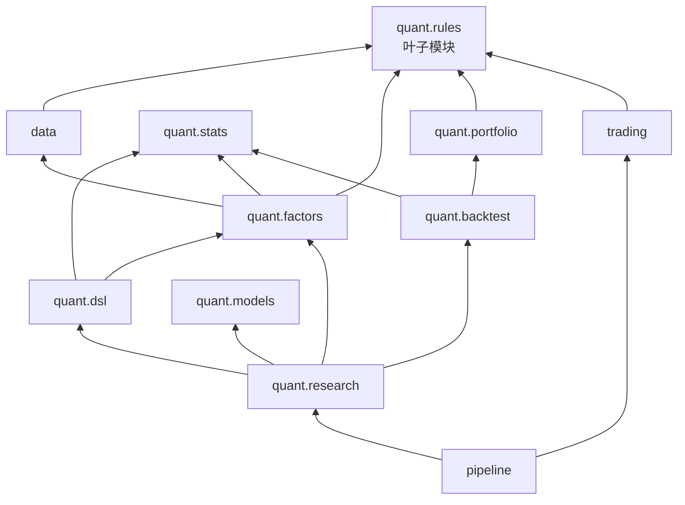
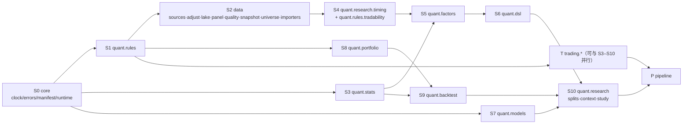
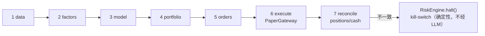

# 内核层详细设计（data / quant / trading / pipeline）与 qtc 迁移方案

> 状态：**草案，待评审** · 对应 spec：§5.2（内核层）、§5.1（目录）、§7（离线、性能）、§8.6–8.7（合成数据、偏差披露）、§9（unit / golden）、§10 M1/M6/M7
> 最后更新：2026-11-08（已对齐 spec v1.2）
> 上游：`docs/superpowers/specs/2026-11-08-alphapilot-design.md`（冲突时以 spec 为准）。相关：ADR-0003、ADR-0006、`testing-and-evals.md` §4（golden）、`tools-and-mcp.md` §2.2（TrialLedger）、`agents.md` §1.2（SampleSplit）。
> 标注约定：**〔核实〕** = 已在 qtc 源码中逐行确认；**〔待 M1 核实〕** = 设计推断，迁移时需要再确认；**⊕** = spec 未写、本文增补。

---

## 0. 范围与原则

1. **纯内核**：`alphapilot.data`、`alphapilot.quant`、`alphapilot.trading`、`alphapilot.pipeline` 不 import `db`、`llm`、`api`、`agents`、`tools`。需要持久化时通过 Protocol 注入（例如 `SnapshotRepository`、`EventLog`）。由 import-linter 强制（见 §2.3）。
2. **数值行为不变**：迁移只做"去 sys.path、改名、补类型、拆文件、修已知问题"。任何改变数值的修复都登记到 `tests/golden/divergences.yaml`（见 §17）。
3. **无 import 副作用**：qtc 里 `_paths.py` 在 import 时改 `sys.path`、设 `OMP_NUM_THREADS`，`factors/__init__` 在 import 时往全局注册表注册因子，`to_exchange_symbol` 修改全局合约注册表。AlphaPilot 一律改为显式调用或实例注入。
4. **无 `print`**：qtc 用 `print("⚠️ …")` 提示合成数据和失败原因；AlphaPilot 改为 structlog 事件 + 结构化返回值（例如 `FetchResult.errors`）。
5. **时间**：内核函数不调用 `datetime.now()`；需要"今天"时由 `core.clock.Clock` 注入（mini_trader 的 `OrderData.created_at=datetime.now` 改为由 clock 填充，tz-aware，Asia/Shanghai）。

---

## 1. 包结构

```
src/alphapilot/
├─ core/        settings · errors · clock · ids · manifest(run_manifest, code_fingerprint) · runtime(configure_threads)
├─ data/
│  ├─ sources/  base · eastmoney · sina · synthetic · fallback        ← qtc utils/data.py、phase-01 fetcher.py
│  ├─ adjust.py                                                       ← utils/data.py、bt_core.add_reference_columns
│  ├─ lake.py                                                         ← phase-01 storage.py（重写布局）
│  ├─ panel.py                                                        ← phase-7 factor_data.py（FactorPanel、build_real_panel）
│  ├─ quality.py                                                      ← phase-01 quality.py + mini_quant data.quality_report
│  ├─ snapshot.py  ⊕
│  ├─ universe.py                                                     ← factor_data._select_universe、SECTORS
│  └─ importers/qtc.py ⊕                                              ← ap data import-qtc
├─ quant/
│  ├─ contracts.py                                                    ← mini_quant/contracts.py
│  ├─ config.py                                                       ← mini_quant/config.py（StrategyConfig、load_config）
│  ├─ rules/    board · costs · limits · tradability                  ← bt_core 交易规则与成本、factor_tools 可交易性、mini_quant/rules.py
│  ├─ dsl/      grammar · evaluate · lookahead · canonical ⊕ · fields · compile ⊕   ← phase-10 factor_dsl.py、ai_tools.daily_fields
│  ├─ stats/    ic · performance · multiple                           ← factor_tools、bt_core、ai_tools、portfolio_utils
│  ├─ factors/  registry · builtin · pit · preprocess · diagnostics · engine   ← mini_quant/factors、factor_tools
│  ├─ models/   zoo · gbdt · rolling                                  ← mini_quant/models、phase-9 ml_tools.make_regressor
│  ├─ portfolio/ construct · orders · optimize                        ← mini_quant/portfolio、portfolio_utils
│  ├─ backtest/ monthly · vectorized · factor_bt ⊕ · capacity · metrics ← mini_quant/backtest、bt_core
│  └─ research/ splits ⊕ · timing · context · study · trial_log       ← mini_quant/research.py、ai_tools、factor_tools 时间口径
├─ trading/
│  ├─ models.py · contracts.py ⊕（spec 目录未列）                    ← mini_trader/models.py、contracts.py
│  ├─ engine · events · gateway · oms · positions · risk · persistence · recovery · sessions · monitor
│  ├─ system.py ⊕                                                     ← mini_trader/system.py
│  └─ gateways/ mock_exchange ⊕ · paper · vnpy_bridge（M7，可选 extra）
└─ pipeline/    contracts · daily · executor · health · strategy_version  ← mini_quant/pipeline.py、execution/、monitor/
```



---

## 2. 依赖拆解与迁移顺序

### 2.1 `_paths.py` 引入的跨阶段依赖〔核实〕

`mini_quant/_paths.py` 把 `src/`、`phase-4-backtesting/`、`phase-7-multi-factor/`、`phase-8-portfolio-risk/`、`phase-13-trading-system-live/` 加入 `sys.path`，并 `os.environ.setdefault("OMP_NUM_THREADS", "4")`。实际被 mini_quant 使用的外部符号：

| qtc 模块 | 被谁使用 | 使用的符号 | AlphaPilot 去向 |
|---|---|---|---|
| `utils.data` | factor_data、bt_core、portfolio_utils、ai_tools、panel_source | `get_stock_daily_adj`、`get_index_daily`、`get_etf_daily(_adj)`、`is_offline`、`is_synthetic`、`synthetic_ohlcv`、`CACHE_DIR` | `data.sources.*`、`data.adjust`、`data.lake` |
| `bt_core` | rules、portfolio/orders、backtest/engine、backtest/metrics、execution、research | `BoardRule`、`board_rule`、`round_price`、`limit_prices`、`round_lot_buy`、`CostModel`、`stamp_duty_rate_at`、`performance_report`、`sharpe_ratio`、`psr`、`expected_max_sr` | `quant.rules.board`、`quant.rules.costs`、`quant.stats.*` |
| `factor_data` | data/panel_source、research | `FactorPanel`、`load_panel`、`_load_cached`、`synthetic_panel`、`PANEL_FILE…`、`FACTOR_START/END`、`RF_ANNUAL`、`warn_synthetic` | `data.panel`、`data.sources.synthetic`、`quant.research.timing` |
| `factor_tools` | panel_source、factors/*、research | `rebalance_dates`、`period_returns`、`bench_period_returns`、`tradable_status`、`build_factors`、`winsorize_mad`、`zscore`、`neutralize`、`preprocess`、`calc_ic`、`ic_summary`、`quantile_returns`、`FACTOR_LABELS/CATEGORY` | `quant.research.timing`、`quant.rules.tradability`、`quant.factors.*`、`quant.stats.ic` |
| `portfolio_utils` | portfolio/construct | `inverse_vol_weights`（只用这一个） | `quant.portfolio.optimize` |
| `mini_trader` | execution/executor | `ContractSpec`、`Direction`、`Market`、`MockExchange`、`RiskConfig`、`register_spec`、`TradingSystem`、`positions_to_map`、`reconcile_positions` | `trading.*` |

另外两处隐式依赖：`mini_quant.models.zoo` 的 hgb 直接用 sklearn（**没有**走 phase-9 `ml_tools.make_regressor` 的 LightGBM→HGB 降级）〔核实〕；phase-10 `ai_tools` 依赖 `factor_data`/`factor_tools`，`factor_dsl.factor_ic` 在函数内 `from factor_tools import calc_ic`〔核实〕。

### 2.2 迁移顺序（拓扑序）



每一步的完成条件：该步的 unit 测试迁移通过 + 该步涉及的 golden 用例通过（golden-synth 必过；golden-qtc 在本机有缓存时必过，M1 验收带 `AP_REQUIRE_GOLDEN=1`，缺少 qtc 缓存时直接失败）。S2 完成时 `ap data import-qtc`、`ap data status` 可用；S10 完成时 `ap backtest run -c configs/strategy.yaml` 可用（M1 验收）。

### 2.3 import-linter 契约

```ini
[importlinter:contract:kernel-pure]
type = forbidden
source_modules = alphapilot.data, alphapilot.quant, alphapilot.trading, alphapilot.pipeline
forbidden_modules = alphapilot.db, alphapilot.llm, alphapilot.api, alphapilot.agents, alphapilot.tools, alphapilot.mcp, alphapilot.worker

[importlinter:contract:rules-leaf]      # data.quality 需要板块涨跌幅，但 data 不能依赖 quant 的其他部分
type = forbidden
source_modules = alphapilot.quant.rules
forbidden_modules = alphapilot.data, alphapilot.quant.factors, alphapilot.quant.stats, alphapilot.trading

[importlinter:contract:data-only-rules]
type = forbidden
source_modules = alphapilot.data
forbidden_modules = alphapilot.quant.factors, alphapilot.quant.dsl, alphapilot.quant.models, alphapilot.quant.portfolio, alphapilot.quant.backtest, alphapilot.quant.research

[importlinter:contract:dsl-one-way]     # dsl → factors.registry 单向
type = forbidden
source_modules = alphapilot.quant.factors
forbidden_modules = alphapilot.quant.dsl
```

`quant.rules.tradability` 依赖 `data.panel.FactorPanel` 的结构，为了维持 rules 为叶子，它只依赖 `FactorPanelLike` Protocol（定义在 `quant.rules.tradability` 内），不 import `data`。

---

## 3. 必须保留的领域规则

| # | 规则 | qtc 出处〔核实〕 | AlphaPilot 位置 | 守护测试 |
|---|---|---|---|---|
| R1 | 股票收益**只用 Sina 等比后复权因子**（`ak.stock_zh_a_daily(adjust="hfq-factor")`），`adj_close = close × adj_factor`。东财 `qfq/hfq` 是加减法复权，除息日收益失真，**禁止**用于收益 | `utils/data.get_adj_factor`、`get_stock_daily_adj` 的 docstring | `data.adjust.attach_adj_factor`；`EastmoneySource.fetch_daily` 只接受 `adjust=""`，传其他值抛 `ValueError` | `test_adjust_rejects_em_qfq`、除息日收益对拍 |
| R2 | ETF 收益用 `etf_corrected_returns`（不复权价 + 东财 hfq 仅在事件日修正） | `utils/data._etf_corrected_returns`、`portfolio_utils.etf_total_return`（两份相同逻辑） | `data.adjust.etf_corrected_returns`（合并为一份） | golden：事件表、修正收益 |
| R3 | **撮合用不复权价，收益用 adj_close**。涨跌停、整数手、成交金额、市值用 `open/high/low/close`；收益、因子、IC 用复权价 | `get_stock_daily_adj` docstring、`FactorPanel` docstring、`ai_tools.daily_fields` | `FactorPanel` 字段约定；`quant.dsl.fields.daily_fields`（全部复权口径）；`pipeline.executor.build_market`（不复权） | 类型别名 `RawPx`/`AdjPx` + 单测 |
| R4 | 创业板 `symbol.startswith("30")`（含 300/301/**302**） | `bt_core.board_rule`、`factor_data.board_of` | `quant.rules.board.board_of` | 参数化：`302132 → CHINEXT` |
| R5 | 主板 ST/*ST 涨跌幅 **2026-07-06 起 ±10%**（之前 ±5%） | `bt_core.ST_RULE_CHANGE_DATE`、`factor_tools.ST_LIMIT_CHANGE_DATE` | `quant.rules.board.ST_RULE_CHANGE_DATE` | 2026-07-03 / 2026-07-06 边界测试 |
| R6 | 创业板 2020-08-24 起 20%；科创板 20%、买入至少 200 股、超出按 1 股递增；北交所 30%；主板/创业板 100 股整数倍 | `bt_core.board_rule`、`factor_tools.limit_pct` | `quant.rules.board` | `test_orders.py` 迁移 |
| R7 | 涨跌停价用 `Decimal` + `ROUND_HALF_UP`（交易所四舍五入，不是银行家舍入）；除权日前收盘用除权参考价 `close_{t-1} × f_{t-1} / f_t` | `bt_core.round_price/limit_prices/add_reference_columns` | `quant.rules.board`、`data.adjust.add_reference_columns` | 单测 |
| R8 | 印花税仅卖出：2023-08-28 前 0.1%，之后 0.05%；佣金双向 0.025% 最低 5 元；过户费双向 0.001% | `bt_core.CostModel/stamp_duty_rate_at`、`factor_tools.stamp_tax` | `quant.rules.costs` | 单测 |
| R9 | **用 `is_synthetic(df)` 判断合成数据，不用 `is_offline()`**：离线时先读缓存（真实数据），缓存缺失才合成 | `utils/data.is_synthetic` docstring | `data.sources.fallback.is_synthetic`；面板级 `FactorPanel.is_synthetic`；快照级 `data_snapshots.is_synthetic` | 单测：离线 + 有缓存 → `is_synthetic=False` |
| R10 | 合成价格**不能**配真实复权因子（除权日会出现虚假跳变） | `get_stock_daily_adj` | `data.adjust.attach_adj_factor(synthetic=True)` 强制因子为 1 | 单测 |
| R11 | lightgbm 导入失败（macOS 缺 libomp 抛 `OSError` 不是 `ImportError`，所以捕获 `Exception`）时降级到 sklearn `HistGradientBoostingRegressor`，参数映射且 `early_stopping=False` | phase-9 `ml_tools.py` | `quant.models.gbdt.make_regressor` | 单测：monkeypatch 导入失败 |
| R12 | qlib 初始化必须 `kernels=1`（多进程加载在部分 macOS 上会卡住） | phase-9 `09-qlib-workflow.py:174` | `quant.models.qlib_compat.init_qlib()`（M7 Alpha158 基线用，可选依赖） | 单测检查调用参数 |
| R13 | 信号 t 日收盘计算，t+1 开盘执行；持有到下一调仓日的次日开盘 | `factor_tools` 模块说明、`period_returns` | `quant.research.timing` | golden |
| R14 | 滚动训练 `LABEL_LAG = 2`（d_i 收盘时最新可用标签是 d_{i-2}） | `mini_quant/models/rolling.py` | `quant.models.rolling` | 单测 + golden |
| R15 | 财报 PIT：按实际披露日 `merge_asof(direction="backward", allow_exact_matches=False)`，剔除报告期倒退；`yjbb` 的"最新公告日期"不能用于 PIT | `factor_tools.pit_merge`、`factor_data` 说明 | `quant.factors.pit` | golden |
| R16 | 东财成交量单位是"手"，×100 转股；新浪已是股 | `utils/data._normalize_em` | `data.sources.eastmoney` | 单测 |
| R17 | 线程：小数据上 OpenMP 线程多反而慢，限制 4 线程 | `_paths.py`、`ml_tools.py` | `core.runtime.configure_threads(4)`，CLI/worker 启动时调用一次 | — |

---

## 4. `alphapilot.data`

### 4.1 职责

数据获取（多源回退）、复权、数据湖读写、面板构建、质量检查、快照、股票池、qtc 缓存导入。**不做**任何因子计算。

### 4.2 `data.sources`

```python
# data/sources/base.py
DAILY_COLUMNS = ("symbol", "date", "open", "high", "low", "close", "volume", "amount")  # volume：股

class SourceError(RuntimeError): ...
class OfflineError(SourceError): ...           # AP_OFFLINE=1 时任何网络源都抛这个

class DailyBarSource(Protocol):
    name: str
    def fetch_daily(self, symbol: str, start: date, end: date) -> pd.DataFrame: ...   # 不复权
class AdjFactorSource(Protocol):
    def fetch_adj_factor(self, symbol: str) -> pd.DataFrame: ...                       # [date, adj_factor]，阶梯序列
class IndexSource(Protocol):
    def fetch_index(self, code: str, start: date, end: date) -> pd.DataFrame: ...
class UniverseSource(Protocol):
    def fetch_constituents(self, index_code: str) -> pd.DataFrame: ...                 # [symbol, name]
class CalendarSource(Protocol):
    def fetch_calendar(self) -> pd.DatetimeIndex: ...

# data/sources/eastmoney.py
class EastmoneySource:                 # stock_zh_a_hist / index_zh_a_hist / fund_etf_hist_em
    name = "eastmoney"
    def __init__(self, *, request_interval: float = 0.5, max_retries: int = 3) -> None: ...
    def fetch_daily(self, symbol: str, start: date, end: date, adjust: Literal[""] = "") -> pd.DataFrame: ...
    def fetch_etf_daily(self, symbol: str, start: date, end: date, adjust: Literal["", "hfq"] = "") -> pd.DataFrame: ...
# data/sources/sina.py
class SinaSource:                      # stock_zh_a_daily / hfq-factor / stock_zh_index_daily / fund_etf_hist_sina
    name = "sina"
    def fetch_daily(self, symbol: str, start: date, end: date) -> pd.DataFrame: ...
    def fetch_adj_factor(self, symbol: str) -> pd.DataFrame: ...
# data/sources/synthetic.py
def synthetic_ohlcv(symbol: str, start: date | str, end: date | str, start_price: float = 20.0,
                    annual_return: float = 0.08, annual_vol: float = 0.30) -> pd.DataFrame: ...
def synthetic_panel(n: int = 120, seed: int = 7) -> FactorPanel: ...        # 原样迁移（种子与结构不变）

# data/sources/fallback.py
class SyntheticPolicy(StrEnum):
    AUTO = "auto"       # 所有真实源失败后回退合成（研究、教学）
    NEVER = "never"     # 失败即抛错（data.update job、forward 流水线）
    FORCE = "force"     # 直接用合成（替代 QTC_FORCE_SYNTHETIC=1，测试降级路径）

@dataclass(frozen=True)
class FetchResult:
    frame: pd.DataFrame
    source: str                         # "lake" | "eastmoney" | "sina" | "synthetic"
    synthetic: bool
    errors: tuple[str, ...] = ()

def fetch_with_fallback(fetchers: Sequence[tuple[str, Callable[[], pd.DataFrame]]],
                        synth: Callable[[], pd.DataFrame] | None, *, label: str,
                        policy: SyntheticPolicy, offline: bool) -> FetchResult: ...
def is_synthetic(df: pd.DataFrame) -> bool: ...          # bool(df.attrs.get("synthetic", False))，签名不变
def mark_synthetic(df: pd.DataFrame, flag: bool) -> pd.DataFrame: ...
def exchange_prefix(symbol: str) -> Literal["sh", "sz", "bj"]: ...
def retry(max_retries: int = 3, base_delay: float = 1.0, sleep: Callable[[float], None] = time.sleep): ...
```

迁移改动：
- `_load_with_fallback` 的"读缓存"这一步移到 `Lake`：sources 只负责"联网取数"，回退链是 `lake → eastmoney → sina → synthetic`（spec §5.2）。
- `_finalize` 把索引统一为 `datetime64[ns]`（pandas 3 下不同来源精度不同，`merge_asof` 要求一致）——保留〔核实〕。
- `exchange_prefix`：qtc `utils/data._exchange_prefix` 把 `92xxxx`（北交所新代码段）判为 `sh`，phase-01 `fetcher.exchange_prefix` 判为 `bj`〔核实〕。采用 phase-01 的正确版本（K1）。
- 重试与限速：采用 phase-01 的 `retry`（指数退避 1s、2s、4s）和 `_throttle`；factor_data `_cached_df` 的"重试 2 次、sleep 1+i 秒"并入。
- 合成数据不写入数据湖（与 qtc 一致：合成数据不写缓存）。

### 4.3 `data.adjust`

```python
class AdjFactorMissing(SourceError): ...

def attach_adj_factor(bars: pd.DataFrame, factor: pd.DataFrame | None, *, synthetic: bool) -> pd.DataFrame:
    """增加 adj_factor、adj_close、adj_open。factor 为阶梯序列：并到 bars 日期上 ffill，首个事件之前填 1.0。
    synthetic=True 时因子恒为 1（R10）。factor 为空且 synthetic=False 时抛 AdjFactorMissing。"""
def add_reference_columns(df: pd.DataFrame) -> pd.DataFrame: ...     # pre_close = round_price(close_{t-1}·f_{t-1}/f_t)
def etf_corrected_returns(raw: pd.Series, hfq: pd.Series, tol: float = 0.002) -> tuple[pd.Series, pd.DataFrame]: ...
def get_stock_daily_adj(lake: "Lake", symbol: str, start: date, end: date) -> pd.DataFrame: ...   # 兼容门面
def get_etf_daily_adj(lake: "Lake", symbol: str, start: date, end: date) -> pd.DataFrame: ...
```

已知问题 K2〔核实〕：qtc `get_stock_daily_adj` 在复权因子下载失败时，`get_adj_factor` 回退为"恒 1 的合成序列"，但 `get_stock_daily_adj` 不检查它是否合成，结果是**真实不复权价被当成复权价**，且 `attrs["synthetic"]=False`。factor_data 靠检查 `factor_{code}.parquet` 文件是否存在绕开了这个问题。AlphaPilot：因子缺失抛 `AdjFactorMissing`，由调用方决定跳过该股票并在快照 `known_biases` 中记 `adj_factor_missing`。

### 4.4 数据湖布局 `data.lake`

**qtc 的实际做法**〔核实〕：
- `utils/data.py` 的缓存是"一次请求一个文件"：`data/cache/{kind}_{symbol}_{adjust|none}_{start}_{end}.parquet`（例如 `stock_600519_none_20180101_20250228.parquet`），复权因子 `factor_{symbol}.parquet`。同一只股票的不同区间会重复存储（缓存目录下 236 个 stock 文件，其中 132 个是面板区间 `20180101_20250228`）。
- phase-7 面板是**单个长表** `factor_panel_daily.parquet`（MultiIndex `date, code`，9 列，229,020 行）加 `info/fin/bench` 三个文件。
- phase-01 项目是**按年分区**：`warehouse/stock_daily/year=YYYY/data.parquet`，复权因子是单个 `adj_factor/data.parquet`，DuckDB 用 `read_parquet('…/*/*.parquet', hive_partitioning=true)` 建视图。

**AlphaPilot 的选择：按 symbol 分文件，symbol 目录内按年分片；文件内容寻址（CAS）以保证快照不可变。**

```
data/lake/
├─ objects/ab/abcdef….parquet          # 内容寻址对象（sha256 of canonical content），只增不改
├─ heads/                              # 当前"头"指针：逻辑路径 → 对象哈希（JSON，原子替换）
│  └─ HEAD.json
├─ daily/{symbol}/{yyyy}.parquet        # 逻辑路径（实际是 heads 中的一项；工作副本可硬链接到 objects）
├─ adj_factor/{symbol}.parquet
├─ index/{code}/{yyyy}.parquet
├─ etf/{symbol}/{yyyy}.parquet          ⊕（spec 布局未列 etf，ETF 研究需要）
├─ universe/{universe_id}.parquet       # 例如 course_panel_v1、hs300@2026-11-06
├─ meta/
│  ├─ trade_calendar.parquet
│  ├─ instruments.parquet               # symbol, name, board, list_date, delist_date, sector, industry
│  ├─ shares/{symbol}.parquet           # 逐日总股本、流通股本（stock_value_em）
│  └─ fin/{yyyymmdd}.parquet            # 按报告期：yjbb 数值 + yysj 首次披露日
└─ snapshots/{snapshot_id}.json         # 快照清单（见 §4.6）
```

理由：
1. **更新粒度**：每日增量只改每只股票当年的分片（`daily/600519/2026.parquet`），历史年份对象不变，快照间共享，CAS 去重后每日新增约"股票数 × 当年分片"（300 只约数 MB），远小于"按 symbol 单文件"每日重写全部历史。
2. **与 spec 一致**："Parquet 按 symbol 分文件"——以 symbol 为一级目录满足 spec；年分片是细化（spec 问题 S3，已在 spec v1.2 解决：§5.2 已写明"按 symbol 分目录、目录内按年分片"）。
3. **读取模式**：研究读"一个股票池 × 一段区间"，DuckDB 按 `symbol/year` 两级裁剪；按年分区（phase-01）在读单只股票全历史时要扫所有年份文件。
4. **qtc 导入**：qtc 缓存本来就是 per-symbol 文件，导入时按年切分即可。
5. **后复权因子的性质**：Sina hfq 因子以上市日为锚，新的除权事件只追加新阶梯、不改历史值，所以 `adj_factor/{symbol}.parquet` 很小且几乎只追加。

**Parquet schema**（pyarrow；列顺序固定；`date` 为 `date32`，不含时区）

| 数据集 | 列 |
|---|---|
| daily | `date: date32, open: float64, high: float64, low: float64, close: float64, volume: float64(股), amount: float64(元), source: dictionary<string>` |
| adj_factor | `date: date32（除权除息日）, adj_factor: float64` |
| index / etf | 同 daily（新浪 ETF/指数接口无 amount 时为 null） |
| universe | `symbol: string, name: string, sector: string, industry: string, index: string, board: string, weight: float64?, as_of: date32` |
| instruments | `symbol, name, board, list_date, delist_date, sector, industry, is_st_now: bool` |
| shares | `date: date32, total_shares: float64, float_shares: float64` |
| fin | `symbol, end_date, ann_date, ann_source('实际披露'|'截止日补齐'), latest_ann_date, net_profit, revenue, eps, bvps, roe` |
| trade_calendar | `date: date32` |

**DuckDB 视图**（`Lake.duckdb(snapshot)` 创建，只读连接；快照模式下从清单的对象路径读取）

```sql
CREATE VIEW daily AS
  SELECT * FROM read_parquet($daily_files, filename = true, union_by_name = true);   -- symbol 从路径解析
CREATE VIEW adj_factor AS SELECT * FROM read_parquet($adj_files, filename = true);
CREATE VIEW daily_adj AS                         -- 等比后复权：ASOF JOIN 取 ≤ date 的最近因子
  SELECT d.*, coalesce(f.adj_factor, 1.0) AS adj_factor,
         d.close * coalesce(f.adj_factor, 1.0) AS adj_close,
         d.open  * coalesce(f.adj_factor, 1.0) AS adj_open
  FROM daily d ASOF LEFT JOIN adj_factor f ON d.symbol = f.symbol AND d.date >= f.date;
CREATE VIEW calendar AS SELECT * FROM read_parquet($calendar_file);
CREATE VIEW universe AS SELECT * FROM read_parquet($universe_file);
```

```python
class Lake:
    def __init__(self, root: Path, *, read_only: bool = False) -> None: ...
    def write_daily(self, symbol: str, df: pd.DataFrame, *, source: str) -> WriteResult: ...   # upsert(symbol,date)，新数据优先
    def write_adj_factor(self, symbol: str, df: pd.DataFrame) -> WriteResult: ...
    def write_index(self, code: str, df: pd.DataFrame) -> WriteResult: ...
    def write_universe(self, universe_id: str, members: pd.DataFrame) -> WriteResult: ...
    def write_meta(self, name: str, df: pd.DataFrame) -> WriteResult: ...
    def head(self) -> dict[str, str]: ...                                   # 逻辑路径 → 对象哈希
    def read_daily(self, symbols: Sequence[str] | None = None, start: date | None = None, end: date | None = None,
                   *, manifest: "SnapshotManifest | None" = None) -> pd.DataFrame: ...
    def duckdb(self, manifest: "SnapshotManifest | None" = None) -> "duckdb.DuckDBPyConnection": ...
    def gc(self, keep: Iterable["SnapshotManifest"]) -> int: ...           # 删除不被任何保留快照引用的对象
```

`upsert` 沿用 phase-01 `storage.upsert`（`drop_duplicates(keep="last")`），增量更新回看 `lookback_days=7`（覆盖数据源对近期数据的修正）。

### 4.5 `data.panel`

```python
@dataclass
class FactorPanel:                              # 字段与 qtc 完全一致〔核实〕
    open: pd.DataFrame; high: pd.DataFrame; low: pd.DataFrame; close: pd.DataFrame
    adj_factor: pd.DataFrame; volume: pd.DataFrame; amount: pd.DataFrame
    float_shares: pd.DataFrame; total_shares: pd.DataFrame
    info: pd.DataFrame          # index=code；name, sector, industry, index, board, list_date
    fin: pd.DataFrame           # 长表；code, end_date, ann_date, ann_source, latest_ann_date, net_profit, revenue, eps, bvps, roe, total_shares_end, equity
    bench: pd.DataFrame         # {hs300,zz500,zz1000}_{open,close}
    is_synthetic: bool = False
    notes: list[str] = field(default_factory=list)
    snapshot_id: str | None = None              ⊕
    # 派生（cached_property，公式不变）：dates, codes, adj_close, adj_open, close_ffill, mcap, total_mcap, turnover, daily_ret
    def bench_ret(self, name: str = "hs300") -> pd.Series: ...

def build_panel(lake: Lake, *, universe_id: str, start: date, end: date,
                manifest: "SnapshotManifest | None" = None, bench_codes: Mapping[str, str] = BENCH_CODES) -> FactorPanel: ...
def load_course_panel(lake: Lake, manifest: "SnapshotManifest | None" = None) -> FactorPanel: ...   # = qtc _load_cached 的语义
```

`build_panel` 复刻 `factor_data._load_cached` 与 `build_real_panel` 的组装逻辑：日历取沪深 300 交易日（`bench.index`）；`float_shares/total_shares/adj_factor` 向前填充（"状态"而非"成交"）；成交量为 0 或 NaN 的行视为停牌，`open..amount` 置 NaN；`info["board"]` 用 `board_of` 重新计算；`fin` 的 `ann_date` 缺失用 `report_deadline` 补齐并标 `ann_source="截止日补齐"`、`equity = bvps × total_shares_end`。

去掉：模块级单例 `_PANEL`（改由调用方缓存，key 为 `snapshot_id`）；硬编码常量 `PRICE_START/END="20180101"/"20250228"`、`FACTOR_START/END`、`FIN_PERIODS`（改为参数；课程面板的默认值放在 `configs/universe.yaml` 的 `course_panel_v1`）。

### 4.6 数据快照 `data.snapshot`

```python
class KnownBiasCode(StrEnum):
    SURVIVORSHIP_CURRENT_CONSTITUENTS = "survivorship_current_constituents"   # 用"当前"成分股回测过去
    CONSTITUENT_LOOKAHEAD = "constituent_lookahead"                           # 成分股前视（入选本身含未来信息）
    UNIVERSE_SECTOR_SAMPLED = "universe_sector_sampled"                       # 课程面板：每行业每指数抽 ≤6 只
    CURRENT_INDUSTRY_CLASSIFICATION = "current_industry_classification"       # 东财"所处行业"是当前分类
    FINANCIALS_RESTATED = "financials_restated"                               # yjbb 数值可能是修订后版本
    ANN_DATE_IMPUTED = "ann_date_imputed"                                     # 缺失披露日按法定截止日补齐
    ST_INFERRED = "st_inferred_from_price_limits"                             # 无历史 ST 标记，用涨跌停反推
    ST_UNDETECTABLE_AFTER_RULE_CHANGE = "st_undetectable_after_2026_07_06"    # 见 K4
    SUSPENSION_HANDLING = "suspension_nan_valued_at_last_close"               # 停牌为 NaN，估值沿用最后收盘价
    DELISTED_EXCLUDED = "delisted_excluded"
    CALENDAR_FROM_INDEX = "calendar_from_hs300"                               # 交易日历用沪深 300 交易日近似
    ADJ_FACTOR_MISSING = "adj_factor_missing"                                 # 有股票因缺复权因子被剔除
    MIXED_SOURCES = "mixed_sources"                                           # 同一快照混用东财与新浪
    SYNTHETIC_DATA = "synthetic_data"
    SMALL_UNIVERSE = "small_universe"                                         # < 200 只，统计功效有限

@dataclass(frozen=True)
class KnownBias:
    code: KnownBiasCode
    severity: Literal["info", "warn", "critical"]
    detail: str                        # 中文说明，直接进报告附录（spec §8.7）
    affects: tuple[str, ...] = ()      # 例如 ("returns",)、("fundamental_factors",)

@dataclass(frozen=True)
class SnapshotManifest:
    schema_version: int                       # 1
    universe_id: str
    entries: Mapping[str, str]                # 逻辑路径 → 对象 sha256（只含本快照用到的文件）
    date_min: date; date_max: date; as_of: date
    n_symbols: int
    is_synthetic: bool
    synthetic_symbols: tuple[str, ...]
    known_biases: tuple[KnownBias, ...]
    sources: Mapping[str, int]                # {"eastmoney": 129, "sina": 3}
    quality: Mapping[str, Any]                # QualityReport.summary()
    content_hash: str                         # 见下

class SnapshotRepository(Protocol):           # db 层实现，写 data_snapshots 表；内核只依赖接口
    def get_by_hash(self, content_hash: str) -> str | None: ...
    def insert(self, manifest: SnapshotManifest) -> str: ...       # 返回 snap_<ULID>

def create(lake: Lake, *, universe_id: str, as_of: date, quality: "QualityReport",
           known_biases: Sequence[KnownBias], repo: SnapshotRepository | None = None) -> tuple[str | None, SnapshotManifest]: ...
def verify(lake: Lake, manifest: SnapshotManifest) -> list[str]: ...     # 重算对象哈希，返回不一致项
def default_biases(universe: "UniverseSpec", panel_meta: Mapping[str, Any]) -> list[KnownBias]: ...
```

**哈希算法**
1. **对象哈希**（内容哈希，与 Parquet 编码无关）：把 DataFrame 规范化（按主键排序、固定列顺序和 Arrow schema、`date32`、float64、去掉 pandas 元数据）→ 写成**无压缩 Arrow IPC stream** → `sha256`。这样换 pyarrow 版本或压缩算法不会改变哈希。
2. **快照哈希**：`sha256( "apsnap:v1\n" + universe_id + "\n" + as_of + "\n" + "".join(f"{path}\t{obj}\n" for path, obj in sorted(entries.items())) )`。`known_biases`、`quality` 是**描述**，不进入哈希（同样的数据换一种偏差描述不应变成新快照）。
3. `create()` 幂等：同一哈希已存在时复用（`repo.get_by_hash`），对应 api.md 的 data.update 第 3 步。

**默认偏差取值**

| 股票池 | 自动写入的 known_biases |
|---|---|
| `course_panel_v1`（M1） | survivorship_current_constituents(critical)、constituent_lookahead(warn)、universe_sector_sampled(warn)、current_industry_classification(warn)、financials_restated(warn)、ann_date_imputed(info，按实际补齐数量)、st_inferred_from_price_limits(warn)、suspension_nan…(info)、delisted_excluded(warn)、calendar_from_hs300(info)、small_universe(warn) |
| `hs300_current`（M6） | 上表去掉 universe_sector_sampled、small_universe；数据覆盖 2026-07-06 之后时加 st_undetectable_after_2026_07_06(critical，直到接入真实 ST 名单) |
| 合成 | synthetic_data(critical)，`is_synthetic=True` |

### 4.7 股票池 `data.universe`

```python
@dataclass(frozen=True)
class UniverseSpec:
    id: str                                   # "course_panel_v1" | "hs300_current"
    kind: Literal["static_list", "index_current"]
    index_code: str | None                    # "000300"
    as_of: date | None                        # 成分股抓取日
    price_start: date; price_end: date | None # None = 最新交易日
SECTORS: dict[str, str]; INDUSTRY_TO_SECTOR: dict[str, str]     # 11 个大类，原样迁移
def select_course_universe(latest_yjbb: pd.DataFrame, listed_2019: set[str], cons: pd.DataFrame,
                           per_sector_per_index: int = 6) -> pd.DataFrame: ...
def hs300_current(src: UniverseSource, as_of: date) -> pd.DataFrame: ...
def load_universe(lake: Lake, spec: UniverseSpec) -> pd.DataFrame: ...
```

- **M1 课程面板**〔核实〕：qtc 缓存实际为 **132 只**、2018-01-02 至 2025-02-28、1735 个交易日、11 个行业；主板 110、创业板 14（其中 1 只 302 号段）、科创板 8；基准列 `hs300/zz500/zz1000_{open,close}`。来源是沪深 300 + 中证 500 的**当前**成分股，每行业每指数按代码均匀抽 ≤6 只，要求 2019 年报已披露。导入方式：`ap data import-qtc` 把 `factor_panel_*.parquet` 拆回 per-symbol 文件。
- **M6 沪深 300**：`index_stock_cons_csindex("000300")` 取当前成分股，`price_start=2018-01-01`，刷新到最新交易日；行业沿用 `INDUSTRY_TO_SECTOR`（映射不到的行业归入"其他"并在 quality 中计数，**待 M6 核实**映射覆盖率）。
- `configs/universe.yaml`：

```yaml
default: course_panel_v1
universes:
  course_panel_v1: {kind: static_list, price_start: 2018-01-01, price_end: 2025-02-28, source: qtc_import}
  hs300_current:   {kind: index_current, index_code: "000300", price_start: 2018-01-01, price_end: null}
```

### 4.8 `AP_OFFLINE` 语义（替代 `QTC_OFFLINE`）

| 变量 | 取值 | 语义 |
|---|---|---|
| `AP_OFFLINE` | `1` | **任何**网络数据源（东财、新浪、中证）直接抛 `OfflineError`，不发请求；数据只来自数据湖；LLM 只走缓存或 fake（llm-router.md）。unit/agent 测试与 CI 都在此模式 |
| | `0`（默认） | 先读数据湖，缺失时联网 |
| `AP_SYNTHETIC_FALLBACK` ⊕ | `auto`（研究、CLI 默认）/ `never`（`data.update`、forward 流水线强制）/ `force`（替代 `QTC_FORCE_SYNTHETIC=1`） | 数据湖缺失且联网失败或离线时是否回退合成数据 |

与 qtc 的对应关系〔核实〕：qtc 离线时"有缓存读缓存、无缓存才合成"；factor_data 的 `load_panel` 在**有缓存**时无论是否离线都读真实面板；ai_tools/panel_source 额外支持 `QTC_FORCE_SYNTHETIC`。AlphaPilot 保持"离线 ≠ 合成"（R9），并把是否允许合成变成显式策略，避免 forward 流水线悄悄跑在合成数据上。

### 4.9 `data.quality`

```python
@dataclass(frozen=True)
class QualityItem: check: str; value: float | int; threshold: str; passed: bool; detail: str = ""
@dataclass
class QualityReport:
    items: list[QualityItem]; issues: pd.DataFrame        # [symbol, date, check, detail]
    @property
    def passed(self) -> bool: ...
    def summary(self) -> dict[str, Any]: ...
    def to_markdown(self) -> str: ...
def check_quality(df_long: pd.DataFrame) -> pd.DataFrame: ...          # phase-01 的 7 类检查，原样
def panel_quality_report(panel: FactorPanel, start: date | None = None, end: date | None = None) -> QualityReport: ...  # mini_quant quality_report
```

改动：phase-01 `quality.limit_pct` 与 bt_core `board_rule` 是两套板块规则（前者把 688/689/30 都判 20%，不区分创业板改革日期）〔核实〕，统一用 `quant.rules.board.board_rule(symbol, date=d)`；mini_quant `quality_report` 的中文列名改英文，`结论` 列（✅/⚠️）移到 `to_markdown`。

### 4.10 qtc 缓存导入 `data.importers.qtc`

```python
@dataclass
class ImportReport: symbols: int; files_read: int; objects_written: int; skipped: list[tuple[str, str]]; warnings: list[str]
def import_qtc(src: Path, lake: Lake, *, include: Sequence[str] = ("panel", "stocks", "adj", "index", "etf", "fin", "calendar")) -> ImportReport: ...
```

文件名识别（qtc `data/cache` 中 `factor_` 前缀被多种数据共用〔核实〕）：

| 正则 | 含义 | 去向 |
|---|---|---|
| `^factor_panel_(daily|info|fin|bench)\.parquet$` | phase-7 面板 | 拆成 daily/adj_factor/shares/instruments/fin/index、`universe/course_panel_v1` |
| `^factor_(\d{6})\.parquet$` | Sina hfq 因子 | `adj_factor/{sym}` |
| `^stock_(\d{6})_none_(\d{8})_(\d{8})\.parquet$` | 不复权日线 | `daily/{sym}/{yyyy}`（同一股票多个区间合并 upsert） |
| `^stock_\d{6}_(qfq|hfq)_.*` | 东财加减法复权 | **跳过**（R1），记入 skipped |
| `^index_(\d{6})_none_.*` | 指数 | `index/{code}` |
| `^etf_(\d{6})_(none|hfq)_.*` | ETF | `etf/{sym}`（hfq 仅用于 R2 的事件修正） |
| `^factor_fin_(yjbb|yysj)_(\d{8})\.parquet$`、`^factor_(value|info)_(\d{6})`、`^factor_cons_(\d{6})` | 财报、股本、个股信息、成分股 | `meta/*` |
| `data/phase-13/trade_calendar.csv` | 交易日历 | `meta/trade_calendar` |
| 其他（futures、option、stat_arb、phase9/10 子目录） | 与本项目无关 | 跳过 |

---

## 5. `alphapilot.quant.rules`

```python
# quant/rules/board.py
ST_RULE_CHANGE_DATE: Final = date(2026, 7, 6)
CHINEXT_20PCT_DATE: Final = date(2020, 8, 24)
class Board(StrEnum): MAIN = "主板"; CHINEXT = "创业板"; STAR = "科创板"; BSE = "北交所"
@dataclass(frozen=True)
class BoardRule: name: str; limit_pct: float; min_lot: int; step: int
def board_of(symbol: str) -> Board: ...      # 688/689→STAR；30→CHINEXT；4/8/92→BSE；其余 MAIN
def board_rule(symbol: str, is_st: bool = False, date: date | pd.Timestamp | None = None) -> BoardRule: ...
def round_price(x: float, tick: str = "0.01") -> float: ...
def limit_prices(pre_close: float, pct: float, tick: str = "0.01") -> tuple[float, float]: ...
def round_lot_buy(shares: float, rule: BoardRule) -> int: ...
def lot_ok(symbol: str, side: Literal["BUY", "SELL"], volume: int, current_shares: int, target_shares: int) -> bool: ...
def to_exchange_symbol(code: str) -> str: ...    # 600000 → 600000.SSE；000001 → .SZSE；92/4/8 → .BSE
def from_exchange_symbol(symbol: str) -> str: ...

# quant/rules/costs.py
STAMP_CUT_DATE: Final = date(2023, 8, 28)
@dataclass(frozen=True)
class CostModel:
    commission_rate: float = 0.00025; min_commission: float = 5.0
    stamp_duty_rate: float = 0.0005; transfer_fee_rate: float = 0.00001; slippage: float = 0.0005
    @classmethod
    def proportional(cls, rate: float) -> "CostModel": ...
    @classmethod
    def zero(cls) -> "CostModel": ...
    def fees(self, value: float, is_sell: bool, on: date | None = None) -> FeeBreakdown: ...  # on 不为空时印花税按当时费率
    def total(self, value: float, is_sell: bool, on: date | None = None) -> float: ...
def stamp_duty_rate_at(on: date | pd.Timestamp) -> float: ...
def cost_rates(cost: CostModel, on: date | pd.Timestamp) -> tuple[float, float]: ...   # (买, 卖) 单边比例费率

# quant/rules/tradability.py（面板级，输入 FactorPanelLike）
def limit_pct_panel(panel: FactorPanelLike, st: pd.DataFrame | None = None) -> pd.DataFrame: ...
def infer_st(panel: FactorPanelLike, window: int = 60) -> pd.DataFrame: ...
def tradable_status(panel: FactorPanelLike, dates: pd.DatetimeIndex, min_list_days: int = 365) -> TradableStatus: ...
class TradableStatus(TypedDict): listed: pd.DataFrame; trading: pd.DataFrame; not_st: pd.DataFrame; buyable: pd.DataFrame; all: pd.DataFrame
```

来源：`bt_core` 第 41–139 行、`factor_tools` 第 44–193 行、`factor_data.board_of`、`mini_quant/rules.py`、`execution/executor.to_exchange_symbol`〔核实〕。

迁移改动：
- **合并三份板块判断**：`bt_core.board_rule`（688/689、30、8/4/92）、`factor_data.board_of`（只有 688、30）、phase-01 `quality.limit_pct`。统一为 `board_of` + `board_rule`。
- `mini_quant/rules.py` 的"302 补丁"**不迁移**：它的注释说 bt_core 会把 302 判为主板，但当前 bt_core 已用 `startswith("30")`，补丁是冗余的〔核实〕（K3）。
- `board_rule` 的创业板 20% 在 qtc 中**不看日期**；`factor_tools.limit_pct` 看日期（2020-08-24 之前 10%）〔核实〕。AlphaPilot：`date` 非空且早于 `CHINEXT_20PCT_DATE` 时返回 10%（divergence `rules.chinext_pre_2020`，只影响 2020-08 前的质量检查，不影响 golden 的因子与回测路径——**待 M1 核实**）。
- `to_exchange_symbol` 不再调用全局 `register_spec`：科创板合约规格由 `trading.contracts.ContractRegistry` 实例在构造时注册（K9）。
- `infer_st`（K4）：用"过去 60 日至少 2 次恰好收在 ±5% 且无超 5.25% 的涨跌"反推 ST，**2026-07-06 之后 ST 涨跌幅为 10%，该方法失效**。AlphaPilot：`infer_st` 增加 `as_of` 判断，规则变更日之后返回 `False` 并由快照写入 `st_undetectable_after_2026_07_06`；M6 接入当日 ST 名单（股票简称前缀 `ST`/`*ST`，每日快照 `instruments.is_st_now` 累积成历史）——**待 M6 核实数据源**。

---

## 6. `alphapilot.quant.dsl`

### 6.1 语法与求值（原样迁移）〔核实〕

字段 `open high low close volume amount turnover vwap ret`；运算 `+ - * /`、一元负号；截面 `rank`（pct）、`zscore`；逐元素 `abs log sign`；时序 `delay delta ts_mean ts_std ts_sum ts_max ts_min ts_rank corr(x,y,n)`；窗口必须是 1..250 的整数常量（负数 = 未来函数，解析期拒绝）；表达式 ≤ 400 字符、节点 ≤ 60、深度 ≤ 10；禁止属性访问、下标、关键字参数、比较、lambda、推导式。

```python
FIELDS: Final = ("open", "high", "low", "close", "volume", "amount", "turnover", "vwap", "ret")
MAX_WINDOW, MAX_NODES, MAX_DEPTH, MAX_LEN = 250, 60, 10, 400
class DSLError(ValueError): ...
@dataclass(frozen=True)
class ExprInfo: expr: str; fields: frozenset[str]; funcs: frozenset[str]; lookback: int; n_nodes: int
def validate(expr: str) -> ExprInfo: ...
def evaluate(expr: str, data: Mapping[str, pd.DataFrame], *, strict_inf: bool = True) -> pd.DataFrame: ...
def lookahead_test(expr_or_fn: str | Callable[[Mapping[str, pd.DataFrame]], pd.DataFrame],
                   data: Mapping[str, pd.DataFrame], cut: pd.Timestamp, n_check: int = 20) -> bool: ...
def lookahead_scan(expr: str, data: Mapping[str, pd.DataFrame], cuts: Sequence[pd.Timestamp], n_check: int = 20) -> LookaheadResult: ...  ⊕
def factor_ic(expr: str, data: Mapping[str, pd.DataFrame], dates: pd.DatetimeIndex, fwd: pd.DataFrame,
              mask: pd.DataFrame | None = None, min_obs: int = 20) -> pd.Series: ...
# dsl/fields.py（← ai_tools.daily_fields，全部为复权口径，R3）
def daily_fields(panel: FactorPanel) -> dict[str, pd.DataFrame]: ...
```

迁移改动：
- `ExprInfo.fields/funcs` 由 `set` 改为 `frozenset`（可哈希、可放入 frozen dataclass）。
- `strict_inf`（K10）：qtc 只在**最终结果**把 ±inf 换成 NaN，中间的 `x/0` 产生的 inf 会被 `rank` 当作最大值参与排序〔核实〕。AlphaPilot 默认在每个 `/` 节点后替换 inf；`strict_inf=False` 复现 qtc 行为，golden 用例用 `False`（divergence `dsl.inner_inf`）。
- `lookahead_scan` ⊕：在 IS 区间内取 3 个切点（1/3、2/3、末尾）各做一次 `lookahead_test`，全部通过才算 `lookahead_ok`。qtc 只测一个切点、最后 20 天。`factor.evaluate` 使用 scan。
- `factor_ic` 改为包内 import `quant.stats.ic.rank_ic_series`。

### 6.2 `canonical_hash`（⊕，AST 规范化去重）

```python
CANON_VERSION: Final = 1
@dataclass(frozen=True)
class Node:
    op: str                                 # "field" | "const" | "add" | "mul" | "neg" | "inv"? 见下 | 函数名
    args: tuple["Node", ...] = ()
    value: float | str | int | None = None  # field 名、常数值或窗口
@dataclass(frozen=True)
class CanonicalForm: expr: str; sexpr: str; hash: str; version: int
def parse(expr: str) -> Node: ...                  # validate 之后把 ast 转为 Node
def canonicalize(node: Node) -> Node: ...
def to_sexpr(node: Node) -> str: ...
def to_expr(node: Node) -> str: ...                # 可读的 DSL 字符串（canonical_expr）
def canonical_form(expr: str) -> CanonicalForm: ...
def canonical_hash(expr: str) -> str: ...          # canonical_form(expr).hash
```

规范化规则（自底向上反复应用直到不动点）。所有规则都必须是**数值等价**的（NaN 传播也一致）：

| # | 规则 | 例子 |
|---|---|---|
| C1 | 常量折叠：纯常数子树直接求值；整数与浮点统一为 float，序列化用 `repr(float(v))` | `2*3*close` → `6.0*close` |
| C2 | 减法改写为加负：`a - b` → `add(a, neg(b))`；`neg(neg(x))` → `x`；`neg(const c)` → `const -c` | `close - open` ≡ `-open + close` |
| C3 | 加法、乘法**展平并排序**（交换律、结合律）：n 元 `add`/`mul`，操作数按其 sexpr 字典序排序；常数项合并到一个 | `(a + b) + c` ≡ `c + (b + a)` |
| C4 | 乘法中的负号提到外层：`mul(neg(a), b)` → `neg(mul(a, b))` | |
| C5 | 单位元：`add(x, 0)` → `x`；`mul(x, 1)` → `x`；`x / 1` → `x`。**不做** `x*0 → 0`（NaN×0=NaN） | |
| C6 | `delta(x, n)` → `add(x, neg(delay(x, n)))`；`delay(delay(x,a),b)` → `delay(x, a+b)`（a+b ≤ 250） | `close - delay(close,5)` ≡ `delta(close,5)` |
| C7 | `corr(x, y, n)` 对称：按 sexpr 排序 x、y | |
| C8 | 幂等：`abs(abs(x))`→`abs(x)`；`abs(neg(x))`→`abs(x)`；`sign(neg(x))`→`neg(sign(x))`；`rank(rank(x))`→`rank(x)` | |
| C9 | 截面单调不变：`rank(mul(c, x))`（c>0）→ `rank(x)`；`rank(add(c, x))` → `rank(x)`；`zscore` 同理（c>0 的缩放与平移） | `rank(2*close+1)` ≡ `rank(close)` |
| C10 | 窗口为 1 的恒等时序算子：`ts_mean(x,1)`、`ts_sum(x,1)`、`ts_max(x,1)`、`ts_min(x,1)` → `x` | |
| C11 | **顶层正仿射剥离**：整个表达式的最外层 `mul(c>0, ·)` 和 `add(c, ·)` 去掉。理由：因子进入评估前要做 MAD + z-score，Rank IC、TopN 都对正仿射不变，两者是同一个 trial | `2*x + 1` ≡ `x`；但 `-x` ≢ `x` |

序列化与哈希：`sexpr` 形如 `(add (neg (ts_std (field ret) 20)) …)`；`hash = sha256(f"apdsl:v{CANON_VERSION}:{sexpr}")`。版本号进哈希，规则修改时 `CANON_VERSION+1`，trials 表同时存 `canonical_version`。

两点约束：
1. **评估用原始表达式，不用规范形**。排序会改变浮点求和顺序（差异约 1e-16），规范形只用来查重；查重命中时复用首次评估的 trial（tools-and-mcp.md §3）。
2. **等价性测试**：用 hypothesis 随机生成合法表达式，`evaluate(expr)` 与 `evaluate(to_expr(canonicalize(parse(expr))))` 在合成面板上 `allclose(atol=1e-10, equal_nan=True)`（C11 除外：比较截面 Spearman 相关 = 1）。

### 6.3 `compile_to_factor`（⊕，把已批准的 DSL 因子桥接进 FactorRegistry）

```python
def compile_to_factor(expr: str, *, name: str, family: str = "", description: str = "",
                      factor_id: int | None = None) -> FactorSpec:
    info = validate(expr)
    form = canonical_form(expr)
    def fn(ctx: FactorContext) -> pd.DataFrame:
        f = ctx.dsl_cache.get_or_compute(form.hash, lambda: evaluate(expr, daily_fields(ctx.panel)))
        return ctx.at(f, 0)                     # 与 factor_ic 的 .reindex(dates) 口径一致：t 日收盘值
    return FactorSpec(name=name, fn=fn, category=family, description=description,
                      source=f"dsl:{form.hash[:12]}", kind="dsl", expr=expr,
                      canonical_hash=form.hash, lookback=info.lookback, factor_id=factor_id)

def register_dsl_factors(registry: FactorRegistry, items: Iterable[DslFactorRow]) -> None: ...
```

- 因子名规则：`^[a-z][a-z0-9_]{2,40}$`（registry 原有正则更宽），DSL 因子前缀 `dsl_`，与内置因子名冲突时报错（`overwrite=False`）。
- **谁调用**：`pipeline.strategy_version.load_factor_set(sv)` 在每次流水线 / 回测开始时，从 strategy_version 的不可变 `factor_set`（包含 expr 与 canonical_hash）重建一个**本次运行专用**的 `FactorRegistry`（`default_registry()` + DSL 因子），不使用全局单例。DB 读取在 pipeline 的调用方完成，内核只接收 `DslFactorRow` 列表。
- 方向：DSL 因子的方向已经写在表达式里（"值越大越好"），不额外存 sign。
- 预热：`FactorContext` 构造时检查 `panel` 在第一个调仓日之前至少有 `lookback` 个交易日，否则抛 `PipelineError`。
- 一致性守护：`compile_to_factor` 后重算 `canonical_hash` 与 strategy_version 记录比对，不一致（例如 `CANON_VERSION` 变了）时用记录的 `canonical_version` 对应的旧规则重算，仍不一致则拒绝运行。

---

## 7. `alphapilot.quant.stats`

```python
# stats/ic.py
def rank_ic_series(factor: pd.DataFrame, fwd: pd.DataFrame, method: Literal["rank", "pearson"] = "rank",
                   min_obs: int = 20) -> pd.Series: ...                  # = factor_tools.calc_ic
@dataclass(frozen=True)
class ICStats: ic: float; icir: float; t: float; p: float; n: int; pos: float
def ic_stats(ic: pd.Series) -> ICStats: ...                             # = ai_tools.ic_stats（t 分布双侧 p，n<3 返回 NaN）
def split_half(ic: pd.Series) -> tuple[ICStats, ICStats]: ...           # 前后半段（09 课 h = len//2）
def ic_summary(ic: pd.Series) -> pd.Series: ...                          # 英文键：ic_mean, ic_std, icir, t, pos_ratio, n
def nw_tstat(x: pd.Series, lags: int) -> float: ...
def quantile_labels(factor: pd.Series, n_groups: int = 5) -> pd.Series: ...
def quantile_returns(factor: pd.DataFrame, ret: pd.DataFrame, n_groups: int = 5, min_obs: int = 30) -> pd.DataFrame: ...  # 列 1..n + "long_short"
def coverage(factor: pd.DataFrame, mask: pd.DataFrame) -> float: ...                       ⊕
def mean_cs_corr(a: pd.DataFrame, b: pd.DataFrame, method: Literal["spearman", "pearson"] = "spearman") -> float: ...  ⊕

# stats/performance.py
TRADING_DAYS: Final = 252
def performance_report(ret: pd.Series, rf_annual: float = 0.0, periods: int = TRADING_DAYS) -> PerfReport: ...   # bt_core
def drawdown_info(nav: pd.Series) -> DrawdownInfo: ...
def max_drawdown(ret: pd.Series) -> float: ...                         # portfolio_utils：峰值从 1.0 起
def perf_summary(ret: pd.Series, bench: pd.Series | None = None, rf_annual: float = 0.0, periods: int = 12) -> PerfSummary: ...
def sharpe_ratio(ret: ArrayLike, periods: int = 1) -> float: ...
def sharpe_geometric(ret: pd.Series, rf: float = 0.0) -> float: ...   # portfolio_utils.perf_stats 的口径，显式命名
def extract_trades(pos: pd.Series, ret: pd.Series) -> pd.DataFrame: ...
def trade_stats(trades: pd.DataFrame) -> pd.Series: ...
def annual_turnover(turnover: pd.Series, periods: int = TRADING_DAYS) -> float: ...
def cost_summary(bt: pd.DataFrame, periods: int = TRADING_DAYS) -> pd.Series: ...

# stats/multiple.py
def holm(pvals: ArrayLike) -> np.ndarray: ...
def benjamini_hochberg(pvals: ArrayLike) -> np.ndarray: ...
def psr(ret: ArrayLike, sr_benchmark: float = 0.0) -> float: ...                       # bt_core（偏度、非超额峰度）
def psr_from_moments(sr: float, n_obs: int, skew: float = 0.0, kurt: float = 3.0, sr_benchmark: float = 0.0) -> float: ...
def expected_max_sr(n_trials: int, sr_std: float) -> float: ...                         # ai_tools 签名；n≤1 返回 0
def expected_max_sr_from_trials(trial_srs: ArrayLike, n_trials: int | None = None) -> float: ...   # bt_core 签名
def deflated_sharpe(sr: float, n_obs: int, n_trials: int, sr_std: float, skew: float = 0.0, kurt: float = 3.0) -> float: ...
def deflated_sharpe_from_returns(ret: ArrayLike, trial_srs: ArrayLike, n_trials: int | None = None) -> float: ...
@dataclass(frozen=True)
class Correction: n: int; watermark: int; sr_std: float; p_holm: dict[int, float]; q_bh: dict[int, float]; dsr: dict[int, float]
def correct(targets: Sequence[int], ledger_p: Mapping[int, float], ledger_sr: Mapping[int, float],
            n_obs: Mapping[int, int], *, watermark: int) -> Correction: ...      ⊕ 供 stats.correct 工具使用
```

迁移改动（K5、K6）〔核实〕：
- **两套 DSR/E[max SR] API**：`bt_core.expected_max_sr(trial_srs, n_trials)`（用 `var(ddof=1)`，n=1 时 `norm.ppf(0) = -inf`）与 `ai_tools.expected_max_sr(n_trials, sr_std)`（n≤1 返回 0）。两者都保留，前者改为调用后者，并对 n≤1 返回 0（divergence `stats.emax_n1`，golden 不涉及 n=1）。
- **四套 perf_stats 口径不同**：`factor_tools.perf_stats`（periods=12，算术 Sharpe）、`ai_tools.perf_stats`（periods=252，算术）、`portfolio_utils.perf_stats`（Sharpe = (CAGR − rf)/vol，**几何**口径）、`bt_core.performance_report`（扣 rf 的算术）。统一以 `performance_report` 为准，几何口径改名 `sharpe_geometric`，不再叫 Sharpe。
- 中文键（"年化收益"、"IC均值"、"夏普"）改为英文 snake_case，`tests/golden/keymap.yaml` 维护映射。
- `ic_stats` 的 p 值假设各期独立；信号间隔小于持有期（重叠样本）时必须用 `nw_tstat`。`factor.evaluate` 默认 `sample_every = horizon = 5`（与 09 课一致），不重叠。

---

## 8. `alphapilot.quant.factors`

```python
FactorFn = Callable[["FactorContext"], pd.DataFrame]
@dataclass(frozen=True)
class FactorSpec:
    name: str; fn: FactorFn; category: str = ""; description: str = ""; source: str = ""
    kind: Literal["builtin", "python", "dsl"] = "python"           ⊕
    expr: str | None = None; canonical_hash: str | None = None; lookback: int | None = None; factor_id: int | None = None
class FactorRegistry:
    def register(self, name: str, *, category: str = "", description: str = "", source: str = "",
                 overwrite: bool = False) -> Callable[[FactorFn], FactorFn]: ...
    def add(self, spec: FactorSpec, *, overwrite: bool = False) -> None: ...                  ⊕
    def unregister(self, name: str) -> None: ...
    def get(self, name: str) -> FactorSpec: ...
    def names(self) -> list[str]: ...
    def table(self) -> pd.DataFrame: ...                     # 英文列 name, category, description, source, kind
    def compute(self, name: str, ctx: "FactorContext") -> pd.DataFrame: ...   # reindex + inf→NaN，不变
    def copy(self) -> "FactorRegistry": ...
def default_registry() -> FactorRegistry: ...                # 新实例 + 8 个课程因子 + mom_20、vol_20
class FactorContext:
    def __init__(self, panel: FactorPanel, dates: pd.DatetimeIndex, *, dsl_cache: "DslCache | None" = None) -> None: ...
    def at(self, df: pd.DataFrame, lag: int = 0) -> pd.DataFrame: ...
    @cached_property
    def builtin_raw(self) -> dict[str, pd.DataFrame]: ...    # 原 phase7_raw = build_factors(panel, dates)
# factors/pit.py：report_deadline, add_fin_derived, pit_merge（原样）
# factors/builtin.py：FACTOR_LABELS, FACTOR_CATEGORY, BUILTIN_FACTORS, build_factors(panel, dates, how="ann")
# factors/preprocess.py：winsorize_mad, zscore, neutralize, preprocess, preprocess_all, preprocess_cross_section, preprocess_panel
# factors/diagnostics.py：ic_series, ic_table, diagnose
class RegistryFactorEngine:
    def __init__(self, source: "PanelDataSource", names: Sequence[str], neutralize: bool = True,
                 registry: FactorRegistry | None = None, use_tradable_mask: bool = True) -> None: ...
    def raw(self, dates: pd.DatetimeIndex) -> dict[str, pd.DataFrame]: ...
    def panel(self, dates: pd.DatetimeIndex) -> dict[str, pd.DataFrame]: ...
    def long_frame(self, dates: pd.DatetimeIndex) -> pd.DataFrame: ...
    def compute(self, date: date | pd.Timestamp) -> pd.DataFrame: ...
```

来源：`mini_quant/factors/*`、`factor_tools` 第 196–346 行、`factor_data.report_deadline`〔核实〕。

迁移改动：
- 全局 `REGISTRY` 与"import 即注册"改为 `default_registry()` 工厂（K9）。
- `RegistryFactorEngine.compute(date)` 在 qtc 中用 `source.rebalance_dates()` 的默认区间 `FACTOR_START..FACTOR_END`（2019-01..2024-12）判断是否是调仓日；forward 模式（2025 年之后）会退化为"单日截面"（K7）。AlphaPilot：调仓日区间由快照的 `date_min/date_max` 推出。
- 缓存键加入 `snapshot_id`（qtc 注释已指出"实盘中缓存键还应包含数据内容哈希"）。
- `preprocess` 逐截面循环保持不变（golden）；性能优化放到 §19。

---

## 9. `alphapilot.quant.models`

```python
LABEL_LAG: Final = 2; MIN_FEATURE_RATIO: Final = 0.5
def make_labels(period_ret: pd.DataFrame) -> pd.Series: ...         # 截面百分位排名 − 0.5
class EqualWeightModel: name = "equal"
class ICWeightModel: name = "icw"
class SklearnModel:
    def __init__(self, name: str, estimator: RegressorMixin, fill_na: bool = True) -> None: ...
def make_model(name: Literal["equal", "icw", "ridge", "hgb", "gbdt"], seed: int = 42) -> Model: ...
# models/gbdt.py（← phase-9 ml_tools）
HAS_LGB: bool
GBDT_PARAMS: Final[dict[str, float | int]]
def gbdt_backend() -> Literal["LightGBM", "sklearn HistGradientBoosting"]: ...
def make_regressor(seed: int = 42, **overrides: Any) -> RegressorMixin: ...
# models/rolling.py：ModelVersion, training_dates, training_set, RollingTrainer（原样）
```

- `ridge` = `Ridge(alpha=50)`；`hgb` = mini_quant 原参数 `HistGradientBoostingRegressor(max_iter=80, learning_rate=0.05, max_depth=3, min_samples_leaf=200, l2_regularization=10, random_state=seed)` + **显式 `early_stopping=False`**（K8）。qtc 没写这个参数，sklearn 默认 `'auto'` 在样本数 > 10000 时启用内置早停，而早停用**随机**切出的验证集，在金融面板上会泄漏（phase-9 `ml_tools` 已强调）。课程面板 36 期 × ~120 只 ≈ 4300 样本，不触发，所以 golden 不变；沪深 300（36 × 300 ≈ 10800）会触发。
- `gbdt` ⊕ = `make_regressor`：优先 LightGBM，导入失败（含 `OSError`）降级 HGB（R11）。
- lightgbm 是可选依赖（`[ml]` extra）。

---

## 10. `alphapilot.quant.portfolio`

```python
EPS: Final = 1e-9
def topn_weights(scores: pd.Series, n: int, weighting: Literal["equal", "inverse_vol"] = "equal", vol: pd.Series | None = None) -> pd.Series: ...
def one_way_turnover(target: pd.Series, current: pd.Series) -> float: ...
def limit_turnover(target: pd.Series, current: pd.Series, max_turnover: float) -> pd.Series: ...
def cap_weights(w: pd.Series, max_w: float, fixed: pd.Index | None = None) -> pd.Series: ...
def drift_weights(w: pd.Series, ret: pd.Series) -> pd.Series: ...
class TopNPortfolio:
    def __init__(self, n_top: int = 20, max_weight: float = 0.10, max_turnover: float = 1.0, weighting: str = "equal") -> None: ...
    def target_weights(self, scores: pd.Series, current: pd.Series, sellable: pd.Series | None = None, vol: pd.Series | None = None) -> pd.Series: ...
class LotOrderPlanner:
    def __init__(self, cost_model: CostModel | None = None, min_order_value: float = 0.0, cash_buffer: float = 0.003) -> None: ...
    def target_shares(self, target: pd.Series, prices: pd.Series, capital: float) -> pd.Series: ...
    def plan(self, target: pd.Series, current_shares: pd.Series, prices: pd.Series, capital: float) -> list[RebalanceOrder]: ...
def orders_frame(orders: list[RebalanceOrder]) -> pd.DataFrame: ...
def realized_weights(shares: pd.Series, prices: pd.Series) -> pd.Series: ...
# portfolio/optimize.py（← portfolio_utils）：gmv_weights, tangency_weights, inverse_vol_weights, risk_contribution, erc_weights, walk_forward, annualize
```

原样迁移；`lot_ok` 移到 `quant.rules.board`（portfolio 里保留 `lot_ok(order)` 薄封装）。`erc_weights` 依赖 cvxpy，放 `[optim]` extra。portfolio_utils 的 ETF 资产池、`simulate_returns`、`STOCK_UNIVERSE`、配色是课程演示，**不迁移**。

---

## 11. `alphapilot.quant.backtest`

```python
def cost_rates(cost: CostModel, on: date | pd.Timestamp) -> tuple[float, float]: ...   # 再导出 rules.costs
@dataclass
class BacktestResult:
    frame: pd.DataFrame                 # index=调仓日；gross, cost, net, turnover, n_hold
    weights: dict[pd.Timestamp, pd.Series]; trades: dict[pd.Timestamp, pd.Series]
    def returns(self, col: str = "net", start: date | None = None, end: date | None = None) -> pd.Series: ...
    def nav(self, col: str = "net") -> pd.Series: ...                                         ⊕
class MonthlyBacktester:
    def __init__(self, period_ret: pd.DataFrame, constructor: PortfolioConstructor, cost_model: CostModel | None = None,
                 sellable: pd.DataFrame | None = None, cost_multiplier: float = 1.0, vol: pd.DataFrame | None = None) -> None: ...
    def run(self, scores: pd.DataFrame, start: date | None = None, end: date | None = None) -> BacktestResult: ...
def vectorized_backtest(close: pd.Series, signal: pd.Series, cost_rate: float = 0.0, open_: pd.Series | None = None,
                        execution: Literal["close", "next_open"] = "close") -> pd.DataFrame: ...       # bt_core
# backtest/factor_bt.py ⊕ —— backtest.run 工具使用
def factor_topn_backtest(factor: pd.DataFrame, period_ret: pd.DataFrame, sellable: pd.DataFrame, *, n_top: int = 30,
                         max_turnover: float = 1.0, cost: CostModel | None = None, periods_per_year: int) -> BacktestResult: ...
def factor_quantile_backtest(factor: pd.DataFrame, period_ret: pd.DataFrame, n_quantiles: int = 5) -> pd.DataFrame: ...
# backtest/capacity.py：sqrt_impact_bp, capacity_curve, capacity_at；backtest/metrics.py：trial_sharpes, deflated
```

- `MonthlyBacktester` 名字保留（golden、文档引用），但它对调仓频率是通用的：周频（horizon=5）时 `periods_per_year` 由调仓日间隔推出，传给 `perf_summary`。
- 已知简化（保留并在报告中披露）：向量化回测按比例费率扣费，**不含最低佣金 5 元**；逐笔费用见 `LotOrderPlanner`。
- `factor_topn_backtest` = 用因子值作 score 的 `MonthlyBacktester(TopNPortfolio(n_top, max_weight=max(0.1, 1/n_top)))`。

---

## 12. `alphapilot.quant.research`

### 12.1 样本切分 `research/splits.py`（⊕）

**qtc 09 课的实际值**〔核实，在 qtc 缓存日历上重算〕：
- `TRAIN = ("2019-07-01", "2022-12-31")`、`HOLDOUT = ("2023-01-01", "2025-02-14")`（spec v1.2 已写作精确值 **2025-02-14**；面板数据覆盖 2018-01 至 2025-02-28）、`HORIZON = 5`、`BUDGET = 14`、`HOLDOUT_LIMIT = 1`。
- 信号日 = `cal[TRAIN[0] ≤ d ≤ HOLDOUT[1]][::5]`；训练信号日 = `dates[dates ≤ 2022-12-31][:-1]` → **170 期**，最后一期 2022-12-20（其标签在 2022-12-28 开盘实现）；被去掉的 2022-12-27 标签要到 2023-01-05 才实现。
- holdout 信号日 = `dates[dates ≥ 2023-01-01]` → **102 期**，2023-01-04 至 2025-02-11，最后一期标签在 2025-02-19 实现（面板到 2025-02-28 为止）。
- qtc **没有显式 embargo**，只靠 `[:-1]` 去掉跨界标签；特征在 holdout 期用的是全量数据（含 IS 期历史作为回看窗口），这是正确的（特征只看过去）。

```python
class Window(StrEnum):
    IS = "IS"; EMBARGO = "EMBARGO"; HOLDOUT = "HOLDOUT"; RESERVED = "RESERVED"; FORWARD = "FORWARD"

@dataclass(frozen=True)
class SampleSplit:
    is_start: date
    is_end: date
    embargo_days: int                   # 交易日；holdout 的第一个信号日至少在 is_end 之后 embargo_days 个交易日
    holdout_start: date                 # 名义起点（日历日）
    holdout_end: date                   # 最后一个 holdout 信号日的上界；其标签必须在数据范围内实现
    forward_start: date | None = None   # 因子批准日之后的第一个交易日；None = 尚未批准（按因子设置，不按 run）
    split_id: str = "custom"            # 切分版本（spec v1.2）；每条 trial 都记录它，对应 data-model.md §2.2 的 splits 表
    @property
    def holdout_window_id(self) -> str: ...       # f"ho:{holdout_start}:{holdout_end}"；与 split_id 一一对应（各版本 holdout 不重叠）
    def window_of(self, d: date) -> Window: ...
    def is_signal_dates(self, calendar: pd.DatetimeIndex, *, horizon: int, sample_every: int) -> pd.DatetimeIndex: ...
    def holdout_signal_dates(self, calendar: pd.DatetimeIndex, *, horizon: int, sample_every: int) -> pd.DatetimeIndex: ...
    def data_cutoff_for_is(self) -> date: ...     # = is_end；G1 截断点
    def to_dict(self) -> dict[str, Any]: ...
    @classmethod
    def from_dict(cls, d: Mapping[str, Any]) -> "SampleSplit": ...

def signal_dates(calendar: pd.DatetimeIndex, start: date, end: date, every: int) -> pd.DatetimeIndex: ...   # ai_tools
def label_safe(dates: pd.DatetimeIndex, calendar: pd.DatetimeIndex, *, horizon: int, end: date) -> pd.DatetimeIndex:
    """保留 cal.pos(t) + 1 + horizon ≤ cal.pos(最后一个 ≤ end 的交易日) 的信号日（标签在 end 之前实现）。"""
def make_split(split_id: str | Mapping[str, Any], *, calendar: pd.DatetimeIndex, data_end: date) -> SampleSplit: ...
```

区间语义（交易日口径）：

```
 is_start ─────── IS ─────── is_end │ EMBARGO（embargo_days 个交易日）│ ── HOLDOUT ── holdout_end │ RESERVED │ forward_start ── FORWARD ──▶
   IS 信号日：label_safe(..., end=is_end)           holdout 信号日从 embargo 之后开始，且 label_safe(..., end=数据末日)
```

- **IS**：Agent 与 research profile 工具可见（G1 截断到 `is_end`，标签再按 `label_safe` 去掉跨界期）。在 qtc 日历上，`label_safe` 与 09 课的 `[:-1]` 结果**完全相同**（都是 170 期，见上），所以 golden 可以直接复现。
- **EMBARGO**：IS 工具不可见，也不作为 holdout 样本；用于隔离特征自相关。
- **HOLDOUT**：需要审批、每个 canonical_hash 在同一 split 版本（即同一 `holdout_window_id`）下只能用一次。
- **RESERVED** ⊕：`holdout_end` 之后、因子批准之前已经存在的历史数据。它不是 IS（Agent 不可见），也不是 FORWARD（批准之前就已存在，可能被反复看过）。研究阶段任何人都不能使用；CLI 只有 admin 加 `--allow-sealed-window` 才能访问（§12.3）。M6 数据刷新到 2026 后，这一段会变长，可以作为**下一个 split 版本的 holdout 窗口**。（spec 问题 S5，已在 spec v1.2 解决：spec §2 已定义 RESERVED。）
- **FORWARD**：`forward_start = 批准日之后的第一个交易日`，按因子记录（`factors.approved_at`），evidence_level 只有在这里才可能是 `TRUE_OOS`。

**切分版本（spec v1.2）**：切分方案带版本号 `split_id`，每个版本是 `splits` 表中的一行（data-model.md §2.2），**不可变**，每个版本有自己独立的 holdout 窗口；每条 trial 记录 `split_id`。数据刷新后窗口**不自动滑动**，而是新建 split 版本；旧版本的 trial 仍计入全局 N。版本定义（`configs/research.yaml: splits`；run 只能选择已登记的版本，不能临时覆盖起止日）：

```yaml
splits:
  default: qtc09
  versions:
    qtc09:        # 由 ap data import-qtc 作为 split 版本导入；M1–M5 默认，也是 golden 使用的版本
      {is_start: 2019-07-01, is_end: 2022-12-31, embargo_days: 0, holdout_start: 2023-01-01, holdout_end: 2025-02-14}
    v2_refresh:   # M6 数据刷新后新建（holdout 只能取 2025-02-14 之后新刷新的数据；holdout_end 按 auto 规则在创建时固定）
      {is_start: 2019-07-01, is_end: 2024-12-31, embargo_days: 5, holdout_start: 2025-03-01, holdout_end: auto}
```

**S6 定稿**（spec 问题 S6，已在 spec v1.2 解决）：去掉原草稿中与 `qtc09` 共用 holdout 窗口、只差 `embargo_days=5` 的 `v1` 预设。规则是**各 split 版本的 HOLDOUT 窗口互不重叠**（`splits` 表的排他约束），所以换一个版本不能重新看同一段 holdout，"每个表达式只能用一次"按 split 版本判定即可成立；`holdout_window_id` 与 `split_id` 一一对应。新版本的 `embargo_days` 默认 5；`qtc09` 保持 0，以便与 09 课逐期一致。`auto` 规则：`holdout_end = 数据末日之前第 (horizon + 5) 个交易日`，在创建版本时算出并写死。

### 12.2 研究编排

```python
@dataclass
class StrategyRun: cfg: StrategyConfig; bt: BacktestResult; scores: pd.DataFrame; versions: pd.DataFrame; bench: pd.DataFrame
    # net/gross/bench_ret/excess/summary(period: Literal["all","is","oos"]) 原样
class ResearchContext:
    def __init__(self, source: PanelDataSource, *, registry: FactorRegistry | None = None) -> None: ...
    def run(self, cfg: StrategyConfig) -> StrategyRun: ...
    def score_ic(self, scores: pd.DataFrame) -> pd.Series: ...
def default_grid(base: StrategyConfig) -> list[StrategyConfig]: ...       # 4 模型 × 3 持仓数 × 2 换手 = 24
def run_grid(ctx: ResearchContext, grid: list[StrategyConfig], *, split: SampleSplit, log: TrialSink | None = None) -> tuple[pd.DataFrame, dict, dict]: ...   # 只用 IS，见下
def select_best(table: pd.DataFrame, metric: str = "is_information_ratio") -> str: ...
def run_study(ctx: ResearchContext, base: StrategyConfig, *, split: SampleSplit, log: TrialSink | None = None,   # 只用 IS，见下
              cost_multipliers: Sequence[float] = (0.0, 1.0, 2.0, 3.0), aums: np.ndarray | None = None) -> Study: ...
def yearly_table(run: StrategyRun, bench: str = "ew_universe") -> pd.DataFrame: ...
class TrialSink(Protocol):                       # qtc 的两份 TrialLog（mini_quant、ai_tools）统一为接口
    def log(self, record: Mapping[str, Any]) -> int: ...
class JsonlTrialLog: ...                         # 离线 CLI 用；生产环境由 tools 层的 PgLedger 实现
# research/timing.py（← factor_tools 时间口径）
def month_ends(calendar: pd.DatetimeIndex) -> pd.DatetimeIndex: ...
def rebalance_dates(calendar: pd.DatetimeIndex, start: date, end: date, freq: Literal["M", "W"] = "M") -> pd.DatetimeIndex: ...
def exec_price(panel: FactorPanel) -> pd.DataFrame: ...
def period_returns(panel: FactorPanel, dates: pd.DatetimeIndex) -> pd.DataFrame: ...
def forward_returns(panel: FactorPanel, dates: pd.DatetimeIndex, h: int) -> pd.DataFrame: ...
def bench_period_returns(panel: FactorPanel, dates: pd.DatetimeIndex, name: str = "hs300") -> pd.Series: ...
```

`StrategyConfig` 迁到 `quant/config.py`，字段与 `config/strategy.yaml` 完全一致〔核实〕（name、factors、neutralize、model、train_window=36、min_train=10、retrain_every=1、n_top=20、weighting、max_weight=0.10、max_turnover=0.5、capital=1e6、min_order_value=3000、slippage=0.001、cost_multiplier=1.0、is_start=2020-01-01、is_end=2022-12-31、oos_start=2023-01-01、oos_end=2024-12-31、seed=42）。注意它的 IS/OOS（月度策略研究）与 §12.1 的 SampleSplit（Agent 因子研究）是**两套**切分，前者只用于 `ap backtest run` 与 golden；`ap backtest run` 默认仍受 §12.3 的 `is_end` 截断约束。研究默认的 `horizon=5`、`sample_every=5` 属于 ResearchCfg，与这里的月度调仓无关：生产调仓频率由 `strategy.yaml` 单独配置（默认月度）。`run_manifest`/`code_fingerprint` 迁到 `core/manifest.py`，指纹范围从"mini_quant 包"改为 `alphapilot` 包。


**`run_grid` / `run_study` 只能使用 IS 区间（spec v1.2）**：两者必须传入 `split`，内部把数据截断到 `split.is_end`，`StrategyConfig` 的区间超过 `is_end` 时抛 `SealedWindowError`。qtc `run_study` 中依赖 OOS 区间的产出（`oos_psr`；`cost_table`、`capacity` 若用到 OOS 段也一样，**待 M1 核实**）从 `run_study` 中移出。

### 12.3 CLI 的信任边界（spec v1.2 §5.7、§8）

| 入口 | 默认行为 | 访问封存窗口 |
|---|---|---|
| `ap backtest run -c … [--factors builtin\|production]` | 只评估 builtin 或 production 因子，数据截断到当前 split 的 `is_end` | HOLDOUT 或 RESERVED 必须是 admin 身份加 `--allow-sealed-window`，否则拒绝；通过时写入 ledger（trial，`tool=cli_backtest`）和 audit_log |
| `ap trade paper --replay A:B` | 只能回放已上线的 `strategy_version` | 不提供 |
| `run_grid` / `run_study` | 只用 IS（§12.2） | 不提供 |

CLI 的身份来自 `AP_LOCAL_USER`（对应 users 表中的一个用户，初始化时用 `ap user create --role admin` 创建），审计标记 `channel=cli_local`。

**直接 import 内核库**属于信任边界之外，系统无法阻止，golden 测试就是这样运行的；但这样得到的结果在 ledger 中没有 trial，**不能注册，也不能 promote**。

---

## 13. `alphapilot.trading`

### 13.1 模块与 API（原样迁移为主）〔核实〕

| 模块 | 公开符号 | 来源 |
|---|---|---|
| `models` | `Direction(LONG="多", SHORT="空")`、`Offset`、`Status(SUBMITTING, NOT_TRADED, PART_TRADED, ALL_TRADED, CANCELLED, REJECTED)`、`Market`、`TERMINAL_STATUSES`、`TickData`、`BarData`、`OrderRequest`、`OrderData`、`TradeData`、`PositionData`、`AccountData`、`split_symbol`、`market_of`、`opposite`、`to_dict`、`from_dict` | models.py |
| `contracts` | `ContractSpec`、`ContractRegistry` ⊕（替代模块级 `_registry`）、`get_spec`、`required_funds` | contracts.py |
| `events` | `EVENT_TICK/BAR/ORDER/TRADE/CANCEL_REJECT/TIMER/ERROR/SIGNAL/GATEWAY`、`Event` | events.py |
| `engine` | `EventEngine(timer_interval: float \| None = 1.0)`：`register/unregister/register_general/put/put_threadsafe/start/join/stop` | engine.py |
| `positions` | `PositionBook`（T+1：`yd_volume` 为可卖，`settle()` 今仓转昨仓）、`position_side`、`is_closing` | positions.py |
| `oms` | `OMS`、`ALLOWED_TRANSITIONS`、`check_transition`、`InvalidTransition`、`OverfillError`、`OrderIdGenerator` | oms.py |
| `risk` | `RiskConfig`、`RiskEngine`（12 条规则，顺序 kill_switch → … → order_rate）、`RiskResult` | risk.py |
| `gateway` | `BaseGateway`（async 抽象）、`MockGateway` | gateway.py |
| `gateways/mock_exchange` | `MockExchange`、`FAULT_TYPES`、`ExchangeError`、`DuplicateOrderError`、`ExchangeTimeout`、`ExchangeDisconnected` | mock_exchange.py |
| `gateways/paper` ⊕ | `PaperGateway`、`PaperState` | 新增（包装 MockExchange） |
| `persistence` | `EventLog` Protocol ⊕、`JsonlEventLog`、`SqliteEventLog`、`record`、`rebuild_oms` | persistence.py |
| `recovery` | `SendResult`、`sync_order`、`send_with_confirm`、`positions_to_map`、`reconcile_positions`、`reconcile_orders`、`RecoveryReport`、`recover_from_exchange` | recovery.py |
| `sessions` | `TradingCalendar`、`A_SHARE_SESSIONS`、`in_sessions`、`in_a_share_session` | sessions.py |
| `monitor` | `StalenessMonitor`、`HeartbeatWatchdog`、`AlertManager`、`Alert`、`LEVELS` | monitor.py |
| `system` | `TradingSystem` | system.py |

OMS 状态机（`orders.status` 沿用，data-model.md §3.5 画图）：

```
SUBMITTING → {NOT_TRADED, PART_TRADED, ALL_TRADED, CANCELLED, REJECTED}
NOT_TRADED → {PART_TRADED, ALL_TRADED, CANCELLED}
PART_TRADED → {PART_TRADED, ALL_TRADED, CANCELLED}
ALL_TRADED / CANCELLED / REJECTED：终态
```

### 13.2 迁移改动

| # | 改动 | 原因〔核实〕 |
|---|---|---|
| T1 | `ContractRegistry` 实例化，`get_spec` 改为 `registry.get(symbol)`；科创板规格（lot_size=1）在构造时注册 | `executor.to_exchange_symbol` 调 `register_spec` 改全局状态 |
| T2 | `OrderData.created_at/updated_at`、`TradeData.dt`、`OMS._set_status` 不再用 `datetime.now`，由注入的 `Clock` 提供（tz-aware） | 可复现 replay |
| T3 | **MockExchange 费用模型**：qtc 只收 `commission_rate × 成交额`，没有最低 5 元、印花税、过户费；`MiniTraderExecutor` 的 `fills.fee` 却用 `CostModel.total` 计算，现金对账用 `commission_rate`——模拟盘 NAV 系统性高估。AlphaPilot：`MockExchange(fee_fn: Callable[[TradeData], float])`，PaperGateway 传入 `CostModel.total(·, on=trade_date)`，冻结资金按 `price × volume × (1 + commission_rate) + min_commission` 估算 | mock_exchange.py `_fill`、executor.py 第 284、292–296 行 |
| T4 | **kill-switch 持久化**：`RiskEngine.halted/halted_symbols` 只在内存，`MiniTraderExecutor` 每个交易日新建 `TradingSystem` → 前一天触发的 kill-switch 第二天自动消失。AlphaPilot：`RiskEngine(initial_state: RiskState)`，状态从 `kill_switch_state` 表加载（由 pipeline 调用方注入），`halt()` 回调写库；`resume()` 只能由 admin 审批 + 对账通过后经 services 调用 | executor.py `_run_day` |
| T5 | `RiskEngine.daily_pnl` 不会按日重置：PaperGateway 每日开盘调用 `risk.start_day(trade_date)` ⊕ | risk.py |
| T6 | `client_order_id` 改为确定性 `"{pipeline_run_id}:{symbol}:{side}"`（api.md §4.3），重跑同一天时由 `orders.client_order_id` 唯一约束与 MockExchange 的 `DuplicateOrderError` 双重去重；`OrderIdGenerator` 只用于交互式下单 | 幂等重入（spec §7） |
| T7 | `MockExchange` 状态（现金、持仓、`_all_coids`）跨日持久化：`PaperState` 从 `paper_accounts.cash` + `positions_daily(上一交易日)` 恢复，`settle()` 后写回 | qtc 依赖进程内对象跨日保存"真相" |
| T8 | `persistence.EventLog` 抽成 Protocol；生产实现 `PgEventLog` 在 db 层写 `oms_events` 表（write-ahead：先写 `order_request` 再发单）；`JsonlEventLog` 保留给 CLI 和测试（含尾行修复 `_repair_tail`） | 内核不依赖 db |
| T9 | `monitor.JsonFormatter/get_json_logger` 不迁移（由 structlog 替代）；`Metrics` 不迁移（由 Prometheus 替代）；`AlertManager` 的去重语义迁到 `alerts` 表的指纹 upsert | — |
| T10 | `deploy_templates.py`、`sessions` 中期货夜盘逻辑保留但不使用；调度改由 APScheduler（api.md §5） | — |
| T11 | 测试：phase-13 `tests/`（test_exchange 9、test_oms 11、test_recovery 16、test_risk 9 个函数，pytest 收集 **59** 个用例〔核实〕）全部迁移到 `tests/unit/trading/`，只改 import | spec §9 |

### 13.3 PaperGateway（spec §5.2 "默认网关，包装 MockExchange"）

```python
@dataclass
class PaperState:
    account_id: str; trade_date: date; cash: float
    positions: list[PositionData]                 # 上一交易日 settle 后：volume = yd_volume
    risk: RiskState

class PaperGateway(MockGateway):
    def __init__(self, event_engine: EventEngine, state: PaperState, *, cost: CostModel, contracts: ContractRegistry,
                 clock: Clock, name: str = "PAPER") -> None: ...
    def open_day(self, market: Mapping[str, "MarketSnapshot"]) -> None: ...    # set_market：开盘价、涨跌停价、深度
    def close_day(self) -> PaperState: ...                                     # settle → 新状态，由调用方写库
```

---

## 14. `alphapilot.pipeline`

```python
# pipeline/contracts.py：再导出 quant.contracts 的 DataSource、FactorEngine、Model、PortfolioConstructor、OrderPlanner、Executor、validate_*
@dataclass
class StepLog: step: str; status: Literal["OK", "FAIL", "SKIP"]; seconds: float; detail: str = ""
@dataclass
class PipelineResult: as_of: pd.Timestamp; orders: list[RebalanceOrder]; target: pd.Series; scores: pd.Series; factors: pd.DataFrame
    current_weights: pd.Series; prices: pd.Series; equity: float; steps: list[StepLog]; skipped: list[dict]; info: dict
class DailyPipeline:                          # 原样：5 步，失败即停，不返回半成品指令
    STEPS = ("data", "factors", "model", "portfolio", "orders")
    def __init__(self, data: DataSource, factors: FactorEngine, model: Model, portfolio: PortfolioConstructor,
                 planner: OrderPlanner, *, n_top: int, max_weight: float, max_turnover: float = 1.0,
                 training_data: Callable[[pd.Timestamp], tuple[pd.DataFrame, pd.Series]] | None = None,
                 sellable: Callable[[pd.Timestamp], pd.Series] | None = None,
                 lot_ok: Callable[[RebalanceOrder], bool] = ..., min_coverage: float = 0.8,
                 price_lookback_days: int = 30, completed_steps: Mapping[str, Any] | None = None) -> None: ...
    def run(self, date: date, current_shares: pd.Series | None = None, cash: float = 0.0) -> PipelineResult: ...
def build_daily_pipeline(cfg: StrategyConfig, source: PanelDataSource, registry: FactorRegistry) -> DailyPipeline: ...
# pipeline/executor.py（← mini_quant/execution）：MarketSnapshot, build_market, ExecutionReport, PaperExecutor（原 MiniTraderExecutor）
# pipeline/health.py（← mini_quant/monitor/health）：THRESHOLDS, Alert, nav_metrics, factor_health, psi, feature_drift, sector_exposure, build_alerts
# pipeline/strategy_version.py ⊕
@dataclass(frozen=True)
class StrategyVersionSpec: id: str; seq: int; factor_set: tuple[DslFactorRow | BuiltinFactorRow, ...]; config: StrategyConfig; config_hash: str; effective_from: date
def load_factor_set(sv: StrategyVersionSpec) -> FactorRegistry: ...
def run_daily(sv: StrategyVersionSpec, *, mode: Literal["forward", "replay"], trade_date: date, panel: FactorPanel,
              state: PaperState, on_step: Callable[[StepLog], None]) -> DailyOutcome: ...
def replay(sv: StrategyVersionSpec, start: date, end: date, ...) -> Iterator[DailyOutcome]: ...
```

spec §5.2 的"数据 → 因子 → 模型 → 组合 → 订单 → 执行"中，qtc `DailyPipeline` 只到"订单"（5 步）〔核实〕，"执行"由 `MiniTraderExecutor` 在流水线外完成。AlphaPilot 保持 `DailyPipeline` 5 步不变（golden），`run_daily` 组装第 6 步执行 + 对账：



- **重入**：`completed_steps` 来自 `pipeline_runs.steps`，已成功的步骤直接用保存的产物（订单 JSON）跳过（api.md §4.3）。
- **replay 与 forward**：replay 逐日调用 `run_daily(mode="replay")`，使用指定快照、独立的 replay 账户；forward 只跑当天、要求快照 `is_synthetic=False`。
- K7 的修复点在 `build_daily_pipeline`：`training_data` 的调仓日由快照日期范围推出，而不是 `FACTOR_START..FACTOR_END`。
- `health.build_alerts` 的告警键（`pipeline.failed`、`exec.reconcile` 为 P1）原样作为 `alerts.fingerprint` 前缀。

---

## 15. 迁移对照总表

改动类型：**原样**（只改 import/命名/类型）· **重构**（拆分、合并、改接口，数值不变）· **修复**（有意改变行为，登记 divergence）· **新增** · **不迁移**。

| qtc 文件 / 符号 | AlphaPilot 模块 / 符号 | 类型 |
|---|---|---|
| `utils/__init__.DATA_DIR/OUTPUT_DIR` | `core.settings.Settings.lake_root/outputs_root` | 重构 |
| `utils/data.is_offline` | `core.settings.offline`（`AP_OFFLINE`） | 重构 |
| `utils/data.synthetic_ohlcv` | `data.sources.synthetic.synthetic_ohlcv` | 原样 |
| `utils/data._load_with_fallback/_finalize/_cache_path` | `data.sources.fallback.fetch_with_fallback` + `data.lake` | 重构 |
| `utils/data.is_synthetic` | `data.sources.fallback.is_synthetic` | 原样 |
| `utils/data._normalize_em/_normalize_sina` | `data.sources.eastmoney/sina` | 原样 |
| `utils/data._exchange_prefix` | `data.sources.fallback.exchange_prefix`（phase-01 版本） | 修复 K1 |
| `utils/data.get_stock_daily/get_index_daily/get_etf_daily` | `EastmoneySource`、`SinaSource` + `Lake` | 重构 |
| `utils/data.get_adj_factor` | `SinaSource.fetch_adj_factor` | 原样 |
| `utils/data.get_stock_daily_adj` | `data.adjust.attach_adj_factor`、`get_stock_daily_adj` | 修复 K2 |
| `utils/data._etf_corrected_returns`、`portfolio_utils.etf_total_return` | `data.adjust.etf_corrected_returns` | 重构（合并） |
| `utils/data.get_close_panel` | `Lake.read_daily` + pivot | 重构 |
| `utils/plotting` | — | 不迁移（Web 用 ECharts） |
| `bt_core.BoardRule/board_rule/round_price/limit_prices/round_lot_buy` | `quant.rules.board` | 原样（创业板日期 修复） |
| `bt_core.CostModel/stamp_duty_rate_at` | `quant.rules.costs` | 原样 |
| `bt_core.add_reference_columns/load_bars/trading_calendar` | `data.adjust.add_reference_columns`；`Lake` 日历 | 重构 |
| `bt_core.vectorized_backtest` | `quant.backtest.vectorized` | 原样 |
| `bt_core.drawdown_info/performance_report/extract_trades/trade_stats/annual_turnover/cost_summary` | `quant.stats.performance` | 原样（英文键） |
| `bt_core.format_report/report_table` | `cli` 展示层 | 重构 |
| `bt_core.sharpe_ratio/psr/expected_max_sr/deflated_sharpe` | `quant.stats.multiple` | 原样（n≤1 修复 K5） |
| `bt_core.load_lesson` | — | 不迁移 |
| `factor_data.FactorPanel` | `data.panel.FactorPanel` | 原样（+snapshot_id） |
| `factor_data.board_of` | `quant.rules.board.board_of` | 重构（合并） |
| `factor_data.report_deadline` | `quant.factors.pit.report_deadline` | 原样 |
| `factor_data._save/_load_cached/build_real_panel/_fetch_stock/_yjbb/_yysj/_cached_df` | `data.panel.build_panel`、`data.importers.qtc`、`data.sources` | 重构 |
| `factor_data._select_universe/SECTORS/INDUSTRY_TO_SECTOR` | `data.universe` | 原样 |
| `factor_data._looks_synthetic` | — | 不迁移（来源显式返回 `synthetic`） |
| `factor_data.synthetic_panel/size_z_last` | `data.sources.synthetic` | 原样 |
| `factor_data.load_panel/_PANEL/warn_synthetic` | `data.panel.load_course_panel`（无单例） | 重构 |
| `factor_data.load_delisted_sample` | `data.universe.load_delisted_sample`（M6 偏差说明用） | 原样 |
| `factor_data.PRICE_*/FACTOR_*/FIN_PERIODS/RF_ANNUAL/BENCH_CODES` | `configs/universe.yaml`、`quant.research.timing.RF_ANNUAL` | 重构 |
| `factor_tools.month_ends/rebalance_dates/exec_price/period_returns/forward_returns/bench_period_returns` | `quant.research.timing` | 原样 |
| `factor_tools.infer_st/limit_pct/tradable_status/tradable_mask` | `quant.rules.tradability` | 原样（infer_st 2026 修复 K4） |
| `factor_tools.add_fin_derived/pit_merge` | `quant.factors.pit` | 原样 |
| `factor_tools.build_factors/FACTOR_LABELS/FACTOR_CATEGORY` | `quant.factors.builtin` | 原样 |
| `factor_tools.winsorize_mad/zscore/neutralize/preprocess/preprocess_all` | `quant.factors.preprocess` | 原样 |
| `factor_tools.calc_ic/nw_tstat/ic_summary/quantile_labels/quantile_returns` | `quant.stats.ic` | 原样（英文键） |
| `factor_tools.perf_stats` | `quant.stats.performance.perf_summary`（periods=12） | 重构 |
| `factor_tools.research_inputs` | `quant.research.context.ResearchContext` | 重构 |
| `factor_tools.COMMISSION/SLIPPAGE/stamp_tax` | `quant.rules.costs` | 重构（合并） |
| `portfolio_utils.gmv/tangency/inverse_vol/risk_contribution/erc_weights/walk_forward/annualize/max_drawdown` | `quant.portfolio.optimize`、`quant.stats.performance.max_drawdown` | 原样 |
| `portfolio_utils.perf_stats/perf_table` | `quant.stats.performance.sharpe_geometric` | 重构（改名） |
| `portfolio_utils.ETF_UNIVERSE/STOCK_UNIVERSE/simulate_returns/load_*_returns/PALETTE` | — | 不迁移（课程演示） |
| `factor_dsl.*`（validate/evaluate/lookahead_test/factor_ic/DSLError/ExprInfo） | `quant.dsl.*` | 原样（inner inf 修复 K10） |
| — | `quant.dsl.canonical`、`quant.dsl.compile`、`lookahead_scan` | 新增 |
| `ai_tools.daily_fields` | `quant.dsl.fields.daily_fields` | 原样 |
| `ai_tools.signal_dates/forward_open_returns/universe_mask` | `quant.research.splits.signal_dates`、`timing.forward_returns`、`tradability` | 原样 |
| `ai_tools.ic_stats/holm/benjamini_hochberg/expected_max_sr/deflated_sharpe/perf_stats` | `quant.stats.*` | 原样 |
| `ai_tools.TrialLog` | `quant.research.trial_log.JsonlTrialLog` + tools 层 `TrialLedger` | 重构 |
| `ai_tools.extract_numbers/verify_numbers` | `tools.monitor.report_verify_numbers`（tools-and-mcp.md） | 重构（出内核） |
| `ai_tools.set_seed/load_etf/load_panel/fmt_pct` | `core.runtime.set_seed`；其余不迁移 | 部分 |
| `09-alpha-research-agent.ResearchTools/GuardrailError/Approval` | `tools.research`、`tools.guards`（tools-and-mcp.md） | 重构（出内核） |
| `09.State/RulePolicy/LLMPolicy/run_agent/human_review/write_report/faithfulness_check` | `agents.research.*`（agents.md）；`RulePolicy` 作为 FakeLLM 脚本的参考 | 重构（出内核） |
| `09.TRAIN/HOLDOUT/HORIZON/BUDGET/HOLDOUT_LIMIT` | split 版本 `qtc09`（`ap data import-qtc` 写入 `splits` 表）与 `configs/research.yaml` 的预算默认值 | 重构 |
| `mini_quant/_paths.py` | — | 不迁移（删除 sys.path hack；线程设置移到 `core.runtime`） |
| `mini_quant/__init__.LAYERS/__version__` | `alphapilot.__version__` | 重构 |
| `mini_quant/config.py` | `quant.config`、`core.manifest` | 原样 |
| `mini_quant/config/strategy.yaml` | `configs/strategy.yaml` | 原样（内容逐字节相同，golden 用） |
| `mini_quant/contracts.py` | `quant.contracts`（`PipelineError` 移到 `core.errors`） | 原样 |
| `mini_quant/rules.py` | — | 不迁移（冗余，K3） |
| `mini_quant/data/panel_source.PanelDataSource/load_panel` | `data.panel.PanelDataSource`（`update` 改为查询数据湖） | 重构 |
| `PanelDataSource.quality_report` | `data.quality.panel_quality_report` | 原样（英文列） |
| `mini_quant/factors/*` | `quant.factors.*` | 重构（去全局注册表） |
| `mini_quant/models/zoo.py`、`rolling.py` | `quant.models.zoo`、`rolling` | 原样（hgb `early_stopping=False`，K8） |
| phase-9 `ml_tools.make_regressor/gbdt_backend/GBDT_PARAMS` | `quant.models.gbdt` | 原样 |
| `mini_quant/portfolio/*` | `quant.portfolio.*` | 原样 |
| `mini_quant/backtest/engine.py`、`metrics.py` | `quant.backtest.monthly`、`capacity`、`metrics` | 原样 |
| `mini_quant/execution/executor.py` | `pipeline.executor`（`MiniTraderExecutor` → `PaperExecutor`） | 重构（T3、T4） |
| `mini_quant/monitor/health.py` | `pipeline.health` | 原样 |
| `mini_quant/monitor/markdown.py` | `core.markdown`（`write_markdown` 不再写死 OUT_DIR） | 重构 |
| `mini_quant/pipeline.py` | `pipeline.daily` | 原样（K7） |
| `mini_quant/research.py` | `quant.research.context/study/trial_log` | 原样（英文指标名） |
| phase-14 `tests/test_factor_registry.py`、`test_orders.py`、`test_pipeline.py` | `tests/unit/quant/…`、`tests/unit/pipeline/…` | 原样（33 个函数，pytest 收集 36 个用例） |
| phase-14 `tests/test_interview.py` | — | 不迁移（测的是 07 课面试题） |
| `mini_trader/*` | `trading/*`（见 §13） | 原样 + T1–T10 |
| phase-13 `tests/*` | `tests/unit/trading/*` | 原样 |
| `projects/phase-01-market-data-pipeline/fetcher.py` | `data.sources`（`Fetcher` Protocol、`retry`、`AkshareFetcher._throttle`、`SyntheticFetcher` 的"固定全长序列再截取"技巧） | 重构 |
| `…/storage.py` | `data.lake`（布局改为 §4.4） | 重构 |
| `…/quality.py` | `data.quality.check_quality` | 原样（板块规则统一） |
| `…/main.py`、`config.py` | `cli` 的 `ap data …` | 重构 |
| `…/tests/*` | `tests/unit/data/*` | 原样（改 import） |

---

## 16. 已知问题与修复清单

| ID | 问题〔核实〕 | 处理 | 影响 golden |
|---|---|---|---|
| K1 | `utils/data._exchange_prefix` 把 92 开头的北交所代码判为 `sh` | 用 phase-01 版本 | 否（面板无北交所） |
| K2 | 复权因子下载失败时，真实价格被当作复权价且不标合成 | 抛 `AdjFactorMissing` | 否 |
| K3 | `mini_quant/rules.py` 的 302 补丁及注释过时 | 删除 | 否 |
| K4 | `infer_st` 用 ±5% 反推 ST，2026-07-06 之后失效 | 规则变更后不再推断 + known_bias + M6 接 ST 名单 | 否（面板止于 2025-02） |
| K5 | `bt_core.expected_max_sr` 在 n=1 时为 −inf | 返回 0 | 否 |
| K6 | 四套 Sharpe 口径同名 | 统一 + 改名 | 否（键映射） |
| K7 | 流水线和因子引擎的调仓日区间写死在 2019-01..2024-12 | 由快照推出 | 否（golden 日期在区间内） |
| K8 | hgb 未关 `early_stopping`，样本 > 10000 时随机验证集泄漏 | 显式 False | 否 |
| K9 | 全局可变单例：`_PANEL`、`REGISTRY`、合约 `_registry` | 实例注入 | 否 |
| K10 | DSL 中间结果的 inf 参与 rank | 每个除法后置 NaN（`strict_inf`） | golden 用 `strict_inf=False` |
| K11 | MockExchange 只收佣金（T3） | 注入 CostModel | 执行报告相关用例登记 divergence |
| K12 | kill-switch 不跨日（T4） | 持久化 | 否 |
| K13 | `tradable_status.buyable` 用 `close_t × (1+lim)` 算次日涨停价，没有用除权参考价（与 `build_market` 不一致） | **保留**（golden），在 `known_biases` 之外的"方法说明"中披露；M6 评估是否修复 | — |
| K14 | `board_rule` 的创业板 20% 不看日期 | 看日期 | 待 M1 核实 |
| K15 | ETF 复权修正逻辑在两个文件里重复且列名不同 | 合并 | 否 |

---

## 17. golden 测试

总体框架（两层 golden-synth / golden-qtc、冻结脚本 `scripts/golden/freeze_qtc.py`、`divergences.yaml`、缓存缺失时跳过、`AP_REQUIRE_GOLDEN=1` 时失败、容差说明）以 `testing-and-evals.md` §4 为准，本节只补充**内核侧具体比对哪些输出**。所有比对都满足：输入先经 `import_qtc` 写入临时数据湖，再由 AlphaPilot 计算；`atol=1e-8, rtol=0`，金额类 `rtol=1e-8`；NaN 位置必须一致；整数/字符串/日期精确相等。

| 编号 | 对象 | qtc 侧（freeze 时调用） | AlphaPilot 侧 | 粒度 |
|---|---|---|---|---|
| G-D1 | 面板派生量 | `load_panel()` → `adj_close`、`daily_ret`、`mcap`、`turnover`、`close_ffill` | `build_panel(lake, universe_id="course_panel_v1")` | 132 × 1735 宽表；同时比对 `dates`、`codes`、`info` |
| G-D2 | 单股复权 | `get_stock_daily_adj(s, "20180101", "20250228")`，s ∈ {600519, 000001, 300750, 688981, 302132 的面板代码} | `get_stock_daily_adj(lake, …)` | `adj_factor`、`adj_close` |
| G-T1 | 时间口径 | `rebalance_dates`、`period_returns`、`forward_returns(h=5)`、`bench_period_returns` | `quant.research.timing` | 72 个调仓日 |
| G-T2 | 可交易性 | `infer_st`、`limit_pct(panel, st)`、`tradable_status` 五张表 | `quant.rules.tradability` | 布尔精确相等 |
| G-F1 | PIT 与原始因子 | `pit_merge(..., ["net_profit_ttm","equity"])`、`build_factors` 8 个因子 | `quant.factors.pit/builtin` | 72 × 132 × 8 |
| G-F2 | 预处理 | `preprocess_all(raw, panel, mask)`；`preprocess_cross_section` 取 3 个截面 | `quant.factors.preprocess` | 同上 |
| G-F3 | 单因子诊断 | `ic_table(clean, fwd)`、`calc_ic`（rank 与 pearson） | `quant.factors.diagnostics` | 键经 keymap |
| G-S1 | 多重检验 | 固定向量：`holm`、`benjamini_hochberg`、`psr`、`expected_max_sr`（两种签名）、`deflated_sharpe`（两种签名） | `quant.stats.multiple` | 标量 |
| G-L1 | DSL 求值 | `factor_dsl.evaluate` 20 个固定表达式（覆盖全部 14 个函数与 9 个字段） | `quant.dsl.evaluate(strict_inf=False)` | 宽表 |
| G-L2 | 09 课 Agent 试验 | `RulePolicy` 跑完的试验日志：7 个 IS 试验与 1 个 holdout 的 `ic, icir, t, p, n, ic_h1, ic_h2`、拒绝试验的 `status/error`；训练信号日 170 期、holdout 102 期 | `SampleSplit(split_id="qtc09")` + `factor_ic` + `ic_stats/split_half` | 逐条；首条 `-corr(close, volume, 10)` 的 IS `ic=0.044567862579381286, n=170`、holdout `ic=0.01922190086405635, n=102`〔核实，qtc outputs〕 |
| G-L3 | 前视检测 | `lookahead_test` 对 20 个表达式 + 1 个手写前视函数 | `quant.dsl.lookahead_test` | 布尔 |
| G-M1 | 滚动训练 | `RollingTrainer.run` 4 个模型（equal/icw/ridge/hgb）的分数宽表与 `versions_frame` | `quant.models.rolling` | 分数 1e-8；版本表精确 |
| G-B1 | 网格研究 | `run_grid(ctx, default_grid(load_config()))` 24 次试验的 5 个样本内指标（与 qtc `outputs/phase-14/trials.jsonl` 同口径） | `quant.research.study.run_grid` | 24 × 5 |
| G-B2 | 回测 NAV | 选定配置与 equal、ridge 两套配置的 `bt.frame`（gross/cost/net/turnover/n_hold）、`weights` | `quant.backtest.MonthlyBacktester` | NAV 归一化 |
| G-B3 | 研究结论 | `run_study` 的 `best`、`dsr` 字典、`cost_table`、`capacity`；`oos_psr` 不再由 `run_study` 产出（§12.2），由测试直接调用内核（`ResearchContext.run` + PSR）计算后比对，属于信任边界之外，不写 ledger | `quant.research.study.run_study` | 键经 keymap |
| G-P1 | 调仓指令 | `build_daily_pipeline(cfg).run(d, …)`，d ∈ {2024-06-28, 2024-09-30, 2024-12-31}，空仓与持仓两种起点 | `pipeline.DailyPipeline` | 见 testing-and-evals.md §4.2 |
| G-X1 | 交易场景 | mini_trader 测试中的确定性场景（部分成交、拒单、超时先查后发、重复成交、断线重放）产生的 OMS 订单状态序列与持仓 | `trading.*` | 精确相等（不涉及浮点容差） |

补充约束：
- **hgb 与 sklearn 版本**：G-M1/G-B1 的 hgb 结果依赖 sklearn 版本。冻结时 MANIFEST 记录 `sklearn` 版本；运行时版本不同则这些用例 `xfail(strict=False, reason="sklearn 版本不同")`，其余用例照常。
- **线程数**：冻结与运行都设置 `OMP_NUM_THREADS=4` 与 threadpoolctl 限制，避免 HGB 并行求和顺序带来的差异。
- **执行报告**（`MiniTraderExecutor`）因为 K11 会改变费用与现金，只做 golden-synth 的"修复前"对照，修复后的值登记在 `divergences.yaml: exec.fee_model`。

---

## 18. vnpy 借鉴点与 `gateways/vnpy_bridge.py` 草案（M7，`[vnpy]` extra）

### 18.1 对齐关系（vnpy `vnpy/trader/gateway.py` master，2026-11-08 查阅）

| vnpy `BaseGateway` | AlphaPilot `trading.gateway.BaseGateway` | 差异与处理 |
|---|---|---|
| `__init__(event_engine, gateway_name)`；类属性 `default_name`、`default_setting`、`exchanges` | `__init__(event_engine, name)` | 增加 `default_setting`、`exchanges` 类属性 ⊕，便于 UI 生成配置表单 |
| `connect(setting: dict) -> None`、`close()` | `async connect(setting)`、`async close()` | vnpy 同步且要求非阻塞、线程安全、自动重连 |
| `subscribe(req: SubscribeRequest)` | `async subscribe(symbol: str)` | bridge 内构造 `SubscribeRequest` |
| `send_order(req) -> str`（返回 vt_orderid） | `async send_order(req) -> OrderData` | vnpy 订单号由柜台生成；bridge 维护 `client_order_id ↔ vt_orderid` 映射（写 `orders.exchange_order_id`） |
| `cancel_order(req: CancelRequest)` | `async cancel_order(client_order_id) -> bool` | 映射后调用 |
| `query_account()`、`query_position()` 返回 None，结果经 `on_account`/`on_position` 推送 | `async query_account() -> AccountData`、`async query_positions()` | bridge：发起查询 → 等待回调更新的快照（超时 5s 抛 `ExchangeTimeout`） |
| 无 `query_order/query_trades` | `query_order/query_orders/query_trades` | 用回调累积的本地缓存实现；**不可视为交易所真相** → `send_with_confirm` 在 vnpy 网关上 `max_resend=0`（不确定时宁停勿错） |
| `on_tick/on_trade/on_order/on_position/on_account/on_quote/on_log/on_contract` | `on_tick/on_order/on_trade` | 增加 `on_position/on_account/on_log` ⊕ |
| 事件引擎：独立线程 | asyncio 单线程 | 回调线程中调用 `EventEngine.put_threadsafe`（qtc 已提供） |
| `Direction.LONG="多"`、`SHORT="空"`；`Status.SUBMITTING/NOTTRADED/PARTTRADED/ALLTRADED/CANCELLED/REJECTED`；`vt_symbol="600000.SSE"` | `Direction` 值相同；`Status` 名称差一个下划线；symbol 格式相同 | 静态映射表；数据对象 `copy.copy` 后再转换（vnpy 文档要求回调数据视为不可变） |

### 18.2 接口草案

```python
# trading/gateways/vnpy_bridge.py   —— 只有安装 alphapilot[vnpy] 时才可 import
class VnpyBridgeGateway(BaseGateway):
    default_name = "VNPY"
    default_setting: ClassVar[dict[str, str | int | float | bool]] = {}
    def __init__(self, event_engine: EventEngine, name: str = "VNPY", *, vnpy_gateway: str = "PAPER",
                 setting: Mapping[str, Any] | None = None, contracts: ContractRegistry, clock: Clock) -> None: ...
    async def connect(self, setting: dict | None = None) -> None:
        """在后台线程启动 vnpy MainEngine；首期 add_app(PaperAccountApp) 走 vnpy 的模拟账户；
        CTP / XT 只保留分支，配置 enable_live=false 时直接 raise NotImplementedError（ADR-0003：默认关闭）。"""
    async def close(self) -> None: ...
    async def subscribe(self, symbol: str) -> None: ...
    async def send_order(self, req: OrderRequest) -> OrderData: ...
    async def cancel_order(self, client_order_id: str) -> bool: ...
    async def query_order(self, client_order_id: str) -> OrderData | None: ...
    async def query_orders(self) -> list[OrderData]: ...
    async def query_trades(self, client_order_id: str | None = None) -> list[TradeData]: ...
    async def query_positions(self) -> list[PositionData]: ...
    async def query_account(self) -> AccountData: ...
    # 内部：vnpy 线程回调 → 转换 → self.event_engine.put_threadsafe(EVENT_ORDER, order)
    def _on_vnpy_order(self, event: "vnpy.event.Event") -> None: ...
    def _on_vnpy_trade(self, event: "vnpy.event.Event") -> None: ...
```

M7 风险与待核实项：vnpy_paperaccount 是 App（拦截 MainEngine 的下单）而不是 Gateway，它需要一个行情来源才能撮合——**待 M7 核实**它在无实盘行情时的撮合方式；vnpy 4.x 是否支持 Python 3.12/3.13 以 ADR-0003 记录的版本为准，安装时再确认。vnpy 4.0 的 `vnpy.alpha`（Alpha158）作为基线因子的参考实现，用 AlphaPilot DSL 重写子集（不 import vnpy）。

---

## 19. 性能

spec §7：约 300 只 × 5 年日频，单次 IS 因子评估 ≤ 2 秒。预算拆分（M2 实测，**待 M2 核实**）：DSL 求值 ≤ 0.6 s（宽表 rolling 向量化）；`lookahead_scan` 3 次重算 ≤ 0.9 s（可只截取 `cut + lookback` 窗口重算以减半）；Rank IC + coverage + 与生产因子相关 ≤ 0.3 s。措施：`daily_fields` 按 `snapshot_id` 缓存；DSL 子表达式按规范化子树哈希做进程内 LRU（同一 run 的变体共享 `ts_std(ret,20)` 等子树）；`preprocess` 的逐截面 `lstsq` 只在 pipeline/backtest 路径使用，`factor.evaluate` 不做中性化（与 09 课一致：只用可交易掩码 + Rank IC）。

## 20. 待定问题

1. ~~`SampleSplit.embargo_days` 默认 5 是否合适，以及 `v1` 与 `qtc09` 共用一个 `holdout_window_id` 是否符合"每个表达式只能用一次"。~~ 已在 spec v1.2 解决：见 §12.1 的 S6 定稿。
2. ~~RESERVED 段（holdout_end 之后、批准之前）的用途与可见性需要回写 spec。~~ 已在 spec v1.2 解决：spec §2 已定义，访问规则见 §12.3。
3. M6 的 ST 历史数据源（K4）。
4. `MonthlyBacktester` 的周频用法是否需要最低佣金的逐笔近似。
